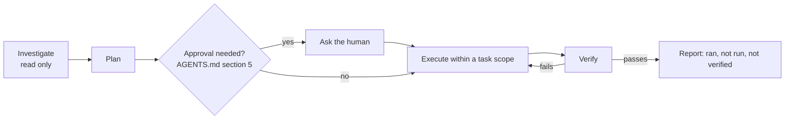

# Agent workflows

Operational checklists for AI-assisted work in this repository. They add no policy: authority, approval gates, and the verification standard live in `AGENTS.md`, `docs/engineering/ai-development.md`, and `docs/engineering/definition-of-done.md`. These files say how to carry those out with this repository's real commands.

## Lifecycle

A question or a request to "look into" something is investigation, not authorization to change files.

## Human-correction reset protocol

A human objection, stop instruction, path correction, or scope correction immediately suspends all mutation authority for the current task. This is a reset, not a suggestion to finish the current batch.

When the reset is triggered:

1. Stop before the next mutation. Do not finish a batch, drain a queue, move or rename artifacts, defend the prior interpretation, or perform cleanup unless the human separately authorizes that exact recovery action.
2. Preserve the current state. Do not hide, revert, or compensate for completed mutations on your own.
3. Report what changed, what is currently in progress, what remains untouched, which systems were affected, and what verification has or has not run.
4. Offer bounded recovery options with their consequences and exact targets. Distinguish leaving the state as-is, reverting specific mutations, and proceeding under a corrected scope.
5. Wait for explicit approval of a recovery option or a replacement mutation manifest. A correction does not preserve authority left over from the superseded interpretation.

## Workflows

| Workflow | Use when |
| --- | --- |
| [repository-investigation](workflows/repository-investigation.md) | Starting any task, before changing anything |
| [implementation-planning](workflows/implementation-planning.md) | Turning an investigation into a plan and approval questions |
| [planning-artifacts](workflows/planning-artifacts.md) | Creating or changing plans, tasks, issues, milestones, project metadata, or another planning surface |
| [scoped-execution](workflows/scoped-execution.md) | Making approved changes |
| [verification](workflows/verification.md) | Before claiming anything is done |
| [architecture-review](workflows/architecture-review.md) | A change touches ownership, packages, or an ADR |
| [documentation-consistency](workflows/documentation-consistency.md) | Docs, ADRs, or statuses changed |
| [dependency-boundary-review](workflows/dependency-boundary-review.md) | Creating or changing a package, or its imports |
| [preservation-and-destructive-change-review](workflows/preservation-and-destructive-change-review.md) | Deleting, rewriting, or changing external state |

Bound each task with a [task scope](task-scope.md).
