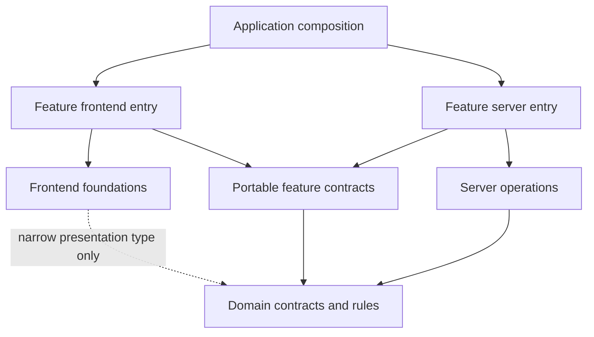
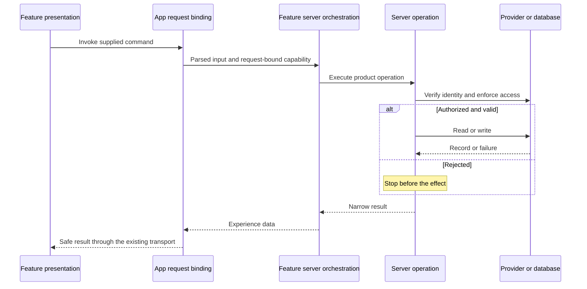

# ADR-0014: Multi-app package boundaries and staged reorganization

**Status:** Accepted
**Date:** 2026-10-23
**Deciders:** Hanaa Sadoqi, repository owner, through the architecture discussion, explicit category/composition selections, and instruction to finish Milestone 2 completely.
**Decision dimension:** Implementation ownership and dependency direction. Product concepts, terminology, and persisted behavior are unchanged.

## Context and authority

The current product implementation is concentrated in `apps/web`, while the shared UI package also owns some product contracts and shell composition. Web, docs, and Storybook already exist; desktop and mobile are planned consumers. The owner prefers establishing useful boundaries early. A second active consumer is not required to justify isolation.

The five [umbrella READMEs](../../../packages/domain/README.md) introduced the selected direction. This ADR is the decision register for their ownership/dependency rules; the [workspace conventions](../workspace-conventions.md) are the operating reference, and the [ownership map](../reorganization-ownership-map.md) assigns existing responsibilities to target owners. They share one decision origin. The task-scope ledger owns execution status; these architecture documents are not a second backlog.

## Decision

### 1. Categories and ownership

| Owner      | Responsibility                                                                                                           |
| ---------- | ------------------------------------------------------------------------------------------------------------------------ |
| `domain`   | Portable contracts, validation, semantic rules, and pure transformations                                                 |
| `frontend` | General presentation, interaction foundations, styling, shells, and isolated frontend platform effects                   |
| `server`   | Trusted operations, identity/access support, repositories, provider integration, and persistence effects                 |
| `features` | Product experiences combining contracts, presentation, data/capability access, workflow state, and product copy          |
| `dev`      | Development tooling, fixtures, scenarios, test utilities, seeds, and explicit demo support                               |
| `apps`     | Framework/platform entry points, request bindings, routes, navigation, application assembly, and deployment entry points |

A package belongs to one category. Categories describe responsibility; a module's ability to render on a server does not make it a backend operation. Frontend presentation may participate in server rendering without gaining request APIs, secrets, or persistence authority.

### 2. Dependency and runtime matrix

This is the normative production-source matrix. **Yes** means public imports are allowed; **Conditional** means the restriction below applies; **No** means no direct or transitive implementation dependency. A type-only import still respects ownership.

| Importing entry              | Domain      | Frontend    | Server      | Feature contracts | Feature frontend | Feature server | Apps | Dev |
| ---------------------------- | ----------- | ----------- | ----------- | ----------------- | ---------------- | -------------- | ---- | --- |
| Domain                       | Conditional | No          | No          | No                | No               | No             | No   | No  |
| Frontend                     | Conditional | Conditional | No          | No                | No               | No             | No   | No  |
| Server                       | Yes         | No          | Conditional | No                | No               | No             | No   | No  |
| Feature contracts            | Yes         | No          | No          | Conditional       | No               | No             | No   | No  |
| Feature frontend             | Yes         | Yes         | No          | Yes               | Conditional      | No             | No   | No  |
| Feature server orchestration | Yes         | No          | Yes         | Yes               | No               | Conditional    | No   | No  |
| App browser entry            | Yes         | Yes         | No          | Yes               | Yes              | No             | No   | No  |
| App backend entry            | Yes         | Yes         | Yes         | Yes               | Yes              | Yes            | No   | No  |

Conditions:

- Same-category and sibling-feature imports use explicit public interfaces, have a named responsibility, and remain acyclic. A shared contract or app-level composition is preferred over importing another feature's private implementation.
- Frontend may consume a portable domain type needed by its public presentation contract. Canonical schemas and product workflows remain outside frontend; generic controls should prefer presentation props.
- Feature contracts contain portable types/validation or view-model contracts, never React, DOM, SDK clients, or a server implementation. They may reuse explicit sibling feature contracts without creating a reverse domain dependency.
- Feature server entries are backend orchestration/loaders. Presentation remains in the presentation entry; an app backend may compose that presentation after loading safe data.
- Development configuration and dedicated tests/stories/seed/demo hosts may consume development utilities and the public interfaces they exercise. This is a non-production exception, not permission for a shipped entry to reach fixtures.
- Evaluate the package dependency graph as well as individual entries. Development dependencies and type-only imports must not conceal cycles. In particular, a domain package whose types are consumed by fixtures must not depend back on those factories for its own tests.

An allowed import does not require an app to consume every category. Docs can use presentation without account operations; Storybook uses public presentation with fixtures; native clients reuse only compatible contracts, behavior, and rendering implementations.

### 3. Host and platform bindings

Apps own Next.js route/action entry points, cookies/headers, navigation destinations, response formatting, and framework-specific revalidation. A host constructs or supplies a request-bound provider capability; server operations verify identity/access and enforce their own operation boundary. Never authorize from client display state or a supplied owner ID.

Feature frontend code invokes a host-supplied command. It does not import the backend implementation. A current web Server Action remains a host entry, while a future client may use another approved transport. Shared code cannot import app source to obtain its bindings.

Approved browser effects live behind a frontend platform entry, supplied/bound by the app or feature. DOM storage, document attributes, font loading, and browser permission APIs are not portable domain behavior. Next.js-specific link/navigation integration stays in a host binding or explicitly framework-specific adapter, never an implicitly portable root export.

The sequence is logical, not a prescribed verification order or a new API. Preserve existing enumeration protection, trusted redirect origin, request isolation, row-level security, and reduced outcomes.

### 4. Grouping and public-interface principles

Group related modules by cohesive responsibility, dependencies, runtime isolation, testability, and expected change. Planned consumers count now. Neither one package per component nor one package per architectural layer per capability is required.

The selected grouping families are:

| Family                        | Grouping rule                                                                                                                                                                                                             |
| ----------------------------- | ------------------------------------------------------------------------------------------------------------------------------------------------------------------------------------------------------------------------- |
| UI foundations                | General primitives/components stay together; product workflows move to features                                                                                                                                           |
| Shells                        | One `frontend/shells` package supports multiple cohesive shells                                                                                                                                                           |
| Collection                    | General browse projections, query mechanics, controls, displays, and local browse state form a reusable frontend family; resource mapping, product copy, navigation, and persistence commands belong to resource features |
| Preferences                   | Portable policy/contracts in domain; browser application/runtime in frontend; persisted account preference operations with server account; settings editing/composition in the feature                                    |
| Identity/account              | Portable validation/contracts in domain; trusted identity and auth operations with server auth; profile/preference operations with server account; product experiences in features                                        |
| Resource persistence          | A cohesive server data family may contain separate Space/Document/Dashboard repository modules; no universal persisted Entity model is introduced                                                                         |
| Resource experiences and Home | Feature groups preserve capability semantics; Home aggregates them rather than owning their records                                                                                                                       |
| Fixtures                      | Extend the existing dev fixtures package with contract-aligned factories, scenarios, and sample content                                                                                                                   |

Keep domain record contracts distinct by kind even where common fields are factored into a shared internal helper. Exact leaf-package names, manifest/export syntax, and private file templates are Milestone 3 implementation design; the owner/responsibility assignments above are settled here.

Public interfaces expose supported capabilities and entry points, not every internal file. Mixed-runtime packages need separate portable, presentation, and backend entries; a default barrel must not make server implementation reachable through frontend code. Concrete interface signatures are specified and checked with all consumers during the relevant migration.

Retain `@synapcity/<category>-<name>` naming. A `features` category example is `@synapcity/features-settings`. Existing provisional capability labels may continue as bounded internal migration handles; this is not final user-facing terminology, a route rename, or a persisted-identifier change.

### 5. State, data, and copy authority

Canonical contracts have one domain owner. Server repositories own persistence effects; database security remains independently enforced. Features own drafts/optimistic projections and must define reconciliation, failed-write handling, and prop-refresh behavior. Frontend controls own local interaction state appropriate to their lifetime. App roots bind the concrete providers.

Device/account preference precedence, durability, storage keys, and behavior stay as decided in ADR-0010. Shell extraction preserves existing in-memory panel behavior; it does not adopt new saved panel preferences.

Features own product messages and workflow copy; frontend owns genuinely generic component text; fixtures own synthetic records and sample document content. Fixture factories consume approved contracts, produce distinct identities, and use explicit seeds/clocks. They do not define a second product model or become a production data source.

### 6. Migration and preservation contract

- Record the baseline before implementation migration. Milestone 1's remaining verification is not silently completed by documentation work.
- Migrate one bounded responsibility/feature slice with its real consumers, tests, stories, styles, and required tooling wiring.
- Preserve existing URLs, identifiers, serialized shapes, auth/session behavior, storage precedence, accessibility, and supported operation outcomes unless a separate scope explicitly changes them.
- Move the canonical implementation once. A temporary compatibility re-export may point to that owner; a second schema/implementation copy is not a bridge.
- Each temporary bridge records its source, target, consumers, migration owner, and removal condition in that migration's task scope. Frontend bridges cannot expose backend code.
- Existing nonconformities are identified by source family in the ownership map. They are migration inputs, not blanket exemptions for new code. Milestone 3 implements checks and scopes any temporary allowances to named paths/edges and removal conditions.
- Keep production and demo bindings explicit. Existing fixture-backed paths and fake-success handlers must be identified and addressed in their feature migration, without silently adding real external effects.
- Preserve useful tests and scenario coverage. A file move does not prove behavior preservation; verify the moved public surface and the app that consumes it.
- Run focused checks during moves and the repository gate at completed implementation checkpoints. Distinguish cache results, environment blockers, live-provider proof, and uncovered behavior.
- Stop on a new product/schema/dependency/deployment decision or overlapping concurrent edits. Recover only the scoped changes, retaining prior work and historical decisions.

### 7. Partial supersession and current implementation

This ADR supersedes **placement and extraction-trigger assumptions only** in ADR-0001, ADR-0007, ADR-0008, ADR-0009, ADR-0010, both ADR-0011 records, ADR-0012, and ADR-0013: the two-category limit, server-only-in-app restriction, mandatory app-local placement, generic UI owning product schemas/shell composition, and waiting for a second current consumer before isolating a capability or platform adapter.

Their toolchain, provider, validation, persistence, security, navigation-destination, styling, accessibility, and product-behavior decisions continue within their scopes. Amendments in each affected record preserve the original reasoning as history. Existing duplicate ADR-0011 numbers remain identified by full filename; this reorganization does not renumber them.

Only category READMEs exist for the new umbrellas at the Milestone 2 snapshot. Source remains largely app-local and existing package exports remain unchanged. The [ownership map](../reorganization-ownership-map.md) identifies the transition; it does not claim packages have been created.

## What this does not decide

- Product purpose, first slice, final vocabulary, record lifecycle, relationship taxonomy, schemas, IDs, or route changes.
- New auth methods, provider settings, SDK versions, API transport, cache/state libraries, a separate backend deployment, or a native renderer.
- A new framework or enforcement dependency, build strategy, executable package template, or export implementation.
- Completion of source migration, Milestone 1 baseline verification, hosted/provider acceptance, or the wider testing strategy.

## Integration and verification expectations

Milestone 3 implements package conventions and direct/transitive boundary checks against the matrix, including public-export bypasses, configuration/development graph cycles, and server reachability from frontend entries. Forbidden-import probes must show that the checks fail, not merely pass on current source.

Later migrations inventory consumers and preserve adopted behavior. Diagram rendering, link validation, and formatting verify this documentation; they do not enforce code boundaries. ADR-0005 remains Proposed and its wider testing questions remain open.

## Evidence and reconsideration

The inspected snapshot is `91be9693` on `docs/reorganization-m2-boundaries`. The web app declares Next.js 16.4.3, React 19.3.0, Supabase SSR 0.12.7 and Supabase JS 2.117.3; other workspaces retain their own declared pins. No version or configuration is changed here. First-party [Next.js server/client composition](https://nextjs.org/docs/app/getting-started/server-and-client-components) and [data-security guidance](https://nextjs.org/docs/app/guides/data-security), checked 2026-10-23, support explicit environment boundaries and narrow, authorized server data access. Those sources are external technology evidence, not authority over Synapcity's ownership choices.

Revisit a boundary when actual change coupling, runtime requirements, security, or consumer needs differ. An additional current consumer is useful evidence, not the prerequisite for reconsideration.
