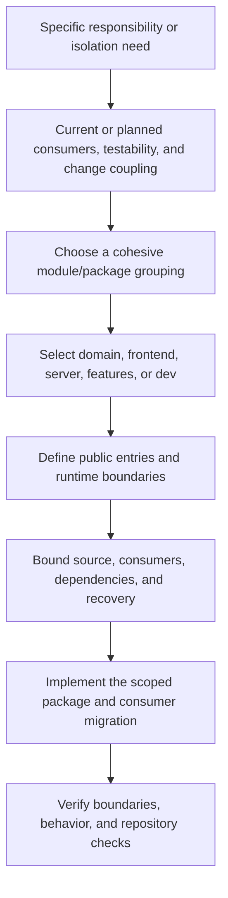

# Package creation checklist

**Status:** Canonical, amended by [ADR-0014](decisions/0014-multi-app-package-boundaries.md), 2026-10-23.

Complete this checklist before introducing a package. Category and responsibility selection is recorded in ADR-0014; exact packages, interfaces, dependencies, and migration files still require a concrete task scope. Existing direct-import tests are partial; workspace-wide/transitive enforcement is Milestone 3 work.

## 1. Justify and group

- [ ] Name the responsibility, owner, and current or planned consumers. Planned desktop/mobile reuse, independent testing, dependency isolation, and change coupling are valid reasons now.
- [ ] Explain why the boundary improves cohesion or isolation. A second current consumer is not a prerequisite; folder size alone is not the reason.
- [ ] Keep related modules together where appropriate. A shell, component, query, or schema does not automatically need an independent package.
- [ ] Classify concept, terminology, and implementation decisions independently. Follow the [glossary](../glossary.md) for final vocabulary; a migration handle is not a product naming decision.

## 2. Place and name

- [ ] Select exactly one of the five approved categories using the [workspace conventions](workspace-conventions.md) and the [ownership map](reorganization-ownership-map.md).
- [ ] Follow `packages/<category>/<name>` and `@synapcity/<category>-<name>`; use `workspace:*` for internal dependencies.
- [ ] State each entry's actual runtime: portable contracts, React behavior, DOM presentation, backend capability, framework adapter, or development support.
- [ ] Keep framework request/navigation/provisioning policy at the host boundary, with explicit capabilities for shared modules.

## 3. Define the public interface and dependencies

- [ ] Expose only supported entry points. Separate backend implementation from browser-reachable entries; prevent a root barrel from reconnecting them.
- [ ] Check direct and transitive dependencies against [ADR-0014's matrix](decisions/0014-multi-app-package-boundaries.md#2-dependency-and-runtime-matrix), including type-only and development edges.
- [ ] Keep same-category and sibling-feature imports explicit and acyclic. No package imports an app.
- [ ] Keep canonical schemas with their domain owner, persistence effects with server, product composition/copy with features, and synthetic data with dev.
- [ ] Avoid fixture/domain reverse dependencies in domain tests. A development dependency alone does not guarantee exclusion from production.
- [ ] Specify actual interface signatures and consumer compatibility before moving code. Do not add unrelated product behavior to make a package appear complete.

## 4. Bound the migration

- [ ] Verify the live checkout, baseline, dirty files, source ownership, and actual consumers.
- [ ] Name exact source/destination files, updates, artifact budgets, affected systems, and recovery in the task scope.
- [ ] Preserve URLs, IDs, serialized formats, auth/session security, preference precedence, accessible behavior, and operation outcomes unless explicitly changed.
- [ ] Move tests/stories with the behavior; update applicable catalogue discovery, style scanning, test aliases, and package tooling in that same scoped migration.
- [ ] Give temporary compatibility re-exports one canonical target, a named owner, and a removal condition. Do not duplicate implementations or create broad migration exemptions.
- [ ] Keep fixtures/demo commands explicit and production effects separate.

## 5. Verify and record

- [ ] Exercise the real public surface and consuming app behavior; use forbidden-import probes to show boundary checks catch violations.
- [ ] Run proportional formatting, lint, types, unused-code, unit/coverage, browser/Storybook, brand, and build checks, plus the root gate for a completed implementation checkpoint.
- [ ] State precisely what passed, failed, was cached, was not run, or needs live provider evidence. A documentation check does not enforce code boundaries.
- [ ] Follow AGENTS section 7a for a new or changed dependency: inspect the declared version, current first-party guidance/registry and peers, and approvals. No incidental upgrades.
- [ ] Add the package README with an `Owns:` statement and applicable scripts/public exports; reconcile its umbrella, ownership map, and affected decision references.
- [ ] Keep execution status in the existing task-scope system. Architecture documents describe decisions and ownership, not a mirrored backlog.
