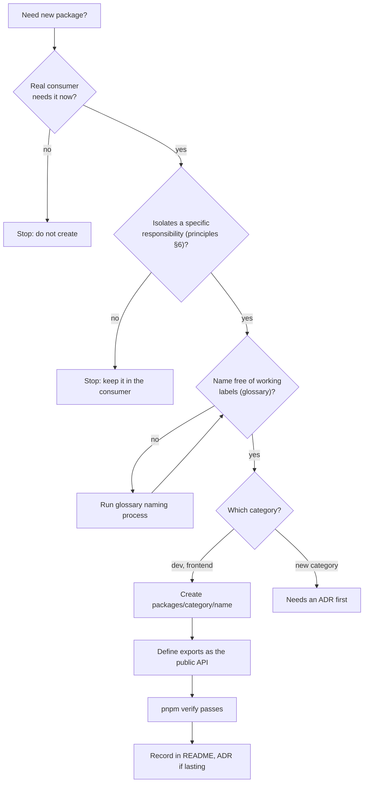

# Package creation checklist

**Status:** Current direction, defined by ADR-0001 (Proposed). No tool enforces package boundaries today; the checklist is followed by convention and review.

Creating a package is an architecture decision (`AGENTS.md` §5). Complete every item before adding a package under `packages/`, and record the answers in the pull request.

## 1. Justify it

- [ ] A real use case needs this package now. Name the consumer, not a future one.
- [ ] It isolates a specific responsibility from architecture principles §6, and you can say what differs in change rate, testability, or coupling. A small module that needs neither independent reuse nor testing stays inside its consumer.
- [ ] The name is not derived from a working label. Check `docs/glossary.md` and its naming-decision process for any product or domain term.

## 2. Place it

- [ ] It lives in exactly one existing category (`dev` or `frontend`) at `packages/<category>/<name>`. A new category needs an ADR first.
- [ ] Directory and package names follow [workspace-conventions.md](workspace-conventions.md): the package is named `@synapcity/<category>-<name>` in lowercase kebab-case, the leaf directory does not repeat the category, and the name is unique across categories.
- [ ] If it goes in `frontend`, it may use React and web presentation capabilities but must not depend on Next.js routing, request APIs or other application-runtime concerns.
- [ ] If it goes in `dev`, it is build-time tooling only and ships nothing to the browser.

## 3. Bound it

- [ ] Its dependencies point from apps to packages, never the reverse, and introduce no cycle. (A formal direction rule between categories is an open candidate decision.)
- [ ] Its `package.json` `exports` defines the entire public API, with one or more entry points. Nothing outside `exports` is imported by other packages.
- [ ] It does not hold a second copy of information owned by another package (architecture principles §2).

## 4. Verify it

- [ ] `pnpm verify` passes with the package present, including `pnpm deps` (Knip reports no unused files, exports or dependencies for it).
- [ ] If a test setup exists by then, the package has at least one test that protects a stated invariant (`docs/engineering/definition-of-done.md`, item 3). If none exists, say so in the pull request.
- [ ] Any new dependency with architectural or security consequences has been approved.

## 5. Record it

- [ ] The category README lists the package if a list is kept.
- [ ] If the decision has lasting architectural consequences, add or update an ADR.
- [ ] The package README starts with an `Owns:` line, and its `package.json` defines `exports` and the scripts the root Turbo tasks need.
