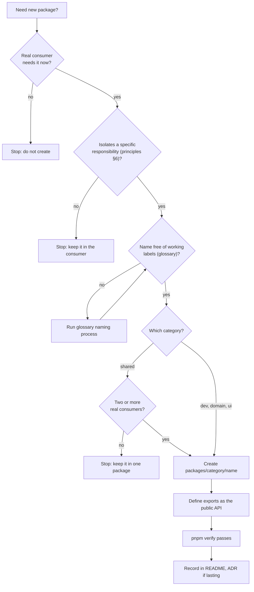

# Package creation checklist

**Status:** Defined by ADR-0005. Boundary rules are enforced by `pnpm deps:boundaries`; the checklist items themselves are not.

Creating a package is an architecture decision (`AGENTS.md` §5). Complete every item before adding a package under `packages/`, and record the answers in the pull request.

## 1. Justify it

- [ ] A real use case needs this package now. Name the consumer, not a future one.
- [ ] It isolates a specific responsibility from architecture principles §6, and you can say what differs in change rate, testability, or coupling. A small module that needs neither independent reuse nor testing stays inside its consumer.
- [ ] The name is not derived from a working label. Check `docs/glossary.md` and its naming-decision process for any product or domain term.

## 2. Place it

- [ ] It lives in exactly one category: `dev`, `shared`, `domain`, or `ui`, at `packages/<category>/<name>`.
- [ ] Directory and package names follow [workspace-conventions.md](workspace-conventions.md): `@synapcity/<category>-<name>` in lowercase kebab-case, the leaf directory not repeating the category, unique across categories.
- [ ] If it goes in `shared`, at least two real consumers exist and its ownership genuinely spans multiple domains.
- [ ] If it goes in `domain`, it is pure logic with no framework, DOM, or library-binding dependency, and it is the single owner of its information.
- [ ] If it goes in `ui`, it may use React/web presentation capabilities but must not depend on Next.js or other application-runtime concerns.

## 3. Bound it

- [ ] Its dependencies follow the direction in ADR-0005 and introduce no cycle.
- [ ] Its `package.json` `exports` defines the entire public API, with one or more entry points. Nothing outside `exports` is imported by other packages.
- [ ] It does not hold a second copy of information owned by another package (architecture principles §2).

## 4. Verify it

- [ ] `pnpm verify` passes with the package present.
- [ ] The package has at least one test that protects a stated invariant, and the report names its category (`docs/engineering/definition-of-done.md`, item 3).
- [ ] Any new dependency with architectural or security consequences has been approved.

## 5. Record it

- [ ] The category README lists the package if a list is kept.
- [ ] If the decision has lasting architectural consequences, add or update an ADR.
- [ ] The package README starts with an `Owns:` line, and its `package.json` and `tsconfig.json` follow the skeleton in workspace-conventions.md.
