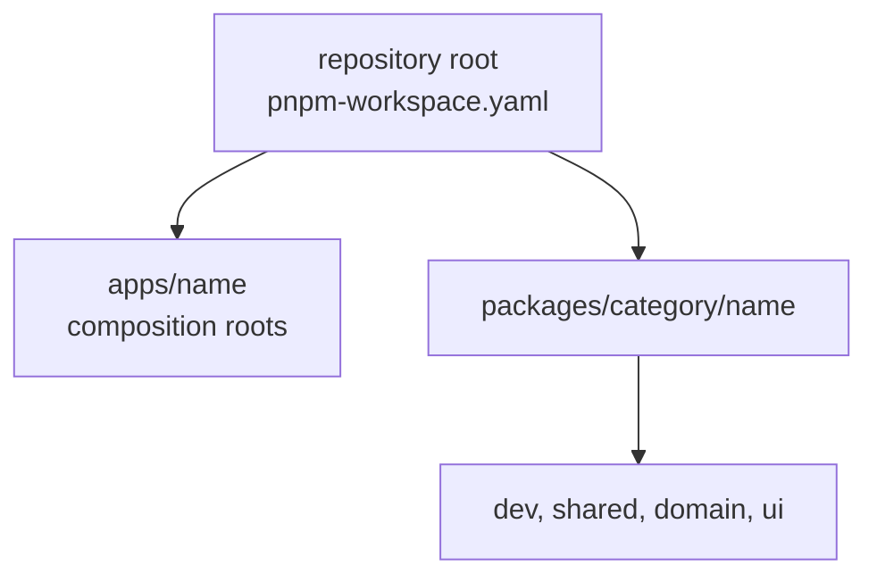

# Workspace conventions

**Status:** Canonical, defined by ADR-0007

How packages and apps are laid out, named, built, and tested. The category rules and dependency direction are in ADR-0005. Creating a package still follows [the checklist](package-creation-checklist.md).



## Layout and names

- Packages live at `packages/<category>/<name>` and apps at `apps/<name>`. The workspace globs are `apps/*` and `packages/*/*`.
- Package names are `@synapcity/<category>-<name>`, where `<category>` is the package's category folder and `<name>` is lowercase kebab-case, matches the leaf directory name (which does not repeat the category), and is unique across all categories. App names remain `@synapcity/<name>`, matching `apps/<name>`, unless a separate accepted decision changes that. (Package naming amended during the Phase 2 architecture reconciliation; it previously read `@synapcity/<name>` for both.)
- Every package and app has a README. A package README starts with an `Owns:` line stating what information or responsibility the package is the single owner of.
- Internal dependencies use `workspace:*`.

## Package skeleton

```text
packages/<category>/<name>/
├── package.json    private, "type": "module", "exports" is the only public API
├── tsconfig.json   extends ../../../tsconfig.json, includes src
├── README.md       starts with "Owns: ..."
└── src/            code and colocated *.test.ts files
```

Scripts: every package defines `build`. Until a bundler is chosen, `build` is a type check: `tsc --noEmit -p tsconfig.json`. The root `pnpm build` runs `pnpm -r --if-present build`, so each package's build runs through `pnpm verify`. Tests need no script: the root `pnpm test` finds every `*.test.ts`.

## Where code runs (client and server)

- Code that can only run on a server (Node APIs, request and response handling, secrets) lives in an app.
- Runtime semantics are ownership-sensitive, not a blanket rule (amended during the Phase 2 architecture reconciliation; see ADR-0005 and ADR-0007):
  - `domain` packages remain portable and runtime-neutral: no React, React DOM, browser/DOM APIs, Next.js, application routing, or application-runtime integration.
  - `ui` packages are application-runtime agnostic but may use React, React DOM, JSX, and DOM/browser/web-platform capabilities intrinsic to reusable presentation, including a narrow `"use client"` boundary where that behavior requires it. They must not acquire Next.js routing, request APIs, Server Actions, app-specific environment integration, or imports from application workspaces.
  - A package that needs an application-runtime-specific capability beyond this defines an interface for it and receives the implementation from an app.
- Next.js is the accepted application framework for `apps/web` (ADR-0010). The ownership rule above remains framework-independent: a future app may compose packages differently without moving application-runtime concerns into reusable packages.

## Testing

- Unit tests use Vitest, colocated with the code as `*.test.ts`.
- Component tests use Vitest with Testing Library (`@testing-library/react`, with `jest-dom` matchers) in a DOM environment. React is the accepted component layer for the current Next.js application and UI package; this does not make Lexical or React Grid Layout part of the technical-foundation package.
- Accessibility is checked with axe inside component tests, Storybook's real-browser accessibility addon, and proportional manual checks. A complementary JSX lint layer remains deferred until a release compatible with the accepted ESLint major exists; see ADR-0007 and the Phase 2 dependency evidence.
- Real-browser tests use Playwright for Storybook and the runnable web application.
- Test-environment dependencies live with the consuming workspace and are checked against current documentation (`AGENTS.md` §7a).

## Verified in this repository

The current repository contains two apps and one real reusable package. `pnpm verify` type-checks and builds all three workspaces, runs the registered root and `ui-core` Vitest projects, exercises every discovered Storybook story in Chromium with accessibility assertions, runs the web application smoke path, and cruises real app/package imports for dependency violations. Boundary fixtures prove every configured rule fires on a deliberate violation; the earlier name-based package and deep-export probes remain historical manual evidence rather than durable package-resolution fixtures.
