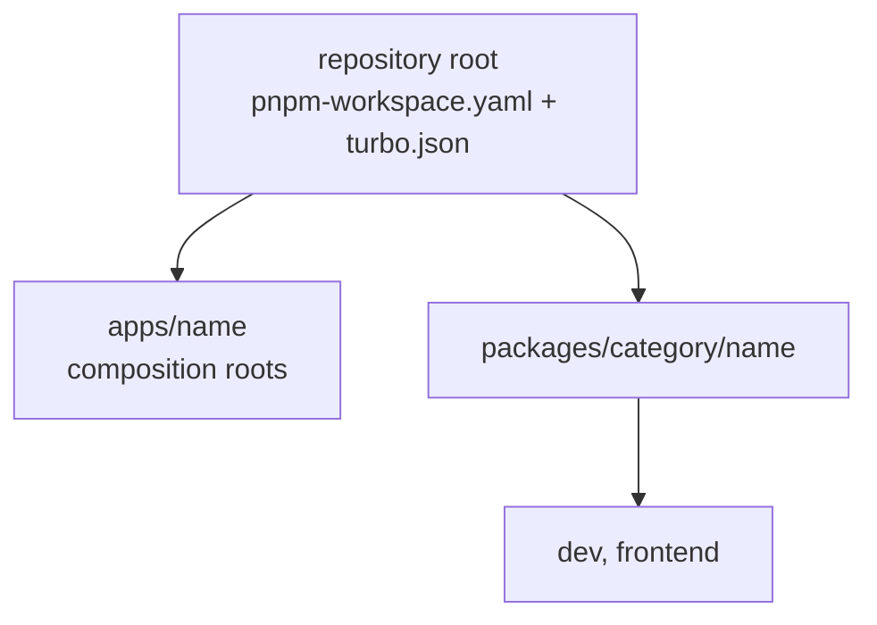

# Workspace conventions

**Status:** Canonical, defined by ADR-0001

How packages and apps are laid out, named and built in the current repository. Creating a package still follows [the checklist](package-creation-checklist.md).

## Layout

- Apps live at `apps/<name>`; packages live at `packages/<category>/<name>`. The workspace globs are `apps/*` and `packages/**/*`.
- Current categories:
  - `dev` — build-time tooling shared by workspaces: `@synapcity/dev-eslint-config`, `@synapcity/dev-typescript-config`.
  - `frontend` — shared presentation code: `@synapcity/frontend-ui` (shadcn components, `cn`, hooks) and `@synapcity/frontend-tailwind-config` (theme, tokens, PostCSS config).
- Current apps: `web` (the product application) and `docs` (the documentation site, port 4000; a placeholder page today).
- Internal dependencies use `workspace:*`.
- A package's `exports` is its public API. Other packages import only what `exports` lists.

## Names

A package is named `@synapcity/<category>-<name>`: the category folder under `packages/`, then the directory name, in lowercase kebab-case. `packages/frontend/ui` is `@synapcity/frontend-ui`; `packages/dev/eslint-config` is `@synapcity/dev-eslint-config`. The leaf directory does not repeat the category, and names are unique across categories. Apps are unscoped and named for their directory (`web`, `docs`). Every package and app has a README that starts with an `Owns:` line.

## Scripts

Turborepo runs `build`, `lint`, `check-types` and `dev` from the root (`turbo.json`). A workspace defines whichever of those apply to it. `build` for an app is its framework build; `check-types` is `tsc --noEmit` (Next apps run `next typegen` first). Outputs cached by `build`: `.next/**` except the cache and dev folders.

## Where code runs (client and server)

- Server-only code (Node APIs, request handling, secrets) lives in an app.
- `@synapcity/frontend-ui` and the other `frontend` packages are application-runtime agnostic: they may use React, JSX and web-platform APIs, and a narrow `"use client"` boundary where a component needs it. They must not import Next.js routing or request APIs, Server Actions, application environment variables, or anything from `apps/*`.
- A package that needs an app-specific capability defines an interface for it and receives the implementation from the app.

## Styling in the workspace

Apps and packages never define theme tokens. `@synapcity/frontend-tailwind-config` owns them and an app's `globals.css` contains imports and `@source` lines only (ADR-0002). New shadcn components are added with `pnpm ui:add <name>` from the root, which targets `apps/web` and writes into `@synapcity/frontend-ui`.

## Testing

No test runner is configured, and none is implied. Whether and how to test is an open candidate decision (`decisions/README.md`). Do not describe a change as tested on the strength of `pnpm verify`, which checks formatting, lint, types, unused code and builds.

## Verified in this repository

On 2026-10-13: `pnpm lint`, `pnpm check-types` and `pnpm build` passed; `pnpm format:check` and `pnpm deps` reported failures that predate the documentation changes (see `docs/engineering/quality-gates.md`).
