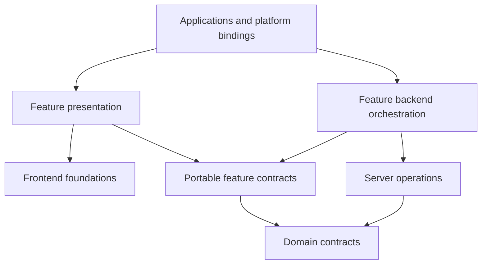

# Workspace conventions

**Status:** Canonical operating conventions, defined by [ADR-0001](decisions/0001-workspace-topology-and-toolchain.md) and amended for placement/dependency direction by [ADR-0014](decisions/0014-multi-app-package-boundaries.md), 2026-10-23.

These conventions describe the selected target architecture and identify the current transition. The [ownership map](reorganization-ownership-map.md) records current locations and target owners; it is not a claim that the code has already moved.

## Layout and categories

Apps live at `apps/<name>` and packages at `packages/<category>/<name>`. The existing workspace globs, `apps/*` and `packages/**/*`, are unchanged.

| Category   | Owns                                                                                  | Boundary reference                            |
| ---------- | ------------------------------------------------------------------------------------- | --------------------------------------------- |
| `domain`   | Portable contracts and product rules                                                  | [Domain](../../packages/domain/README.md)     |
| `frontend` | Presentation, interaction foundations, shells, and explicit frontend platform effects | [Frontend](../../packages/frontend/README.md) |
| `server`   | Trusted operations, repositories, and backend provider integration                    | [Server](../../packages/server/README.md)     |
| `features` | Reusable product composition and workflows                                            | [Features](../../packages/features/README.md) |
| `dev`      | Tooling, fixtures, test/scenario/seed/demo support                                    | [Dev](../../packages/dev/README.md)           |

Current application workspaces are `web`, `docs`, and `storybook`. Current package workspaces still live under frontend/dev. New domain/server/feature packages are not created by the category READMEs. Desktop/mobile are planned consumers; no application scaffold or runtime is selected for them here.

## Layout

- Apps live at `apps/<name>`; packages live at `packages/<category>/<name>`. The workspace globs are `apps/*` and `packages/**/*`.
- Current categories:
  - `dev` — build-time tooling shared by workspaces: `@synapcity/dev-eslint-config`, `@synapcity/dev-typescript-config`.
  - `frontend` — shared presentation code: `@synapcity/frontend-ui` (shadcn components, `cn`, hooks) and `@synapcity/frontend-tailwind-config` (theme, tokens, PostCSS config).
- Current apps: `web` (the product application) and `docs` (the documentation site, port 4000; a placeholder page today).
- Internal dependencies use `workspace:*`.
- A package's `exports` is its public API. Other packages import only what `exports` lists.

## Names

A package is named `@synapcity/<category>-<name>`: the category folder under `packages/`, then the directory name, in lowercase kebab-case. `packages/frontend/ui` is `@synapcity/frontend-ui`; `packages/dev/eslint-config` is `@synapcity/dev-eslint-config`. The leaf directory does not repeat the category, and names are unique across categories. Apps are unscoped and named for their directory (`web`, `docs`). Every package and app has a README that starts with an `Owns:` line.

## Scripts

Turborepo runs `build`, `lint`, `check-types` and `dev` from the root (`turbo.json`). A workspace defines whichever of those apply to it. `build` for an app is its framework build; `check-types` is `tsc --noEmit` (Next apps run `next typegen` first). Outputs cached by `build`: `.next/**` except the cache and dev folders.

## Where code runs (client and server)

- Server-only code (Node APIs, request handling, secrets) lives in an app.
- `@synapcity/frontend-ui` and the other `frontend` packages are free of the server runtime: they may use React, JSX and web-platform APIs, and a narrow `"use client"` boundary where a component needs it. They may use `next/link` and the client navigation hooks of `next/navigation` (for example `usePathname`) for links and active state, because every consumer is a Next.js app and a caller-supplied link component would be an abstraction with no second implementation. They must not import request APIs (`next/headers`, `next/server`), Server Actions, application environment variables, or anything from `apps/*`. Where a link points is the app's decision and arrives as a prop (ADR-0009).
- A package that needs an app-specific capability defines an interface for it and receives the implementation from the app.

## Styling in the workspace

Apps and packages never define theme tokens. `@synapcity/frontend-tailwind-config` owns them and an app's `globals.css` contains imports and `@source` lines only (ADR-0002). New shadcn components are added with `pnpm ui:add <name>` from the root, which targets `apps/web` and writes into `@synapcity/frontend-ui`.

## Testing

Vitest, a Playwright smoke test and Storybook story tests run through the root `test*` scripts and `pnpm verify` (ADR-0005, Proposed). Coverage of the code is thin, and the wider testing strategy is an open candidate decision (`decisions/README.md`). Do not describe a change as tested unless a test exercises it.

## Verified in this repository

On 2026-10-13: `pnpm lint`, `pnpm check-types` and `pnpm build` passed; `pnpm format:check` and `pnpm deps` reported failures that predate the documentation changes (see `docs/engineering/quality-gates.md`).
