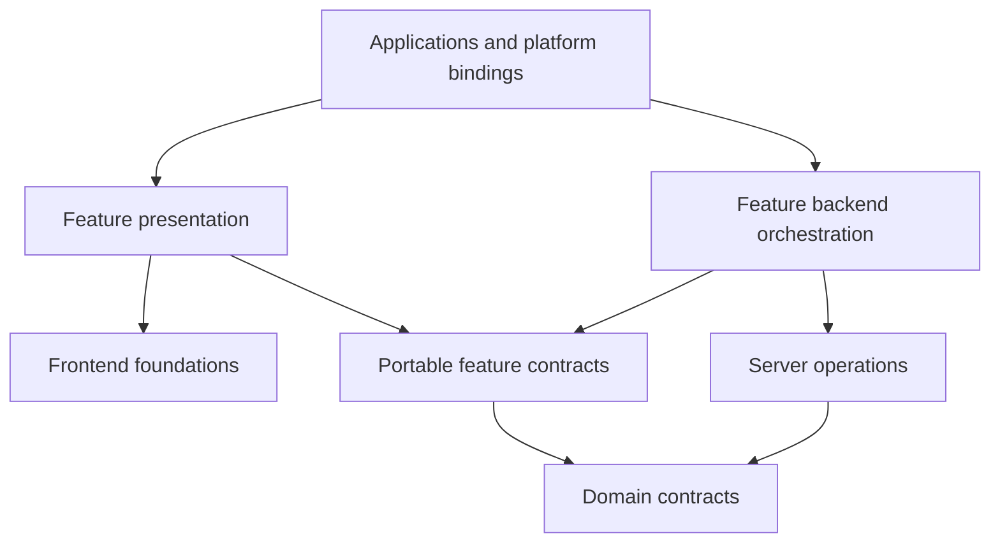

# Workspace conventions

**Status:** Canonical operating conventions, defined by [ADR-0001](decisions/0001-workspace-topology-and-toolchain.md) and amended for placement/dependency direction by [ADR-0014](decisions/0014-multi-app-package-boundaries.md), 2026-10-23.

These conventions describe the selected target architecture and identify the current transition. The [ownership map](reorganization-ownership-map.md) records current locations and target owners; it is not a claim that the code has already moved.

## Layout and categories

Apps live at `apps/<name>` and packages at `packages/<category>/<name>`. The existing workspace globs, `apps/*` and `packages/**/*`, are unchanged.

| Category   | Owns                                                                                  | Boundary reference                            |
| ---------- | ------------------------------------------------------------------------------------- | --------------------------------------------- |
| `domain`   | Portable contracts and product rules                                                  | [Domain](../../packages/domain/README.md)     |
| `frontend` | Presentation, interaction foundations, shells, and explicit frontend platform effects | [Frontend](../../packages/frontend/README.md) |
| `server`   | Trusted operations, repositories, and backend provider integration                    | [Server](../../packages/server/README.md)     |
| `features` | Reusable product composition and workflows                                            | [Features](../../packages/features/README.md) |
| `dev`      | Tooling, fixtures, test/scenario/seed/demo support                                    | [Dev](../../packages/dev/README.md)           |

Current application workspaces are `web`, `docs`, and `storybook`. Current package workspaces still live under frontend/dev. New domain/server/feature packages are not created by the category READMEs. Desktop/mobile are planned consumers; no application scaffold or runtime is selected for them here.

## Names and grouping

Use `@synapcity/<category>-<name>` in lowercase kebab-case; apps remain unscoped. The leaf folder does not repeat the category. For example, `frontend/shells` maps to `@synapcity/frontend-shells`; a `features/settings` example maps to `@synapcity/features-settings`. Examples are not installed-package claims.

Group coherent modules within a package: several shells can share one shells package, and several resource repositories can share one data package. Independence, testability, runtime isolation, planned reuse, and change coupling justify early extraction. A second current consumer is not required. One capability may span categories, such as `frontend/settings` presentation beside the `features/settings` experience, provided each package holds only its category's responsibility.

Do not infer a new product noun, schema, or durable identifier from a package name. Existing provisional labels retain their approved bounded technical use; follow the [glossary](../glossary.md) before a terminology change.

Prefer the name the code and durable identifiers already use. Name a package by responsibility, never by technique or vagueness: `containers`, `layouts`, `utils`, `common` and `shared` are not package names.

A new package must earn its boundary through at least one of: a different runtime, different dependencies, a different consumer set (planned consumers count), independent testing, or a different rate of change. Folder size alone is not a reason. Grow a package through explicit modules before splitting it. Fields shared by several contracts go in a base contract inside the owning package, not in a separate cross-cutting package. Browser platform effects are frontend packages and backend provider integration is server; there is no separate platform or services category. Each outside vendor SDK is wrapped by an adapter package in the category where it runs, named after the vendor (`server-supabase`); other packages receive the vendor's client or capability from that adapter and never import the SDK. A responsibility-named package is a capability, a vendor-named package is an adapter. A separately deployed backend process would be an app, not a package category.

### Package inventory

Accepted 2026-10-23 through the [Milestone 3.1 design](../superpowers/specs/2026-10-23-m3-package-grouping-design.md), which records each package's current source inputs and the owner's decisions. A package is created by the migration that first moves code into it, never as an empty skeleton.

Milestone numbers follow the reorganization roadmap (owner decision, 2026-10-23): M4 server identity boundary, M5 Collection and Spaces pathfinder slice, M6 Preferences and Settings, M7 Authentication and Account, M8 Documents and Dashboards, M9 Home, M10 final verification and sweep. Foundations (domain contracts, fixtures, shells) move with the first slice that needs them, so a package's first code can arrive before the rest of its scope.

| Package                               | Owns                                                                                                                                                                                                                                | First code                         |
| ------------------------------------- | ----------------------------------------------------------------------------------------------------------------------------------------------------------------------------------------------------------------------------------- | ---------------------------------- |
| `domain-records`                      | Base record contract that every record kind extends; kind contracts live in their own packages (owner decision, 2026-10-24)                                                                                                         | M5.1 (exists)                      |
| `domain-spaces`                       | Space create, update and saved contracts on the base record contract; moved out of `domain-records` by owner decision, 2026-10-24                                                                                                   | M5.1 (exists)                      |
| `domain-preferences`                  | Preference schemas, defaults, account/device scope, merging, import/transfer validation, consent policy                                                                                                                             | M6.1 (exists)                      |
| `domain-identity`                     | Profile, name, avatar and credential schemas; pure display-user rules; verified-identity contract                                                                                                                                   | M4 (exists)                        |
| `domain-grids`                        | Breakpoints, grid metrics and layout math (packing, placement, collapse, merge); no workspace dependencies                                                                                                                          | Responsive-grid prototype (exists) |
| `domain-dashboards`                   | Dashboard composition: widget instances, default widget sizes, settings and layout operations. The ADR-0013 Dashboard record contract joins it in M8                                                                                | Responsive-grid prototype (exists) |
| `domain-documents`                    | Document create, update and saved contracts on the base record contract                                                                                                                                                             | M8                                 |
| `domain-prototypes`                   | Prototype record kinds (metric, goal, habit, project, task, event, activity, note, link, asset) on the base record contract, with their rules; provisional, outside the glossary                                                    | Responsive-grid prototype (exists) |
| `frontend-ui` (existing)              | Primitives, generic components, generic hooks, low-level layout primitives                                                                                                                                                          | exists                             |
| `frontend-forms`                      | Form field, message and feedback pieces, first-error focus, React Hook Form binding, dirty-state primitives (ADR-0015)                                                                                                              | exists                             |
| `frontend-shells`                     | Composable app shells and page frames                                                                                                                                                                                               | 2026-10-25 (exists)                |
| `frontend-collection`                 | Browse projections, query mechanics, generic controls and displays, local browse state                                                                                                                                              | M5.3 (exists)                      |
| `frontend-settings`                   | Settings presentation pieces                                                                                                                                                                                                        | deferred (Q3)                      |
| `frontend-preferences`                | Browser preference runtime: device store, apply functions, boot scripts, mode, consent state                                                                                                                                        | M6.2 (exists)                      |
| `frontend-error-reports`              | Consent-gated browser error reporting and event scrubbing                                                                                                                                                                           | M6.5 (exists)                      |
| `frontend-auth`                       | Auth presentation pieces                                                                                                                                                                                                            | deferred (M7 design Q1)            |
| `frontend-supabase`                   | Browser Supabase client used by auth state listening; the only frontend package importing `@supabase/*`                                                                                                                             | M7.3 (exists)                      |
| `frontend-editor` (future)            | Document editor runtime (Lexical), nodes and plugins; created only after the editor and document body are approved                                                                                                                  | not scheduled                      |
| `frontend-site` (existing)            | Site metadata and brand presentation                                                                                                                                                                                                | exists                             |
| `frontend-tailwind-config` (existing) | Tokens and styling foundation                                                                                                                                                                                                       | exists                             |
| `frontend-tokens` (candidate)         | Precision Canvas token values, self-hosted Inter and JetBrains Mono, and a Tailwind theme bridge. Being evaluated to merge with or replace `frontend-tailwind-config`; not adopted, so `frontend-tailwind-config` still owns tokens | exists (candidate)                 |
| `server-data`                         | Space, Document and Dashboard repositories, queries and row mapping                                                                                                                                                                 | M5.2 (exists)                      |
| `server-account`                      | Profile, avatar and account-preference operations (M6: preferences; M7: profile and avatar)                                                                                                                                         | M6.4 (exists)                      |
| `server-auth`                         | Verified identity, auth operations, verified-caller helpers                                                                                                                                                                         | M4 (exists)                        |
| `server-supabase`                     | Request-bound server client from host-supplied cookies, session refresh helpers, provider-error translation; the only server package importing `@supabase/*`                                                                        | M4 (exists)                        |
| `features-spaces`                     | Space browsing and detail                                                                                                                                                                                                           | M5.4 (exists)                      |
| `features-settings`                   | The Settings experience: editors, drafts, guard, import/export, account sync                                                                                                                                                        | M6.4 (exists)                      |
| `features-auth`                       | Sign-in, registration, password, email and session workflows                                                                                                                                                                        | M7.5 (exists)                      |
| `features-account`                    | Name, avatar and profile workflows                                                                                                                                                                                                  | M7.4 (exists)                      |
| `features-documents`                  | Document browsing                                                                                                                                                                                                                   | M8                                 |
| `features-dashboards`                 | Dashboard browsing                                                                                                                                                                                                                  | M8                                 |
| `features-home`                       | Home, aggregating the resource features                                                                                                                                                                                             | M9                                 |
| `dev-*` (five existing)               | Tooling, test configuration and fixtures; `dev-fixtures` grows scenarios and sample content                                                                                                                                         | exists                             |
| `dev-boundaries`                      | Workspace boundary checker (`pnpm boundaries`) and its violation probes                                                                                                                                                             | M3.4                               |

M4 created `domain-identity`, `server-auth` and `server-supabase` for the server identity boundary ([M4 design](../superpowers/specs/2026-10-23-m4-server-identity-boundary-design.md)). Their remaining scope arrives later: credential and profile contracts and auth operations in M7, session refresh in M7, repository support in M5. M5.1 created `domain-records` with the base record and Space contracts, and the Space contract moved to `domain-spaces` on 2026-10-24 (owner decision). The Document contract arrives in M8 as `domain-documents` and the Dashboard record contract in `domain-dashboards` (owner decision, 2026-10-24). M5.2 created `server-data` with the Space queries and writes and the participation reads; Document and Dashboard repositories arrive in M8. M5.3 created `frontend-collection` with the browse mechanics, the entity blocks and the screen-only entity shapes, and a host link capability with a `./next` binding; `frontend-ui` gained a `./next/*` entry for `link-button`. M5.4 created `features-spaces`, the first feature package, with `./contracts`, `./frontend` and `./server` and no root entry; `apps/web` keeps only its Spaces host bindings. M6.1 created `domain-preferences` with the preference rules ([M6 design](../superpowers/specs/2026-10-24-m6-preferences-settings-design.md)); `frontend-settings` remains deferred until something outside Settings needs its pieces. M6.2 created `frontend-preferences` with the boot scripts and apply functions, font loading, the device store, the consent and system-signal hooks, and the mode provider moved from `frontend-ui`, which now depends on it for `ModeToggle`; docs adopts the boot scripts. M6.3 added the shared look: the `look` contract in `domain-preferences`, and in `frontend-preferences` the look cookie store, the mode boot script and cookie-first boot scripts; web writes the cookie and docs shows it and writes mode. M6.4 created `server-account` for preference-row persistence and `features-settings` for the Settings contracts, frontend, and server composition; web retains Auth/Profile composition, request clients, fixture selection, Server Actions and logging. M6.5 created `frontend-error-reports` for consent-gated Sentry reporting and scrubbing; web supplies environment values and binds the public API. `frontend-shells` was planned for M5 and then M6 and deferred by M5 Q2; it was created on 2026-10-25 by the [frontend-shells plan](../superpowers/plans/2026-10-25-frontend-shells.md), whose Task 2 moved the app shell family into it unchanged; slot conversion and the page frames follow in that plan.

**Preferences and Settings** are different packages on purpose: preferences are the data, rules, persistence and browser runtime; Settings is the screen that edits them.

## Public interfaces and dependencies

A package's `exports` defines its supported public interface. Consumers do not bypass it with filesystem paths or import private source. Internal dependencies use `workspace:*`. The complete production dependency matrix and non-production exceptions are owned by [ADR-0014](decisions/0014-multi-app-package-boundaries.md#2-dependency-and-runtime-matrix).

- Packages never import apps. App-to-app source dependencies are not shared-library reuse.
- Domain has no React, DOM, request, concrete storage, provider-client, frontend, feature, or server dependency.
- Frontend and feature presentation cannot reach backend implementations, including transitively.
- Server operations depend on domain and other explicit server interfaces; they do not import the feature composing them.
- Feature contracts are portable. Feature presentation and feature backend orchestration have separate dependency graphs.
- Same-category and sibling-feature reuse stays explicit, cohesive, public, and acyclic.
- Tests, stories, development configuration, seeds, and explicit demo hosts may use dev support; shipped entry points may not.
- Type-only and development dependencies still have owners and must not conceal graph cycles.

### Entry points

Accepted 2026-10-23 through the [Milestone 3.2 design](../superpowers/specs/2026-10-23-m3-public-entry-points-design.md), which records the evidence and the owner's decisions.

1. A package's `exports` map is its whole public interface; consumers never import by file path. List each entry. A wildcard is allowed only where every match is a deliberate public unit, as in `frontend-ui/core/*`.
2. Single-runtime packages (domain, server, and frontend other than framework adapters) expose a root `.` entry. Add a module subpath such as `@synapcity/domain-identity/schemas` only when consumers need a narrower interface.
3. Feature packages expose `./contracts` (portable types, validation, view models), `./frontend` (presentation, including Server Components) and `./server` (backend orchestration and loaders), and no root entry. A feature without server work omits `./server`. Do not use `./client`.
4. A `./frontend` or `./contracts` entry never re-exports from `./server`. Inside a mixed package, files reached from `./frontend` or `./contracts` never import files reached from `./server`, even by relative path.
5. The file behind every server entry (`server-*` roots and feature `./server`) starts with `import 'server-only'` (`server-only@0.0.1`, added when the package is created). The guard sits in the entry file only.
6. `'use client'` goes at the start of a client subtree, not on every file.
7. Framework-specific code has a named entry, such as `./next`; root entries stay framework-neutral.
8. Test-only code (fakes, fake capabilities, story helpers) has a `./testing` entry that only tests, stories and dev hosts import.
9. There are no types-only entries. A type needed on both sides lives in domain or a feature's `./contracts`, never in a server entry.
10. Entries point to TypeScript source; packages have no build step.

`frontend-ui`'s broad `./lib/*`, `./hooks/*`, `./utils/*` and `./types/*` wildcards predate these rules and are narrowed by the migrations that touch them.

Enforcement is `pnpm boundaries` (see [Boundary checks](#boundary-checks)). The existing [web architecture test](../../apps/web/src/architecture.test.ts) checks some direct imports within web; it is not a workspace-wide or transitive proof.

## Runtime and platform integration

App hosts own route/action entry points, cookies/headers, environment selection, navigation, response formatting, framework revalidation, and request-bound provisioning. Server capabilities verify identity/access and return narrow outcomes. A package receives an explicit host capability; it never imports app code to obtain one.

Frontend presentation may render in a backend render pass without becoming a privileged operation. Declare whether an entry is portable logic, React behavior, DOM presentation, or framework-specific integration.

New shared presentation uses host-provided navigation/link capabilities or an explicit platform/framework adapter. Existing Next.js link/navigation imports are a transition item in the ownership map, not a permanent assumption that every consumer is Next.js. Browser storage, DOM attributes, font loading, and permissions stay behind frontend platform entries.

## Data, copy, and state

Domain owns product contracts; repositories own persistence effects; features own drafts, workflow orchestration, product copy, and presentation projections. Frontend components own general interaction state and generic component text. Fixtures own synthetic records and sample content.

Follow existing accepted policies for account/device preference reconciliation, storage keys, auth, and database enforcement. A package move does not alter those policies. A fixture success does not establish a production save.

## Internal organization

Accepted 2026-10-23 through the [Milestone 3.3 design](../superpowers/specs/2026-10-23-m3-internal-organization-design.md), amended the same day by owner decision F4 (kind folders). The rules apply as code moves into packages; current `apps/web` folders stay until their migration.

**Units.** Every unit with tests or stories (component, hook, helper, schema, rule) has its own kebab-case folder inside its kind folder: `utils/avatar-url/` holds `avatar-url.ts`, its tests and `index.ts`; a component folder also holds `name.stories.tsx`. Type-only declarations may be plain files in `types/` (`types/identity-result.ts`). `index.ts` re-exports the unit's public names. Other folders import public units through their folder or kind index (`../utils/avatar-url`, `./types`). A private same-package helper that the target folder's `index.ts` does not re-export may be imported directly; files inside a folder may import siblings directly. Promote a helper through the index when it becomes an intentional cross-folder interface. Tests sit beside the code as `name.test.ts(x)` or `name.dom.test.ts(x)`; browser end-to-end tests stay in each app's `e2e/` as `*.e2e.ts`. Small test inputs stay beside the test; shared records and scenarios come from `dev-fixtures`, except in packages `dev-fixtures` depends on.

**Package top level.** Source lives under `src/`, with one entry file per entry: `src/index.ts` for `.`, `src/<entry>/index.ts` for a named entry. Feature packages mirror their entries: `src/contracts/`, `src/frontend/`, `src/server/` and, if needed, `src/testing/`. Nothing under `frontend/` or `contracts/` imports from `server/`, nothing under `contracts/` imports from `frontend/`, and nothing outside `testing/` imports from `testing/`. Single-runtime packages group by module (`server-data/src/spaces/`); a one-module package puts its kind folders directly under `src/`.

**Kind folders** (owner decision F4, 2026-10-23). Units are grouped by kind, even when there is only one unit of that kind: `types/` (type-only declarations), `schemas/` (runtime validation), `utils/` (pure functions and rules), and `components/`, `hooks/`, `providers/` for presentation. Each kind folder has an `index.ts` that re-exports its public units, and entry files re-export from kind or unit folders. Contract shapes that are not type-only (for example a port interface used by adapters) may keep their own unit folder (`identity-provider/`). Examples: `domain-identity/src/types/`, `server-auth/src/utils/is-owner/`.

**Contracts.** If a second feature, the server or fixtures need a shape, it belongs in domain; if only one feature's own halves or its host need it, it belongs in that feature's `contracts/`. Features use domain types but never redefine or re-export them; a temporary migration bridge is the only exception. `shared` is not a folder name; `utils/` is the kind folder for pure functions and rules, and `lib` is allowed only when no kind or module name fits. Next.js-specific units sit behind the `./next` entry.

**Composition.** Frontend components compose through `children` and named slots rather than configuration props. A frame owns structure and shared behavior (resizing, collapsing, focus, responsive regions, rail/header/footer layout); its consumer supplies the content. Boolean flags that switch between unrelated layouts are not allowed; a second frame is. `frontend-shells` applies this to app shells and page frames; a frame tied to one product workflow stays in its feature.

**Existing packages.** `frontend-ui` keeps its layout and package-structure test, including cross-folder imports through `@synapcity/frontend-ui/...`; that works because every component folder is a public unit. New packages use relative folder imports, because explicit `exports` hide their private units. `frontend-site`, `frontend-tailwind-config` and the `dev-*` packages keep their layouts until a scoped change aligns them. Enforcement is Milestone 3.4.

## Migration and preservation

The [ownership map](reorganization-ownership-map.md) covers all current source families. Migrate one slice with its real consumers and tests/stories; preserve behavior and public/serialized contracts unless changes are separately approved.

Temporary compatibility exports point to one canonical implementation. Record each bridge's source, target, consumers, owner, and removal condition in the migration task scope. No broad legacy exemption authorizes new violations. Keep explicit production/demo bindings and identify existing fixture/fake-operation gaps.

Record the baseline before code migration. Milestone 1 baseline verification remains separate from documentation checks. Use focused checks during moves, then the repository gate at completed implementation checkpoints; report unrun checks and live-provider limits.

## Boundary checks

Accepted 2026-10-23 through the [Milestone 3.4 design](../superpowers/specs/2026-10-23-m3-boundary-enforcement-design.md); enforced by `pnpm boundaries` (`dev-boundaries`) inside `pnpm verify`. Pre-existing violations are named in `packages/dev/boundaries/src/exceptions/exceptions.ts`, each with its removal milestone.
R7 was amended by owner approval on 2026-10-24 to distinguish public folder interfaces from private same-package helpers.

The checker classifies every file by path into package, category and entry graph (in apps, `'use client'` files and what they reach form the browser graph; `'use server'` files are action boundaries), resolves every import, including `import type`, `require()`, `import x = require()` and type-position `import('x')`, with the importing workspace's tsconfig and `exports`, and enforces:

| #   | Rule                                                                                                                                                                                         |
| --- | -------------------------------------------------------------------------------------------------------------------------------------------------------------------------------------------- |
| R0  | Every import resolves to scanned code or an asset, every file parses, and every package folder is one of the five categories, so a scan never passes silently (added by the implementation). |
| R1  | Packages never import app source.                                                                                                                                                            |
| R2  | Every edge between categories and entry graphs is allowed by ADR-0014's matrix, including frontend-to-domain only through the root, `./contracts` or `./rules`.                              |
| R3  | No server code is reachable, directly or transitively, from frontend packages, feature `frontend`/`contracts` graphs or the app browser graph.                                               |
| R4  | Domain imports only domain packages and allowlisted portable libraries (initially `zod`).                                                                                                    |
| R5  | Imports into another package go through its `exports`.                                                                                                                                       |
| R6  | Feature path rules: `frontend/` and `contracts/` never import `server/`; `contracts/` never imports `frontend/`; only `testing/` imports `testing/`.                                         |
| R7  | In new packages, cross-folder imports of public units target the folder's `index.ts`; a private same-package helper not re-exported by that index may be imported directly.                  |
| R8  | Production files never import `dev-*` packages, `./testing` entries, tests or stories.                                                                                                       |
| R9  | No package or module cycles. An exception pins the exact cycle members, so a cycle that grows fails again.                                                                                   |
| R10 | Every server entry file starts with `import 'server-only'`.                                                                                                                                  |
| R11 | `next` imports in frontend packages occur only behind `./next` (`src/next/`); in a feature, only under `src/frontend/next/`.                                                                 |

**Exceptions.** Existing violations are listed one file or edge at a time, each with its rule, reason and removal milestone. An entry that no longer matches fails the run, so the list only shrinks. Category, package or folder-wide exemptions are not allowed. Every rule has a probe that plants a violation in a temporary workspace and proves the check fails. R3's list of app server-only modules (`APP_SERVER_ONLY`) is checked too: an entry that matches no scanned file fails, so a rename cannot disarm the rule.

## Tooling and verification

Root scripts in [package.json](../../package.json) define what actually runs. Packages expose the applicable scripts to those existing tasks. No new runtime, dependency version, Turbo command, or build strategy is selected here; verify declared versions and matching upstream/bundled guidance before changing them.

Tokens remain owned by `frontend-tailwind-config` under ADR-0002; app CSS remains wiring. Product schemas and copied identity/state do not move into generic UI.

Creating a package follows the [package checklist](package-creation-checklist.md). Testing breadth and thresholds remain governed by Proposed ADR-0005 and the existing Definition of Done. Boundary checks cover only the rules listed under [Boundary checks](#boundary-checks) and the frontend-to-domain condition (frontend imports only the domain package root, `./contracts` or `./rules`). The sibling-feature public-interface condition is covered by R5 (exports only); its acyclic requirement by R9.
