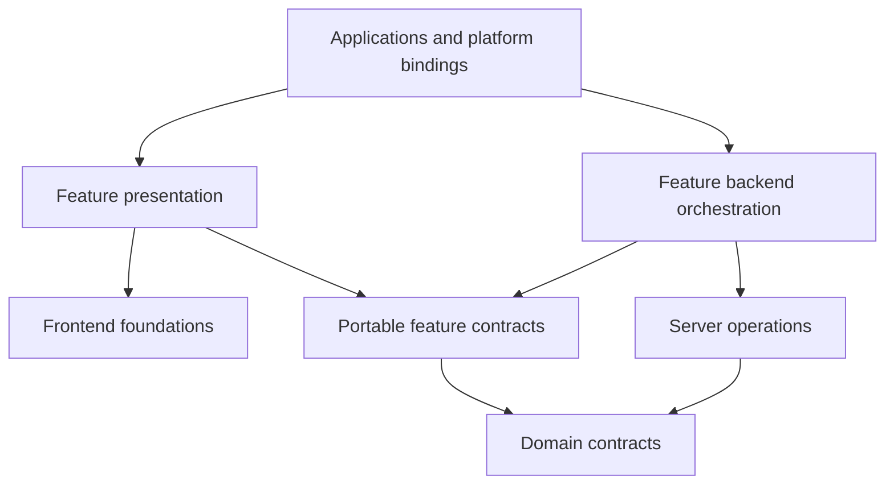

# Workspace conventions

**Status:** Canonical operating conventions, defined by [ADR-0001](decisions/0001-workspace-topology-and-toolchain.md) and amended for placement/dependency direction by [ADR-0014](decisions/0014-multi-app-package-boundaries.md), 2026-10-23.

These conventions describe the selected target architecture and identify the current transition. The [ownership map](reorganization-ownership-map.md) records current locations and target owners; it is not a claim that the code has already moved.

## Layout and categories

Apps live at `apps/<name>` and packages at `packages/<category>/<name>`. The existing workspace globs, `apps/*` and `packages/**/*`, are unchanged.

| Category   | Owns                                                                                  | Boundary reference                            |
| ---------- | ------------------------------------------------------------------------------------- | --------------------------------------------- |
| `domain`   | Portable contracts and product rules                                                  | [Domain](../../packages/domain/README.md)     |
| `frontend` | Presentation, interaction foundations, shells, and explicit frontend platform effects | [Frontend](../../packages/frontend/README.md) |
| `server`   | Trusted operations, repositories, and backend provider integration                    | [Server](../../packages/server/README.md)     |
| `features` | Reusable product composition and workflows                                            | [Features](../../packages/features/README.md) |
| `dev`      | Tooling, fixtures, test/scenario/seed/demo support                                    | [Dev](../../packages/dev/README.md)           |

Current application workspaces are `web`, `docs`, and `storybook`. Current package workspaces still live under frontend/dev. New domain/server/feature packages are not created by the category READMEs. Desktop/mobile are planned consumers; no application scaffold or runtime is selected for them here.

## Names and grouping

Use `@synapcity/<category>-<name>` in lowercase kebab-case; apps remain unscoped. The leaf folder does not repeat the category. For example, `frontend/shells` maps to `@synapcity/frontend-shells`; a `features/settings` example maps to `@synapcity/features-settings`. Examples are not installed-package claims.

Group coherent modules within a package: several shells can share one shells package, and several resource repositories can share one data package. Independence, testability, runtime isolation, planned reuse, and change coupling justify early extraction. A second current consumer is not required. One capability may span categories, such as `frontend/settings` presentation beside the `features/settings` experience, provided each package holds only its category's responsibility.

Do not infer a new product noun, schema, or durable identifier from a package name. Existing provisional labels retain their approved bounded technical use; follow the [glossary](../glossary.md) before a terminology change.

Prefer the name the code and durable identifiers already use. Name a package by responsibility, never by technique or vagueness: `containers`, `layouts`, `utils`, `common` and `shared` are not package names.

A new package must earn its boundary through at least one of: a different runtime, different dependencies, a different consumer set (planned consumers count), independent testing, or a different rate of change. Folder size alone is not a reason. Grow a package through explicit modules before splitting it. Fields shared by several contracts go in a base contract inside the owning package, not in a separate cross-cutting package. Browser platform effects are frontend packages and backend provider integration is server; there is no separate platform category.

### Package inventory

Accepted 2026-10-23 through the [Milestone 3.1 design](../superpowers/specs/2026-10-23-m3-package-grouping-design.md), which records each package's current source inputs and the owner's decisions. A package is created by the migration that first moves code into it, never as an empty skeleton.

| Package                               | Owns                                                                                                    | First code |
| ------------------------------------- | ------------------------------------------------------------------------------------------------------- | ---------- |
| `domain-records`                      | Base record contract; Space, Document and Dashboard contracts as separate modules extending it          | M4         |
| `domain-preferences`                  | Preference schemas, defaults, account/device scope, merging, import/transfer validation, consent policy | M4         |
| `domain-identity`                     | Credential, profile, name and avatar contracts; verified-identity contract                              | M4         |
| `frontend-ui` (existing)              | Primitives, generic components and form pieces, generic hooks, low-level layout primitives              | exists     |
| `frontend-shells`                     | Composable app shells and page frames                                                                   | M6         |
| `frontend-collection`                 | Browse projections, query mechanics, generic controls and displays, local browse state                  | M7         |
| `frontend-settings`                   | Settings presentation pieces                                                                            | M8         |
| `frontend-preferences`                | Browser preference runtime: device store, apply functions, boot scripts, mode, consent state            | M8         |
| `frontend-error-reports`              | Consent-gated browser error reporting and event scrubbing                                               | M8         |
| `frontend-auth`                       | Auth presentation pieces                                                                                | M9         |
| `frontend-site` (existing)            | Site metadata and brand presentation                                                                    | exists     |
| `frontend-tailwind-config` (existing) | Tokens and styling foundation                                                                           | exists     |
| `server-data`                         | Space, Document and Dashboard repositories, queries and row mapping                                     | M7         |
| `server-account`                      | Profile, avatar and account-preference operations                                                       | M8         |
| `server-auth`                         | Verified identity, auth operations, verified-caller helpers                                             | M9         |
| `features-spaces`                     | Space browsing and detail                                                                               | M7         |
| `features-settings`                   | The Settings experience: editors, drafts, guard, import/export, account sync                            | M8         |
| `features-auth`                       | Sign-in, registration, password, email and session workflows                                            | M9         |
| `features-account`                    | Name, avatar and profile workflows                                                                      | M9         |
| `features-documents`                  | Document browsing                                                                                       | M10        |
| `features-dashboards`                 | Dashboard browsing                                                                                      | M10        |
| `features-home`                       | Home, aggregating the resource features                                                                 | M11        |
| `dev-*` (five existing)               | Tooling, test configuration and fixtures; `dev-fixtures` grows scenarios and sample content             | exists     |

**Preferences and Settings** are different packages on purpose: preferences are the data, rules, persistence and browser runtime; Settings is the screen that edits them.

## Public interfaces and dependencies

A package's `exports` defines its supported public interface. Consumers do not bypass it with filesystem paths or import private source. Internal dependencies use `workspace:*`. The complete production dependency matrix and non-production exceptions are owned by [ADR-0014](decisions/0014-multi-app-package-boundaries.md#2-dependency-and-runtime-matrix).

- Packages never import apps. App-to-app source dependencies are not shared-library reuse.
- Domain has no React, DOM, request, concrete storage, provider-client, frontend, feature, or server dependency.
- Frontend and feature presentation cannot reach backend implementations, including transitively.
- Server operations depend on domain and other explicit server interfaces; they do not import the feature composing them.
- Feature contracts are portable. Feature presentation and feature backend orchestration have separate dependency graphs.
- Same-category and sibling-feature reuse stays explicit, cohesive, public, and acyclic.
- Tests, stories, development configuration, seeds, and explicit demo hosts may use dev support; shipped entry points may not.
- Type-only and development dependencies still have owners and must not conceal graph cycles.

Exact manifest/export syntax and enforcement implementation belong to Milestone 3. The existing [web architecture test](../../apps/web/src/architecture.test.ts) checks some direct imports within web; it is not a workspace-wide or transitive proof.

## Runtime and platform integration

App hosts own route/action entry points, cookies/headers, environment selection, navigation, response formatting, framework revalidation, and request-bound provisioning. Server capabilities verify identity/access and return narrow outcomes. A package receives an explicit host capability; it never imports app code to obtain one.

Frontend presentation may render in a backend render pass without becoming a privileged operation. Declare whether an entry is portable logic, React behavior, DOM presentation, or framework-specific integration.

New shared presentation uses host-provided navigation/link capabilities or an explicit platform/framework adapter. Existing Next.js link/navigation imports are a transition item in the ownership map, not a permanent assumption that every consumer is Next.js. Browser storage, DOM attributes, font loading, and permissions stay behind frontend platform entries.

## Data, copy, and state

Domain owns product contracts; repositories own persistence effects; features own drafts, workflow orchestration, product copy, and presentation projections. Frontend components own general interaction state and generic component text. Fixtures own synthetic records and sample content.

Follow existing accepted policies for account/device preference reconciliation, storage keys, auth, and database enforcement. A package move does not alter those policies. A fixture success does not establish a production save.

## Internal organization

Organize around actual responsibilities. Do not generate empty shared/client/server/components trees or a forwarding wrapper for every function. Use folders when they group meaningful implementation, tests, stories, and private helpers.

Frontend components compose through `children` and named slots rather than configuration props. A frame owns structure and shared behavior (resizing, collapsing, focus, responsive regions, rail/header/footer layout); its consumer supplies the content. Boolean flags that switch between unrelated layouts are not allowed; a second frame is. `frontend-shells` applies this to app shells and page frames; a frame tied to one product workflow stays in its feature.

Current UI component-folder/story/test rules remain enforced by its package-structure test until a scoped change updates that contract. They are specific to that package, not a rule for every future package. Milestone 3 defines executable templates and tooling.

## Migration and preservation

The [ownership map](reorganization-ownership-map.md) covers all current source families. Migrate one slice with its real consumers and tests/stories; preserve behavior and public/serialized contracts unless changes are separately approved.

Temporary compatibility exports point to one canonical implementation. Record each bridge's source, target, consumers, owner, and removal condition in the migration task scope. No broad legacy exemption authorizes new violations. Keep explicit production/demo bindings and identify existing fixture/fake-operation gaps.

Record the baseline before code migration. Milestone 1 baseline verification remains separate from documentation checks. Use focused checks during moves, then the repository gate at completed implementation checkpoints; report unrun checks and live-provider limits.

## Tooling and verification

Root scripts in [package.json](../../package.json) define what actually runs. Packages expose the applicable scripts to those existing tasks. No new runtime, dependency version, Turbo command, or build strategy is selected here; verify declared versions and matching upstream/bundled guidance before changing them.

Tokens remain owned by `frontend-tailwind-config` under ADR-0002; app CSS remains wiring. Product schemas and copied identity/state do not move into generic UI.

Creating a package follows the [package checklist](package-creation-checklist.md). Testing breadth and thresholds remain governed by Proposed ADR-0005 and the existing Definition of Done. Planned boundary checks are not implemented merely because the matrix is documented.
