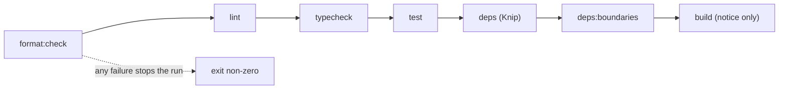

# ADR-0004: Toolchain baseline

**Status:** Accepted
**Amended by:** ADR-0007, ADR-0009
**Date:** 2026-09-26
**Deciders:** Founder (technical direction)

## Context

P1-02 (`hsadoqi/synapcity#3`) requires a coherent, deterministic engineering toolchain and root verification commands. The repository has no application source yet, and ADR-0003 fixed the runtime pins (pnpm 10.24.0, Node 24.20.0) and a single private root package. Versions below were taken from the package registry and configuration patterns were checked against current documentation, per the "current versions" rule in `AGENTS.md`.

## Decision

- **TypeScript** `~6.0` with a strict root `tsconfig.json` (`strict`, `noUncheckedIndexedAccess`, `noImplicitOverride`, `verbatimModuleSyntax`, `moduleResolution: Bundler`, `noEmit`). Pinned to the 6.0 line because `typescript-eslint` 8.70 declares support only for `<6.1.0`; TypeScript 7 is available and is not used until that peer range allows it.
- **Lint:** ESLint 10 flat config using ESLint core `defineConfig`/`globalIgnores` (the `tseslint.config` helper is deprecated) with `typescript-eslint` `recommendedTypeChecked` and `projectService`.
- **Format:** Prettier, with `eslint-config-prettier` to avoid rule conflicts. Markdown is excluded for now so canonical documents are not reformatted.
- **Unit tests:** Vitest, with `passWithNoTests` while no tests exist. The component-testing approach (Testing Library or Vitest browser mode) is deferred until a UI framework is adopted.
- **Dependency analysis:** Knip for unused files, exports, and dependencies.
- **`@types/node`:** the 24.x line, matching the pinned Node major.
- **Root scripts:** `format`, `format:check`, `lint`, `typecheck`, `test`, `deps`, `deps:boundaries` (added by ADR-0005), `build`, and `verify` (runs all checks in order). `build` has no targets yet and only prints a notice.

`verify` runs the steps in order and the first failure stops the run:

## Scope

Governs the Phase 1 baseline tools and root commands only.

## What this does NOT decide

- Tailwind, shadcn/ui, Storybook, and Playwright. Deferred to the first vertical slice; they have no consumer yet. Playwright and accessibility checks return when a runnable app exists (see ADR-0002 verification expectations).
- Architecture boundary and dependency-direction rules. Handled by ADR-0005 (`#4`); CI enforcement is P1-04 (`#5`).
- CI, pre-commit hooks, vulnerability and secret scanning (P1-04).
- An application framework or bundler, and the real `build` implementation.
- Package scope, layout, and folder structure (see ADR-0003).

## Unresolved

- Component-testing strategy and the UI framework it depends on.
- Whether TypeScript 7 replaces 6.0 once `typescript-eslint` supports it.
- Whether to add supply-chain settings such as a minimum release age for new packages.

## Governance boundary

Adding, replacing, or removing a baseline tool needs founder approval (`AGENTS.md` §5). Routine version bumps follow `AGENTS.md` §7a.

## Integration expectations

Tools run from the repository root. `pnpm verify` is the single local entry point that later CI (P1-04) is expected to reproduce.

## Verification expectations

Per `docs/engineering/definition-of-done.md`. As of this ADR there is no source and no tests, so a passing `pnpm verify` proves the toolchain runs, not product behavior. Typecheck, lint, format, and test gates were confirmed to fail on deliberately bad input. Knip's failure path and `pnpm build` are not verified because there is nothing to build or to flag as unused.

## Reconsideration conditions

Revisit if a tool becomes unmaintained, if `typescript-eslint` supports TypeScript 7, if the chosen UI framework requires different test tooling, or if maintaining Prettier and ESLint separately proves costly compared with a single tool.

## Amendments

The sections above are kept as written on 2026-09-26. Where they no longer describe the current state:

- **ADR-0007** replaced the `build` placeholder notice with each package's `build`.
- **ADR-0009** added `pnpm docs:check` to `pnpm verify`. The flow diagram above predates it.
- **Test gate (Phase 1 hardening):** the "`passWithNoTests` while no tests exist" condition no longer applies, because repository tooling tests exist. The invariant is that the test gate fails when test discovery finds no tests. See `docs/engineering/quality-gates.md`.
- **TypeScript constraint (Phase 1 hardening):** the manifest declares `~6.0.3`, which matches the `~6.0` line decided above. It had been declared as `^6.0.3`, which would permit versions outside the `typescript-eslint` range this ADR relies on.
