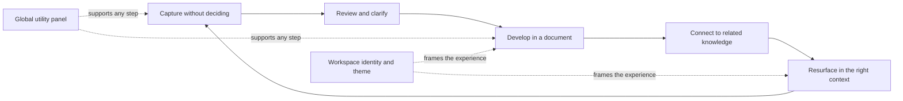
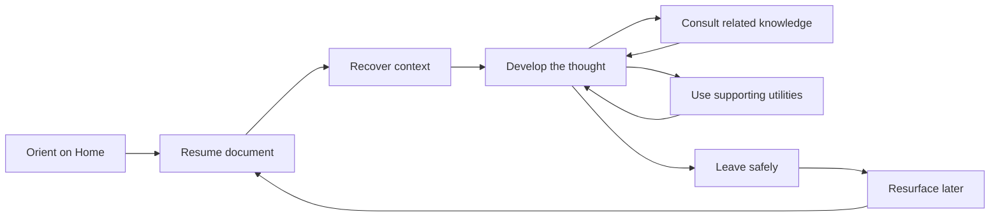
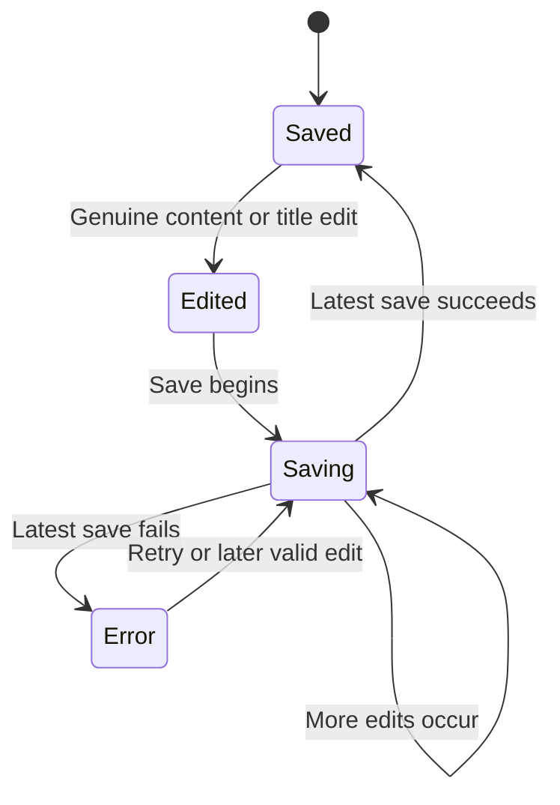
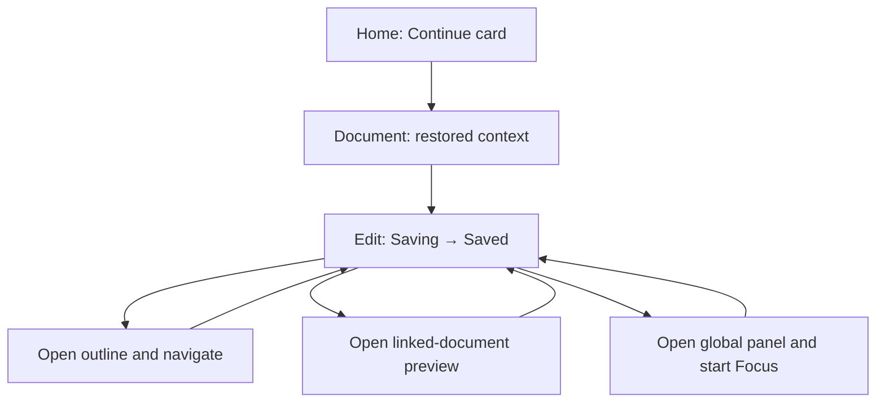
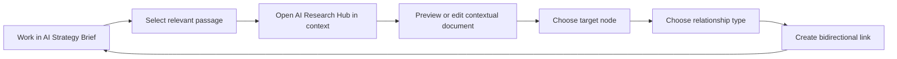
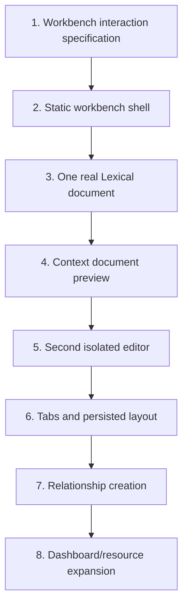

# Brainstorm Themely UI flows

> [@Themely Design+Style Generator](plugin://app-6a64c90329cc8191bedca18adc136ba2@openai-curated-remote) brainstorm some ui flows for me for this project (use `.docs` for context)

<details><summary>11 previous messages</summary>

> I’ll use the Themely plugin as the visual ideation partner, then ground its suggestions in Synapcity’s actual product and architecture documents. Since you’re asking to brainstorm, I’ll keep this exploratory: no product code or architecture decisions will be changed.
>
> `★ Insight ─────────────────────────────────────`
> Synapcity’s repository can contain experiments alongside canonical direction, so I’ll label each flow as either aligned with current product focus, a near-term extension, or a broader future concept. I’ll also keep “theme editing” separate from “appearance preference,” which is a core architectural invariant here.
> `─────────────────────────────────────────────────`
>
> The documentation points to one especially coherent experience spine: effortless capture → lightweight triage → focused document work → cross-page utility access → eventual workspace-level organization. I’m going to use Themely to visualize that as a calm “personal operations desk,” then I’ll branch it into several distinct UI-flow concepts rather than treating one mock direction as the answer.
>
> MCP tool call
>
> codex_apps.themely_design_style_generator.display-theme
>
> ```json
> {
>   "name": "Living Desk",
>   "description": "A calm, information-dense personal workspace that feels like a thoughtful desk rather than a corporate dashboard. The visual hierarchy prioritizes immediate capture, focused document work, contextual utilities, and distinct workspace identity without making theming itself the primary task.",
>   "preview": {
>     "brandName": "Synapcity",
>     "eyebrow": "Your connected personal workspace",
>     "title": "Capture the thought. Keep the context.",
>     "subtitle": "Move naturally from a fleeting idea to a useful note, focused work, and a connected body of knowledge.",
>     "body": "A composed home surface gives quick capture the shortest path, keeps current work visible, and lets Notes, Schedule, Focus, and Files slide into context without taking over the page.",
>     "navigation": ["Home", "Documents", "Workspaces", "Today"],
>     "primaryAction": "Capture a thought",
>     "secondaryAction": "Continue writing",
>     "features": [
>       {
>         "title": "Quick Capture",
>         "body": "Record first; classify later in a lightweight review flow."
>       },
>       {
>         "title": "Document Focus",
>         "body": "Write with trustworthy save state, outline, metrics, and contextual references."
>       },
>       {
>         "title": "Utility Panel",
>         "body": "Bring Notes, Schedule, Focus, and Files into any page without losing your place."
>       },
>       {
>         "title": "Workspace Identity",
>         "body": "Use scoped themes to give each life facet a recognizable atmosphere and structure."
>       }
>     ]
>   },
>   "tokens": {
>     "colors": {
>       "background": "#F4F1EA",
>       "surface": "#FFFDF8",
>       "surfaceMuted": "#ECE8DE",
>       "foreground": "#252722",
>       "foregroundMuted": "#676B61",
>       "primary": "#315C4C",
>       "primaryForeground": "#FFFFFF",
>       "secondary": "#DDE8E1",
>       "secondaryForeground": "#27483C",
>       "accent": "#C66A3D",
>       "border": "#D6D0C4"
>     },
>     "typography": {
>       "headingFamily": "Georgia, 'Times New Roman', serif",
>       "bodyFamily": "Inter, ui-sans-serif, system-ui, sans-serif",
>       "monoFamily": "'SFMono-Regular', Consolas, 'Liberation Mono', monospace",
>       "headingWeight": 600,
>       "bodyWeight": 400,
>       "displaySize": "3rem",
>       "baseSize": "1rem",
>       "smallSize": "0.875rem",
>       "lineHeight": "1.55",
>       "letterSpacing": "-0.015em"
>     },
>     "spacing": {
>       "xs": "0.375rem",
>       "sm": "0.625rem",
>       "md": "1rem",
>       "lg": "1.5rem",
>       "xl": "2.25rem",
>       "2xl": "3.5rem"
>     },
>     "radii": {
>       "sm": "0.375rem",
>       "md": "0.625rem",
>       "lg": "1rem",
>       "full": "9999px"
>     },
>     "shadows": {
>       "sm": "0 1px 2px rgba(37, 39, 34, 0.08)",
>       "md": "0 8px 24px rgba(37, 39, 34, 0.10)",
>       "lg": "0 20px 48px rgba(37, 39, 34, 0.14)"
>     }
>   },
>   "reason": "Create a visual anchor for brainstorming Synapcity UI flows using the documented product vision, approved capture flow, global utility-panel concept, document-first near-term direction, and mature scoped-theme capability."
> }
> ```
>
> ```text
> Displayed the “Living Desk” design theme.
> ```
>
> ```json
> {
>   "name": "Living Desk",
>   "description": "A calm, information-dense personal workspace that feels like a thoughtful desk rather than a corporate dashboard. The visual hierarchy prioritizes immediate capture, focused document work, contextual utilities, and distinct workspace identity without making theming itself the primary task.",
>   "preview": {
>     "brandName": "Synapcity",
>     "navigation": ["Home", "Documents", "Workspaces", "Today"],
>     "eyebrow": "Your connected personal workspace",
>     "title": "Capture the thought. Keep the context.",
>     "subtitle": "Move naturally from a fleeting idea to a useful note, focused work, and a connected body of knowledge.",
>     "body": "A composed home surface gives quick capture the shortest path, keeps current work visible, and lets Notes, Schedule, Focus, and Files slide into context without taking over the page.",
>     "primaryAction": "Capture a thought",
>     "secondaryAction": "Continue writing",
>     "features": [
>       {
>         "title": "Quick Capture",
>         "body": "Record first; classify later in a lightweight review flow."
>       },
>       {
>         "title": "Document Focus",
>         "body": "Write with trustworthy save state, outline, metrics, and contextual references."
>       },
>       {
>         "title": "Utility Panel",
>         "body": "Bring Notes, Schedule, Focus, and Files into any page without losing your place."
>       }
>     ]
>   },
>   "tokens": {
>     "colors": {
>       "background": "#F4F1EA",
>       "surface": "#FFFDF8",
>       "surfaceMuted": "#ECE8DE",
>       "foreground": "#252722",
>       "foregroundMuted": "#676B61",
>       "primary": "#315C4C",
>       "primaryForeground": "#FFFFFF",
>       "secondary": "#DDE8E1",
>       "secondaryForeground": "#27483C",
>       "accent": "#C66A3D",
>       "border": "#D6D0C4"
>     },
>     "typography": {
>       "headingFamily": "Georgia, 'Times New Roman', serif",
>       "bodyFamily": "Inter, ui-sans-serif, system-ui, sans-serif",
>       "monoFamily": "'SFMono-Regular', Consolas, 'Liberation Mono', monospace",
>       "displaySize": "3rem",
>       "baseSize": "1rem",
>       "smallSize": "0.875rem",
>       "headingWeight": 600,
>       "bodyWeight": 400,
>       "lineHeight": "1.55",
>       "letterSpacing": "-0.015em"
>     },
>     "spacing": {
>       "xs": "0.375rem",
>       "sm": "0.625rem",
>       "md": "1rem",
>       "lg": "1.5rem",
>       "xl": "2.25rem",
>       "2xl": "3.5rem"
>     },
>     "radii": {
>       "sm": "0.375rem",
>       "md": "0.625rem",
>       "lg": "1rem",
>       "full": "9999px"
>     },
>     "shadows": {
>       "sm": "0 1px 2px rgba(37, 39, 34, 0.08)",
>       "md": "0 8px 24px rgba(37, 39, 34, 0.10)",
>       "lg": "0 20px 48px rgba(37, 39, 34, 0.14)"
>     }
>   }
> }
> ```
>
> One product-level tension is worth preserving in the brainstorm: “Quick Capture” and the panel’s “Notes” module are adjacent, but the approved docs intentionally give them different jobs. Capture is an inbox with almost no decision cost; Notes is a persistent utility for material you already intend to keep working on. The UI should make that distinction feel natural instead of exposing it as an architectural rule.
>
> <details><summary>Created a file</summary>
>
> - Wrote `~/Projects/active/synapcity/active/next-monorepo/.remember/remember.md` (+16 -0)
>
> </details>
>
> sorry mistake
>
> not a fan tbh
>
> Fair. I think the miss is that “Living Desk” softened Synapcity into a tasteful productivity app—warm, editorial, and a little generic—when the project wants to feel more modular, spatial, customizable, and distinctly yours. I also jumped to a visual theme before actually giving you the flow concepts you asked for.
>
> I’ll reset the visual assumptions. I’m using Themely’s collaborative brief step now, prefilled only with what the project docs establish, so you can steer the aesthetic instead of me inventing another direction.
>
> MCP tool call
>
> codex_apps.themely_design_style_generator.specify-parameters
>
> ```json
> {
>   "productDescription": "Synapcity is a modular personal knowledge and workspace platform: a personal Linear/Notion hybrid for documents, notes, projects, dashboards, runbooks, references, and connected information across customizable workspaces for different areas of life.",
>   "targetAudience": "The builder herself first: a visually discerning power user organizing personal knowledge and work across life facets; broader users are a future possibility.",
>   "designGoal": "Make capture effortless, make organization and resurfacing genuinely useful, support focused document work, and let workspace-level themes create distinct visual identity without losing a coherent application shell.",
>   "reason": "The first generated direction felt too warm, editorial, generic, and productivity-app-like. Reopen the design brief so the user can directly steer Synapcity's visual character before another theme is generated."
> }
> ```
>
> ```text
> The design-parameter form is ready for the user.
> ```
>
> ```json
> {
>   "productDescription": "Synapcity is a modular personal knowledge and workspace platform: a personal Linear/Notion hybrid for documents, notes, projects, dashboards, runbooks, references, and connected information across customizable workspaces for different areas of life.",
>   "designGoal": "Make capture effortless, make organization and resurfacing genuinely useful, support focused document work, and let workspace-level themes create distinct visual identity without losing a coherent application shell.",
>   "targetAudience": "The builder herself first: a visually discerning power user organizing personal knowledge and work across life facets; broader users are a future possibility."
> }
> ```
>
> sorry again lmao
>
> No worries at all 😄 I’ll treat the “not a fan” message and the rejected handoff permission as accidental. The Themely brief is open if you want to play with it, but it isn’t blocking anything—I’ll keep the actual UI-flow brainstorm grounded in the project docs.

</details>

No worries 😄 I treated both apologies as corrections, not product feedback. The “Living Desk” preview is still available as a loose visual reference, and the Themely brief is open if you want to steer the style later.

The strongest concept in the docs isn’t a conventional dashboard. It’s a continuous loop:



That loop can produce a much more distinctive product than “projects + tasks + cards.” Here are the flows I’d explore.

## 1. The orient-and-resume flow

**Status:** Current direction; ideal candidate for the main home experience.

The home screen should answer three personal questions:

- What was I doing?
- What needs my attention?
- What have I forgotten that might matter now?

A user arrives and sees:

1. **Resume** — the last document or active thread, with its title, workspace, last edit, and a short content preview.
2. **Capture** — a single-line input that is always easy to reach.
3. **Today** — a small schedule/task summary, not a comprehensive planner.
4. **Resurfaced** — one or two notes or references related to current work.
5. **Workspaces** — recognizable destinations for different areas of life.

The highest-emphasis action should usually be **Continue writing**, not “Create project” or “Configure theme.” That matches the document-first near-term direction in [PRODUCT.md](./PRODUCT.md).

A representative sequence:

```text
Open Synapcity
  → See “Continue: Theme architecture notes”
  → Notice an unfinished thought from yesterday
  → Resume the document at the previous position
```

This would gradually replace the current placeholder-project-dashboard feeling. In particular, the existing “Invite teammates” section conflicts with the documented personal-first product direction; eventually, that space would be more valuable as a resurfacing or continuation prompt.

## 2. Capture now, understand later

**Status:** Approved and currently buildable.

This follows the approved [Capture Inbox specification](./.docs/specs/2026-09-07-capture-inbox-design.md).

### Capture state

The card starts compact:

```text
Quick Capture

[ What needs your attention?                         ] [Capture]

3 things to review                                      Review
```

The user types:

> Look into whether document backlinks should include headings

They press Enter. The item is immediately saved, the field clears, and the card gives a restrained confirmation:

```text
✓ Captured locally
```

No category, workspace, due date, icon, or metadata decision interrupts the thought.

### Review state

Selecting **Review** expands the card in place:

```text
Unsorted · 3

Look into whether document backlinks should include headings
12 minutes ago

[Task] [Note] [Reference]             [Archive] […]
```

The key interaction principle is that reviewing should feel like clearing a small physical inbox, not completing a form. One click should resolve an item.

There is, however, a meaningful UX caveat in the approved design: choosing Task, Note, or Reference currently applies a lightweight label and then archives the item. Because no real task, note, reference, or workspace entity exists yet, these choices can look more powerful than they actually are.

For the initial implementation, I would therefore use honest language such as:

```text
Clear from inbox as:
[Task] [Note] [Reference]
```

And show:

```text
Saved locally as a reference
```

That communicates the actual behavior without pretending the item has been filed into a permanent destination.

Once the workspace and document models exist, the same flow can evolve naturally:

```text
Capture
  → Clarify as Note
  → Suggested destination: Theme System
  → Add to existing document / Create document / Leave in inbox
```

That future evolution is one of the most important reasons not to over-design the capture object now.

## 3. The document-focus loop

**Status:** Current product direction; strongest candidate for the next major storyboard.

This is where Synapcity can start feeling like the product described in the vision rather than like its supporting systems.

### Entry

The user reaches a document from:

- Resume on Home
- Search or command palette
- A workspace’s document list
- A backlink
- A capture item that has been promoted into a document
- The global panel’s Notes module, if a note later gains a “Develop as document” action

### Working layout

```text
┌───────────────────────────────────────────────────────────────────┐
│ Workspace / Project      Document title       Saved · just now    │
├──────────────┬────────────────────────────────────┬───────────────┤
│ Documents    │                                    │ Outline       │
│              │  Main editor                       │               │
│ Recent       │                                    │ References    │
│ Favorites    │  Focus remains here                │               │
│ Archive      │                                    │ Backlinks     │
└──────────────┴────────────────────────────────────┴───────────────┘
```

The central editor remains calm. Supporting information stays available without competing with the writing surface.

### Core sequence

```text
Open document
  → Restore the previous reading/editing position
  → Edit the title or content
  → Show a quiet “Saving…” state
  → Confirm “Saved”
  → Update outline and word count without moving focus
  → Follow or create a related reference
  → Return without losing editor position
```

The save experience is especially important. Synapcity’s document invariants already treat initialization, selection changes, hydration, and no-op updates as **not saves**. The interface can make that reliability visible without being noisy:

- `Saved` when settled
- `Saving…` only after a real edit
- `Couldn’t save · Retry` when action is needed
- No celebratory toast on every autosave
- No changing status merely because the cursor moved

### Context rail

The document context rail could have three modes:

- **Outline** — headings and current section
- **Connections** — backlinks, outgoing references, and nearby knowledge
- **Details** — workspace, status, dates, tags, and document-level actions

This rail should remain conceptually separate from the global utility panel. The rail is about **this document**; the global panel is about **tools the user carries everywhere**.

That separation will make the application feel much easier to understand.

## 4. Work alongside the global panel

**Status:** Approved; the repository already contains related in-progress changes.

This follows the [Global Panel System specification](./.docs/specs/2026-09-07-global-panel-system-design.md).

The central idea is not “open a drawer.” It is:

> Bring a utility into the current activity without leaving the activity.

### Example: writing with a focus timer

```text
Editing “Theme runtime decisions”
  → Open Tools from the header
  → Panel pushes the document down
  → Show Focus + Schedule panes
  → Start a 25-minute timer
  → Lock the panel
  → Continue editing below it
  → Navigate to a linked document
  → Panel remains open because it is locked
```

### Example: checking something without losing context

```text
Editing a travel document
  → Open Tools
  → Glance at Schedule
  → Add a supporting file to Files
  → Press Escape
  → Panel closes
  → Focus returns to the Tools trigger
  → Document remains exactly where it was
```

### Example: arranging the panel

```text
Open Manage modules
  → Hide Files
  → Move Focus before Notes
  → Close the popover
  → Resize Schedule narrower
  → Reload later
  → Arrangement returns unchanged
```

The panel’s four modules should maintain distinct jobs:

| Surface               | Best use                                          |
| --------------------- | ------------------------------------------------- |
| Quick Capture         | “I don’t want to lose this.”                      |
| Panel Notes           | “I want to keep this text beside what I’m doing.” |
| Documents             | “I’m developing durable knowledge.”               |
| Document context rail | “Show me information about this document.”        |

That distinction prevents the product from accumulating four slightly different text boxes with unclear purposes.

One UX issue worth exploring before polishing the panel is its small-screen behavior. Simultaneous resizable panes make sense on desktop, but not necessarily on a phone-sized viewport. A responsive one-module-at-a-time presentation could be appropriate on small screens without changing the approved multi-pane desktop model.

## 5. Create and enter a life workspace

**Status:** Future; the workspace/hub model has not been designed yet.

This should eventually be a foundational flow because the product’s central promise is organizing different facets of life without fragmenting them across separate apps.

### Creation flow

```text
Create workspace
  → What part of your life is this for?
  → Name it: “Photography”
  → Start blank or choose a structural starting point
  → Pick initial sections
  → Choose a visual identity
  → Preview
  → Create workspace
```

The “structural starting point” could be modest:

- Project-focused
- Reference library
- Ongoing area
- Journal/log
- Blank

These should initialize structure, not permanently classify the workspace.

### Workspace home

```text
Photography
────────────────────────────────

Continue
Editing workflow notes

Documents
12 documents · 3 recently updated

Dashboard
Shoots · Equipment · Ideas · Expenses

Recently connected
“Color grading reference” ↔ “Autumn shoot plan”
```

A workspace should feel recognizable before the user reads its name, but it should still feel like part of Synapcity. That suggests:

- Stable application chrome
- Stable interaction and navigation behavior
- Scoped workspace color and typography
- Optional workspace-specific dashboard composition
- No complete reskinning of foundational controls

The unresolved word—workspace, hub, or space—matters here because it becomes a verb as well as a noun:

- “Move to workspace”
- “Open hub”
- “Create space”

I would resolve that during this flow’s design, not globally in isolation.

## 6. Give each workspace an identity

**Status:** The theme machinery is mature; the final product-facing workflow is still open.

The current header exposes **Theme system** and **Configure**, which makes sense for the experimental theme worktree but sounds like infrastructure rather than a personal-workspace feature.

The user-facing entry could eventually be:

```text
Workspace menu
  → Customize appearance
```

Then:

```text
Choose a starting theme
  → Preview it only inside this workspace
  → Adjust color, typography, radius, and density
  → Inspect light and dark variants
  → Resolve accessibility warnings
  → Save theme
```

A strong layout would place authoring controls beside a realistic workspace preview:

```text
┌───────────────────────────┬──────────────────────────────────────┐
│ Customize Photography     │ Live workspace preview               │
│                           │                                      │
│ Colors                    │ Sidebar · document · dashboard card  │
│ Typography                │                                      │
│ Shape                     │ Selected component can be inspected  │
│ Shadows                   │                                      │
│                           │                                      │
│ [Light] [Dark]            │                                      │
│                           │                                      │
│ [Discard] [Save theme]    │                                      │
└───────────────────────────┴──────────────────────────────────────┘
```

The workflow should preserve the theme architecture’s core distinction:

- **Theme:** what the workspace looks like
- **Appearance preference:** whether the user wants light, dark, or system mode

Changing from light to dark should not feel like editing the workspace theme. Editing the theme should not silently change the user’s global appearance preference.

The preview-before-save pattern in the theme docs is ideal here. It gives the user room to experiment without converting every slider movement into a permanent theme revision.

## 7. Connect knowledge across workspaces

**Status:** Future; depends on documents and workspaces existing.

This is where Synapcity can become meaningfully different from an attractive workspace dashboard.

### Reference creation

While editing:

```text
Type [[
  → Search across documents and workspaces
  → Select “Contrast guidelines”
  → Insert a stable internal reference
```

The result could appear as a recognizable but lightweight inline reference:

```text
The final rendered color should satisfy [[Contrast guidelines]].
```

### Reference exploration

Selecting the reference opens a preview first:

```text
Contrast guidelines
Design System · Updated yesterday

Final foreground contrast must be checked after gamut fitting…

[Open document]
```

That lets the user answer a quick context question without leaving the current document.

### Backlink flow

In the referenced document:

```text
Connections · 4

Theme editor implementation
Referenced under “Accessibility validation”

Photography color workflow
Referenced under “Output checks”
```

The section-level context is important. “This document has four backlinks” is much less useful than showing **why** each source references it.

### Resurfacing flow

Later, on Home or inside a workspace:

```text
Related to your recent work

Contrast guidelines
Referenced by two documents you edited this week
```

Resurfacing should be explainable. Synapcity should say why something returned instead of presenting a mysterious algorithmic feed.

## The north-star end-to-end flow

If I were storyboarding only one larger sequence to express the product, I’d use this:

```text
Hanaa opens Synapcity
  → Home offers to resume a theme architecture document
  → She continues writing
  → She opens the global panel and starts Focus
  → During writing, she captures an unrelated photography thought
  → Capture disappears into the inbox without interrupting the document
  → She links the current paragraph to an existing accessibility reference
  → Autosave confirms the real edit
  → Later, she reviews the captured thought
  → She develops it into a document in the Photography workspace
  → Photography’s scoped visual identity appears
  → The new document retains a connection to the original context
```

That sequence demonstrates almost everything distinctive about Synapcity:

- effortless capture;
- focused document work;
- dependable state;
- contextual tools;
- separation between life facets;
- workspace-specific visual identity;
- connected knowledge rather than isolated containers.

## What I would storyboard first

My recommended order is:

1. **Document focus loop** — establishes the actual near-term product core.
2. **Capture and review** — a contained, already-approved supporting flow.
3. **Document + global panel coexistence** — proves the shell can support focused work.
4. **Workspace entry and switching** — begins defining the broader information architecture.
5. **Theme customization in a workspace** — translates the mature technical system into a product capability.
6. **References, backlinks, and resurfacing** — builds the differentiating knowledge layer after the relevant entities exist.

I would not start by further polishing the placeholder project dashboard. It reflects a different product story—team tasks and projects—while the documented direction is personal-first, document-centered, workspace-aware, and eventually knowledge-connected.

`★ Insight ─────────────────────────────────────`
Synapcity’s most useful UI distinction is not between pages; it is between levels of commitment. Capture stores a fleeting thought, Notes supports temporary working material, Documents develop durable knowledge, and Workspaces provide long-lived context. If those levels feel different in the interaction design, the product will remain understandable even as dashboards, linking, and theming become more powerful.

The mature theme system is best treated as an identity layer around this loop, not as the loop itself. That lets visual customization become a genuine differentiator without allowing configuration UI to displace the document experience as the product’s center.
`─────────────────────────────────────────────────`

No production code, specifications, or existing in-progress panel changes were modified. I only used the project documentation and Themely for exploratory ideation.

> yes!! u found my docs nice....exactly....

Yes!! Once I found [PRODUCT.md](./PRODUCT.md), the [product vision](./.docs/product-vision.md), and the approved capture/panel specs, the project snapped into focus.

The repository’s current screen says “task dashboard,” but your documents describe something much more interesting:

> A personal thinking environment where ideas move from fleeting capture into organized, connected, expressive knowledge—without forcing every part of life into the same visual or structural mold.

And the pieces aren’t random:

- Quick Capture lowers the cost of remembering.
- Review turns raw thoughts into intentional material.
- Documents are where thinking develops.
- The global panel carries useful tools alongside the work.
- Workspaces give different parts of life structure and identity.
- Scoped themes make those spaces feel distinct.
- References and resurfacing prevent knowledge from disappearing after it is organized.

That’s the real product. The theme architecture, persistence work, panel system, Lexical invariants, and design-system work are all infrastructure supporting that loop—not isolated engineering projects.

The particularly strong idea is the progression in commitment:

```text
fleeting thought
  → captured item
  → working note
  → durable document
  → connected knowledge
  → resurfaced context
  → new thought
```

That gives Synapcity a coherent mental model even before workspaces, dashboards, and backlinks are fully built. It also gives us a much better basis for designing individual screens: every surface should help information move through that lifecycle, not merely display another collection of cards.

And your docs are unusually useful because they distinguish **what Synapcity ultimately is**, **what the current product focus is**, **what is already approved**, and **what hasn’t been designed yet**. That means we can brainstorm ambitiously without accidentally pretending the future workspace model or knowledge graph already exists.

The next genuinely exciting design exercise would be to storyboard the **document-focus loop** as Synapcity’s first unmistakably real product experience—then wrap capture and the global panel around it. That’s where the system could stop looking like a placeholder dashboard and start feeling like _Synapcity_.

> yes thatd be great

Absolutely. Here’s a first-pass storyboard for the **document-focus loop as Synapcity’s north-star experience**.

This is intentionally a product storyboard, not an implementation specification. It uses the current architectural invariants—trustworthy autosave, Lexical ownership, scoped themes, global utilities, explicit context—but it does not assume that the unbuilt document, workspace, or linking models have already been approved.

`★ Insight ─────────────────────────────────────`
The document screen should preserve a single “thread of attention.” Navigation, autosave, references, capture, and utilities are successful when they help the user without forcing the document out of the center.

That suggests three distinct interface layers: stable application navigation, document-specific context, and temporary global utilities. Keeping those layers visually and behaviorally separate will prevent the editor from turning into a cockpit of unrelated controls.
`─────────────────────────────────────────────────`

# Synapcity Document-Focus Storyboard

## The experience promise

> I can return to an unfinished thought, understand where I was, develop it without worrying about saving, consult related context without losing my place, and leave knowing Synapcity will help me find the thread again.

The complete loop:



## The underlying screen anatomy

The document experience has three interface layers:

| Layer                | Purpose                                        | Examples                                                                  |
| -------------------- | ---------------------------------------------- | ------------------------------------------------------------------------- |
| Application shell    | Navigate the overall knowledge environment     | Workspace switcher, Home, Documents, Search, global utility-panel trigger |
| Document environment | Support the document currently being developed | Breadcrumbs, title, editor, outline, connections, details, save state     |
| Temporary utilities  | Help without replacing the current activity    | Focus timer, Schedule, Notes, Files, quick reference preview              |

A conceptual desktop layout:

```text
┌────────────────────────────────────────────────────────────────────────────┐
│ Synapcity    Photography⌄     Search                     Tools   Appearance │
├────────────────────────────────────────────────────────────────────────────┤
│                                                                            │
│  DOCUMENTS          Photography / References             Saved · 9:41 PM   │
│                                                                            │
│  Recent             Color grading workflow                                 │
│  Favorites                                                                 │
│  Collections        A practical system for keeping visual decisions…       │
│                     ─────────────────────────────────────                  │
│  Autumn shoot                                                              │
│  Equipment          The actual document body lives here.                   │
│  Color grading                                                             │
│                     The content has room to breathe.                        │
│                     Formatting appears when it is relevant.                │
│                                                               OUTLINE      │
│                                                               Intent       │
│                                                               Workflow     │
│                                                               References   │
│                                                                            │
│                                                               CONNECTIONS  │
│                                                               3 backlinks  │
│                                                               5 references │
│                                                                            │
└────────────────────────────────────────────────────────────────────────────┘
```

The layout should feel like a writing environment with supporting architecture—not a dashboard wrapped around a text area.

---

# Scene 1: Return to an unfinished thread

## Situation

Hanaa opens Synapcity after being away for several hours or a day. She remembers the general subject she was working on, but not the precise paragraph or decision.

## Screen

The Home surface prioritizes continuation:

```text
Good evening

CONTINUE

┌──────────────────────────────────────────────────────────────┐
│ Photography · References                         18 min ago   │
│                                                              │
│ Color grading workflow                                      │
│                                                              │
│ “The exported image should retain the emotional character…” │
│                                                              │
│ 642 words · Section 3 of 5                 [Continue writing]│
└──────────────────────────────────────────────────────────────┘

CAPTURE

[ What do you want to remember?                         ] [↵]

TODAY                               RESURFACED

19:00  Review autumn selects        Contrast guidelines
21:30  Back up camera files         Related to two recent documents
```

## Interaction

She selects **Continue writing**.

Synapcity opens the document at the meaningful prior context:

- the last active section is visible;
- the prior scroll position is restored;
- the cursor does not necessarily jump into editing immediately;
- the last paragraph is visually easy to reacquire;
- the editor does not scroll unexpectedly as surrounding UI hydrates.

## Why this matters

A generic “recent documents” list makes the user reconstruct context manually. A continuation card says:

> Synapcity understands that this was an active thread, not merely a file you opened.

## Important state distinction

The Home screen should distinguish:

- **Recently viewed** — opened, but not necessarily worked on
- **Recently edited** — genuinely changed
- **Continue** — likely unfinished active work
- **Resurfaced** — brought back because of contextual relevance

Those are different signals and should not become one undifferentiated “Recent” feed.

---

# Scene 2: Recover the document’s context

## Situation

The document opens. Before typing, Hanaa needs to answer:

- Where am I?
- What was I trying to do?
- What remains unfinished?
- What information is connected to this?

## Initial document frame

```text
Photography / References

Color grading workflow                                      Saved yesterday

A practical system for maintaining visual consistency across shoots.

────────────────────────────────────────────────────────────────────────────

Intent

Color grading is not only color correction. The grading decisions should
preserve the emotional character of the scene while remaining consistent
with the larger collection.

Workflow

1. Establish a neutral technical baseline.
2. Identify the dominant emotional direction.
3. Compare against the collection reference set.
4. …

────────────────────────────────────────────────────────────────────────────

OUTLINE
• Intent
• Workflow              ← current section
• Export checks
• Reference images

CONNECTIONS
• Autumn shoot plan
• Contrast guidelines
• Lightroom export notes
```

## Orientation behavior

The interface gently highlights the section that was active previously. The emphasis fades after a moment or after the user interacts.

This is preferable to automatically selecting text or placing the caret at an arbitrary serialized selection because those behaviors can feel like the application has already begun acting on the user’s behalf.

A small continuation cue could say:

```text
You left off here
```

It disappears as soon as typing begins.

## Title and location

The document’s location appears as a breadcrumb:

```text
Photography / References
```

The breadcrumb conveys hierarchy without requiring the title to include organizational metadata.

The title remains directly editable, but visually reads like document content—not like an input field permanently surrounded by a border.

## Save state

At rest:

```text
Saved yesterday
```

No green checkmark, toast, or animated success indicator is necessary. Saving is infrastructure; successful infrastructure should be quiet.

---

# Scene 3: Enter focus without entering a special mode

## Situation

Hanaa clicks into the document and begins typing.

## Transition

The editor becomes the strongest visual element. Surrounding chrome subtly recedes:

- navigation remains available;
- sidebars may narrow or reduce contrast;
- the current outline heading stays visible;
- secondary metadata is not constantly displayed;
- toolbars appear contextually or remain compact.

No explicit “Enter focus mode” dialog is required for ordinary writing.

The interface achieves focus through hierarchy rather than by temporarily replacing the application.

## Editing frame

```text
Color grading workflow                                      Saving…

Workflow

1. Establish a neutral technical baseline.
2. Identify the dominant emotional direction.
3. Compare against the collection reference set.
4. Apply adjustments in a deliberate order:
   exposure, white balance, contrast, color relationships…
                                       │
```

## Autosave state sequence



The crucial behavior is that the status reflects genuine content state:

- Clicking in the editor does not show “Saving.”
- Moving the selection does not show “Saving.”
- Opening the document does not show “Saving.”
- Hydration does not show “Saving.”
- Derived outline or word-count updates do not show “Saving.”
- A stale save completion cannot incorrectly replace a newer pending state with “Saved.”

## Save failure

A failure should be visible but not destructive:

```text
Couldn’t save · Your changes are still here        Retry
```

The message belongs near the document status, not as a disappearing toast. A toast can supplement it, but the persistent document-level state is what tells the truth.

The editor should remain usable unless continued editing would actually be unsafe.

---

# Scene 4: Navigate the document through its outline

## Situation

The document grows. Hanaa wants to move between sections without scanning the whole page.

## Outline interaction

The right rail shows the structural projection derived from the same editor update pass:

```text
OUTLINE

Intent
Workflow
  Technical baseline
  Emotional direction
  Collection comparison
Export checks
Reference images
```

The current section is indicated through weight, color, or a small marker—not by turning the outline into a large navigation dashboard.

Selecting **Export checks**:

- scrolls the corresponding heading into view;
- preserves keyboard accessibility;
- does not rewrite the editor selection unnecessarily;
- returns focus according to the interaction’s intent;
- respects reduced-motion preferences.

## Collapsed state

If Hanaa does not need the rail:

```text
[Outline 6] [Connections 3]
```

The rail can collapse into a small edge affordance, leaving more space for the document.

This supports multiple working styles without turning layout preference into a complex settings system.

---

# Scene 5: Create a connection while writing

## Status

Future product flow; depends on the document and reference model. It should use the existing architectural direction of standard links plus the internal `synapcity://` entity-reference scheme unless richer stored behavior is proven necessary.

## Situation

Hanaa writes:

> The final version should be checked against the contrast rules.

She types `[[` or invokes **Insert reference**.

## Search surface

```text
Link to…

[ contrast                                              ]

DOCUMENTS

Contrast guidelines
Design System / Accessibility
Updated yesterday

Contrast experiments
Photography / References
Updated three weeks ago

HEADINGS

“Final foreground validation”
in Contrast guidelines
```

Search results can cross workspaces, but each result visibly carries its location. This avoids two documents named “Notes” becoming indistinguishable.

## Keyboard sequence

```text
Type [[
  → Search field opens
  → Type “contrast”
  → Arrow Down
  → Preview selected result
  → Enter to insert
  → Escape to cancel
```

The user should not need to switch from keyboard to pointer for the common path.

## Inserted result

```text
The final version should be checked against [[Contrast guidelines]].
```

The reference looks distinct enough to be recognized but not so decorative that it disrupts reading.

## Why preview matters

Before inserting, a small preview can answer:

- Is this the right document?
- Is it in the expected workspace?
- Does it contain the relevant section?
- Am I about to create a duplicate?

That turns linking into a meaningful act of connection rather than autocomplete based only on document titles.

---

# Scene 6: Consult a reference without losing the current document

## Situation

Hanaa activates the inserted reference to verify a detail.

## First action: preview

The default action opens a contextual preview—not immediate full navigation:

```text
┌──────────────────────────────────────────┐
│ Contrast guidelines                     │
│ Design System / Accessibility           │
│                                          │
│ Final foreground contrast must be        │
│ verified after gamut fitting and final   │
│ serialization, not only at seed input.   │
│                                          │
│ Referenced by 4 documents                │
│                                          │
│ [Open document]            [Close]       │
└──────────────────────────────────────────┘
```

This could appear in the document context rail or a lightweight anchored preview, depending on available space.

## If she only needed the fact

She closes the preview. Her cursor, scroll position, and current section remain unchanged.

## If she needs deeper context

She selects **Open document**. The new document opens with:

- a clear Back action;
- the source document retained in navigation history;
- the relevant heading visible if the reference targeted a section;
- the ability to return to the original editing position.

The interaction becomes:

```text
Current document
  → Preview reference
  → Open referenced document
  → Inspect relevant section
  → Back
  → Exact original context restored
```

The restoration is part of the feature, not a browser-navigation afterthought.

---

# Scene 7: Open the global utility panel alongside the document

## Status

Approved global-panel behavior.

## Situation

Hanaa wants to work for 25 minutes and keep the evening schedule visible.

She selects **Tools** from the header.

## Transition

The global panel slides down beneath the application header and pushes the document environment downward:

```text
┌────────────────────────────────────────────────────────────────────────────┐
│ Synapcity    Photography⌄     Search                     Tools▲  Appearance │
├────────────────────────────────────────────────────────────────────────────┤
│ FOCUS                                      │ SCHEDULE                      │
│                                            │                               │
│               25:00                        │ 9:30 PM  Back up camera files │
│                                            │ Tomorrow  Review selects      │
│       [Start] [Reset]                      │                               │
│                                            │                               │
│                         [Manage] [Lock ○]   │                               │
├────────────────────────────────────────────────────────────────────────────┤
│ Photography / References                                  Saved · just now │
│                                                                            │
│ Color grading workflow                                                  …  │
```

The page is not dimmed. The document remains interactive.

## Interaction sequence

```text
Open Tools
  → Focus and Schedule return in their prior arrangement
  → Start timer
  → Lock panel
  → Return to editor
  → Continue typing while timer remains visible
```

## Lock meaning

The lock is behavioral, not decorative.

When unlocked:

- Escape closes the panel;
- clicking outside closes it;
- route changes close it;
- closing returns focus to the trigger when appropriate.

When locked:

- those same actions leave it open;
- navigation does not dismiss it;
- the user must intentionally unlock or toggle it closed.

## Why it belongs above the document

The global panel is not part of the document’s data model. Placing it above the document environment reinforces that the utilities travel across routes and workspaces.

The document context rail, by contrast, remains visually attached to the document.

---

# Scene 8: Capture an unrelated thought without breaking focus

## Status

Proposed extension. The approved capture-inbox flow currently lives on the homepage. A global capture affordance would require a future product decision.

## Situation

While editing the photography document, Hanaa remembers:

> Ask about persistent panel sizes on mobile.

This thought does not belong in the current document.

Making her navigate Home to use Quick Capture would contradict the larger “capture should be effortless” promise. A future global capture action could provide a minimal transient surface.

## Possible interaction

Keyboard shortcut or application command:

```text
Capture a thought

[ Ask about persistent panel sizes on mobile              ]

Enter to capture · Esc to cancel
```

After Enter:

```text
✓ Captured to Inbox
```

The surface closes, and editor focus returns to its exact prior location.

## Critical constraint

The capture action should not ask:

- Which workspace?
- Is this a task or note?
- When is it due?
- Which document should contain it?
- Which color should it use?

Those are review-time questions.

## Relationship to panel Notes

If the thought is temporary material needed during the current session, it belongs in panel Notes:

> Try 60/40 pane sizes while testing.

If it is an unrelated thought that should survive and be reviewed later, it belongs in Capture:

> Ask about persistent panel sizes on mobile.

The distinction is:

```text
Panel Note = keep beside me
Capture = remember for me
Document = develop with me
```

That is a strong piece of product language and could guide future onboarding.

---

# Scene 9: Leave with confidence

## Situation

Hanaa finishes the session.

She should not need to perform a ceremonial Save action if autosave is trustworthy.

## Final state

```text
Saved · just now
```

She navigates Home or closes the application.

If the Focus timer is running, it continues according to the approved panel behavior even when the panel itself is closed.

## Home after the session

The continuation card updates:

```text
CONTINUE

Photography · References                         Edited just now

Color grading workflow

You were working in “Export checks.”

688 words · 4 connected documents              [Continue writing]
```

The important point is that Home reflects meaningful document activity. It should not claim a document was recently edited because it was merely opened, hydrated, or scrolled.

---

# Scene 10: Resurface the document later

## Status

Future knowledge-layer behavior.

Several days later, Hanaa begins working on an Autumn Shoot plan.

Synapcity notices an explicit relationship—not merely vague semantic similarity:

```text
RELATED TO THIS WORK

Color grading workflow
Photography / References

Connected through:
• Autumn shoot reference
• Export checks

[Preview] [Open]
```

## Explainability

The interface says why the document resurfaced:

- linked from this document;
- referenced by a recently edited document;
- belongs to the same active workspace;
- was captured for review;
- has an unresolved follow-up;
- was explicitly pinned for later.

Avoid:

```text
You might also like…
```

Prefer:

```text
Related through “Autumn shoot reference”
```

Synapcity is a personal knowledge environment. Its resurfacing should feel like recovered context, not content recommendations.

---

# The document’s three working postures

The same document environment can support three postures without creating three separate products.

## Writing posture

```text
Navigation subdued
Context rail collapsed
Editor comfortably narrow
Formatting controls contextual
Global panel closed
```

Best for developing prose or structured notes.

## Research posture

```text
Connections rail open
Reference previews active
Outline available
Editor slightly narrower
Back-navigation preserves exact position
```

Best for synthesis and cross-document work.

## Planning posture

```text
Global panel locked open
Schedule and Focus visible
Document outline open
Editor remains interactive below
```

Best for structured working sessions.

These are interface states, not necessarily user-configured “modes.” Synapcity can infer them from which surfaces the user opens.

---

# Visual hierarchy

The screen should have a deliberate hierarchy:

1. **Current document content**
2. **Document title and current structural context**
3. **Save/error state requiring attention**
4. **Document outline and connections**
5. **Application navigation**
6. **Secondary metrics and metadata**
7. **Theme/configuration controls**

This is one place the current experimental shell will eventually need to evolve. A persistent header title of **Theme system** and a prominent **Configure** action are appropriate for this worktree’s present experiment, but in the product experience they would draw attention toward infrastructure rather than the user’s work.

Theme customization should remain available through workspace or application customization—not occupy the document’s primary action cluster.

---

# Scoped theme behavior inside the storyboard

When the document belongs to the Photography workspace, its scoped theme can give that context a distinct identity:

- a recognizable accent;
- workspace-owned typography;
- characteristic surface treatment;
- subtle visual cues in navigation and document chrome;
- workspace-specific dashboard presentation later.

But the structural grammar remains stable:

```text
Same locations
Same interaction behavior
Same focus rules
Same accessibility
Same save semantics
Different workspace identity
```

Moving from Photography to Finance should feel like entering another room in the same home—not opening an unrelated application.

Appearance remains separate:

```text
Photography theme + light appearance
Photography theme + dark appearance
Finance theme + light appearance
Finance theme + dark appearance
```

The workspace owns its theme identity. The user owns whether they prefer light, dark, or system appearance.

---

# Responsive adaptation

The desktop document layout can use three columns, but the hierarchy should adapt rather than compress indiscriminately.

## Tablet

```text
[Document navigation drawer] [Editor] [Context rail toggle]
```

Only one side surface may remain expanded at a time.

## Phone

```text
Header
Breadcrumb
Title
Editor

Bottom actions:
[Outline] [Connections] [Tools]
```

Outline, connections, and utilities become dedicated temporary surfaces. The editor remains the underlying location and restores focus when those surfaces close.

The global panel’s desktop requirement for simultaneous resizable modules probably needs a small-screen adaptation. One module at a time on narrow screens would not necessarily contradict the approved desktop model; it would be a responsive presentation of the same registered modules and state.

That deserves an explicit design decision before the panel is considered visually complete.

---

# Empty and edge states

## New document

```text
Untitled

Start writing, or type / for options.
```

No giant illustrated empty state inside the editor. The blank page is the invitation.

## No outline

The rail does not show a blank box labeled Outline. It offers useful guidance:

```text
OUTLINE

Add headings to navigate longer documents.
```

## No connections

```text
CONNECTIONS

This document isn’t connected yet.

Type [[ while writing to link another document.
```

That teaches the interaction without demanding it.

## Read-only document

The UI must not appear editable:

- no active caret;
- no editable title treatment;
- no formatting controls;
- clear read-only status;
- selection and copying remain available;
- reference navigation remains available.

## Offline or save unavailable

```text
Working locally · Changes will sync when available
```

That copy should only appear if such behavior genuinely exists. Until then, the interface must not imply a synchronization guarantee the implementation cannot keep.

## Legacy document opened

Opening older content should not silently rewrite or save it. The UI can render the document normally; migration or normalization should not manufacture a visible “Edited just now” event.

---

# The first clickable prototype

I would make the first prototype cover only six transitions:



The prototype would use one realistic document rather than placeholder lorem ipsum. A theme-system architecture document would work well because it naturally contains:

- multiple headings;
- technical references;
- an outline;
- related documents;
- a reason to consult the Focus panel;
- visible save-state transitions;
- enough content to test scrolling and context restoration.

## What the prototype should answer

It should not try to prove the entire product. It should answer:

1. Does the editor remain visually dominant?
2. Can the user understand where they are?
3. Does the save state create trust without noise?
4. Does the outline help without crowding the document?
5. Can related knowledge be consulted without losing the current thread?
6. Can the global panel coexist with focused writing?
7. Does moving between surfaces preserve focus and position?
8. Does the scoped theme give identity without making the shell inconsistent?

---

# Recommended product decisions to explore next

These are the highest-value questions exposed by the storyboard:

## 1. What is the default document width?

Options include:

- narrow editorial measure;
- moderately wide working canvas;
- user-adjustable width;
- width that changes when the context rail opens.

My instinct is a moderately narrow reading measure with extra canvas around it. Synapcity should feel spacious, but not like a blank blogging editor.

## 2. Is the context rail persistent or summoned?

A persistent rail improves spatial memory but consumes space. A summoned rail keeps the editor calmer but makes connections less discoverable.

A good compromise may be:

- persistent on wide displays if previously opened;
- collapsed affordances on medium displays;
- temporary surface on narrow displays.

## 3. Should global capture exist outside Home?

The product vision strongly supports it, but the approved capture spec does not include it. This should be a deliberate next-step decision rather than silently folded into the initial capture implementation.

## 4. What qualifies a document for Continue?

Possibilities include:

- most recently genuinely edited;
- explicitly left unfinished;
- pinned as active;
- associated with a current focus session;
- selected from several recent active threads.

This matters because an inaccurate Continue card becomes another generic Recent list.

## 5. How visible should workspace theming be in the editor?

The range runs from a subtle accent to dramatically different typography and surfaces. The theme system supports rich variation, but the document interaction grammar should remain stable across themes.

---

# My recommended design direction

The document experience should feel like a cross between:

- the calm content hierarchy of a dedicated writing tool;
- the navigational precision of Linear;
- the connected context of Obsidian;
- the structural flexibility of Notion;
- and a more expressive workspace identity than any of those products normally allow.

But the important part is not visually averaging those references. The distinctive Synapcity behavior is:

> The application remembers the thread around the document—not only the document itself.

It restores position, exposes meaningful connections, carries useful tools alongside the work, captures interruptions without derailing attention, and resurfaces the material when its context becomes relevant again.

`★ Insight ─────────────────────────────────────`
The most important unit in this storyboard is not the document record; it is the user’s active thread. The document, editor position, open contextual surface, running utility, recent reference, and pending capture can all contribute to that thread without becoming one giant persisted UI object.

This also explains why trustworthy autosave and focus restoration are product features rather than implementation polish. If Synapcity cannot preserve content and interaction context reliably, the larger “second brain” promise will feel unsafe no matter how beautiful its themes are.
`─────────────────────────────────────────────────`

No repository code or documentation was changed for this storyboard. It remains a proposed UX direction grounded in the current product vision, document invariants, approved panel behavior, and canonical theme boundaries.

> 1l. user adjustable...it will also render with a second sidebar to the right for context...and till be resizable so that hypothetically, u could edit two documents on one screen... 2. yeah of course it collapses...into. icons so it remains visually accessible without being domineering 3. yes global capture. is available across codebase/contexts 4. havent decided yet lol but sure those sound good 5. well i dont want things to get crazy which is why i am maintaining a dominant neutral theme with accent/primary as enhancements (and accent is optional anyway)
>
> i actually have a ui mockup that i rally really like for synapcity but i wanna see what u come up with then we can compare hahah

<details><summary>4 previous messages</summary>

> Oh, that changes the shape in a good way. You’re describing a **document workbench**, not a centered editor with optional accessories: an adjustable main canvas, a collapsible context rail, and enough horizontal composability to place a second live document beside the first. The neutral theme becomes the stable architectural frame; primary/accent color supplies orientation and emphasis rather than atmosphere everywhere.
>
> I’m going to use the image-generation skill to turn those decisions into one opinionated desktop mockup. I’ll keep it independent of your existing mockup so the comparison is actually interesting.
>
> `★ Insight ─────────────────────────────────────`
> A resizable second document is meaningfully different from a preview rail. It implies that the center of Synapcity is a pane-based work surface whose occupants can change, while the right context sidebar remains a separate, persistent layer.
>
> Collapsing context into icons preserves spatial memory: Connections, Outline, Details, and similar tools keep a stable address even when their content is hidden. That is more appropriate for a power-user workspace than completely removing the rail.
> `─────────────────────────────────────────────────`
>
> The generated concept is ready. I deliberately made the two center panes equal citizens: each has its own title, formatting surface, scroll context, word count, and save state. The rightmost area is not pretending to be the second document—it is explicitly the active document’s context, with an icon rail that survives collapse.
>
> The result is close to the structural idea I had in mind, although I’d challenge two parts in a real iteration: the global Capture button is a little more prominent than your “neutral-first” principle may warrant, and the editor chrome still leans slightly conventional. Those are useful comparison points when you show me yours.
>
> <details><summary>Edited a file</summary>
>
> - Wrote `~/Projects/active/synapcity/active/next-monorepo/.remember/remember.md` (+8 -0)
>
> </details>
>
> Generated image
>
> 

</details>

> this is actually not bad! u confused what i rmeant by two at the same time but its okay, ie sd going to implement tabs too actually....an its funny, this is petty close to my fav mockup lol...soi includd the mockups...as well as some shots of former implementations as well as some widgets i implemented/sorta implemented for context
>
> User context
>
> Attachments:
>
> - widgets.zip: `~/widgets.zip`
>   Images:
> - `~/Desktop/Screenshot 2026-09-02 at 6.17.08 AM.png`
> - `~/Inbox/quarantine/Archives/2026-09-02_Desktop-v2/images/Screenshot 2026-07-12 at 6.57.34 PM.png`
> - `~/Documents/Codex/2026-09-04/dashboard-app-widget-wrapping-bug/outputs/customizable-dashboard-app/project/uploads/Screenshot 2026-07-12 at 3.48.12 PM.png`
> - `~/Inbox/quarantine/Archives/2026-09-02_Desktop-v2/images/Screenshot 2026-07-11 at 10.08.03 PM.png`
> - `~/Development/code-library/quarantine/backlog/images/Screenshot 2026-07-11 at 3.20.00 PM.png`
> - `~/Inbox/quarantine/Archives/2026-09-02_Desktop-v2/images/Screenshot 2026-07-06 at 9.38.37 AM.png`
> - `~/Development/code-library/quarantine/backlog/images/Screenshot 2026-07-06 at 9.39.38 AM.png`
> - `~/Inbox/quarantine/Archives/2026-09-02_Desktop-v2/images/Screenshot 2026-07-06 at 9.40.40 AM.png`

<details><summary>3 previous messages</summary>

> Ohhh, I see it now. In your favorite mockup, “two documents at once” is not a symmetric split-editor layout. The primary document remains the spatial anchor, while the right context workspace can load another document/resource and switch between **Preview** and **Editing**. That preserves a dominant writing surface while still allowing real cross-document work. Tabs can then manage multiple open contexts without turning the center into an IDE grid.
>
> I’m going to use the design-critique workflow to inspect the mockups as a family—including the older experiments and the widget archive—then compare their recurring ideas against both your favorite mockup and my generated concept. This will be analysis only; I won’t treat old implementations as canonical or copy anything into the repository.
>
> `★ Insight ─────────────────────────────────────`
> The right side in your favorite mockup is a _context workspace_, not merely a metadata inspector. It can contain metadata, a second editable resource, and relationship-building tools; that is much richer than the Outline/Connections sidebar I generated.
>
> Your older screenshots also reveal a recurring spatial grammar: main canvas + resizable contextual surface + persistent icon rail. That repetition across experiments is strong evidence of product intent, even though none of the old implementations is automatically canonical.
> `─────────────────────────────────────────────────`
>
> I’ve now inspected the widget archive too: it contains 17 distinct capability prototypes, with duplicate exports of several screens. The useful signal is not their older card styling; it’s the breadth of intended workspace material—timers, calendar, notes, tasks, goals, habits, logs, bookmarks, code, journal, media, mood/color boards, drawing, mind maps, and quick idea capture. That supports dashboards as compositional views over real information, not a collection of decorative mini-apps.
>
> <details><summary>Edited a file</summary>
>
> - Wrote `~/Projects/active/synapcity/active/next-monorepo/.remember/remember.md` (+11 -0)
>
> </details>

</details>

Okay, yes—I understand it now, and your favorite mockup is genuinely strong. It is also funny how close the generated concept landed in silhouette while getting the most important spatial relationship slightly wrong.

Your model is not:

```text
Document A | Document B | Inspector
```

It is:

```text
Primary document | Context workspace containing Document B / search / links / info | Tool rail
```

Document B can still become fully editable, but it enters through the contextual surface and remains subordinate to the primary thread unless the user promotes or swaps it into the main work area. That asymmetry is the clever part.

If I’m reading the set correctly, [the September 2 mockup](<~/Desktop/Screenshot 2026-09-02 at 6.17.08 AM.png>) is the favorite. I would treat it as the strongest north-star artifact in the group—not as a pixel-perfect specification, but as the clearest expression of Synapcity’s spatial model so far.

# Overall impression

The favorite mockup immediately reads as a serious personal knowledge environment. The document is unmistakably the primary object, while navigation and context remain richly available. It feels closer to an editorial research workstation than to a generic Notion clone or task dashboard.

Its largest strength is that the right side is not a static inspector. It is an active **context workspace** capable of:

- displaying another document;
- switching between preview and editing;
- exposing location, tags, dates, and linked-note counts;
- editing contextual content;
- linking a current selection to a target node;
- expressing a relationship type;
- promoting the contextual document into the primary work area.

That directly supports the “develop and connect knowledge” part of Synapcity rather than merely surrounding the editor with metadata.

# What the favorite mockup gets especially right

## 1. The primary document retains authority

The primary document occupies roughly the central half of the screen and receives the strongest typography. Even with both sidebars visible, the eye goes to:

1. **AI Strategy Brief**
2. its introduction and section structure;
3. the active contextual document;
4. navigation.

That is the correct order.

The context document is available and editable without competing equally for visual dominance. My generated concept accidentally made both documents peers, which flattened the hierarchy and made the application feel more like a code editor.

Your version says:

> This is what I’m working on. That is what I’m consulting or relating to it.

That distinction is far more aligned with the document-focus loop.

## 2. The right side supports a real cross-document workflow

The flow in the mockup is remarkably complete:



The relationship tool is not a generic “Add link” form. It preserves:

- the current source selection;
- the target document;
- the target node inside that document;
- the relationship’s semantic type;
- the bidirectional nature of the connection.

That is significantly richer than the simple backlinks rail I initially proposed. It makes connections deliberate and meaningful.

## 3. The document canvas has its own identity

The section spine is one of my favorite details:

```text
SPINE
INTRO

01
PURPOSE

02
PRIORITIES

03
INITIATIVES
```

It gives the document structural rhythm without turning headings into cards. The light ruler across the top, section numbering, generous content measure, and bottom width control collectively make the editor feel like a designed canvas rather than a generic rich-text field.

This is an important differentiator. A lot of document products make the surrounding application polished while leaving the actual document as a white rectangle. Your mockup treats the document itself as a compositional space.

## 4. User-adjustable width is already communicated

The bottom bar includes:

```text
Outline   720px   100%   [slider]
```

That solves the earlier question elegantly. Document width is not buried in Settings, and it does not require the user to know a specialized “focus mode.” It is an immediate property of the current view.

The bottom status bar also has a sensible collection of document-owned projections:

- word count;
- reading time;
- save state;
- outline access;
- content width;
- zoom.

These belong together because they describe or control the current document presentation. They do not compete with the global application bar.

## 5. Neutral-dominant theming is already visible

The favorite mockup does exactly what you described:

- neutral surfaces carry almost the whole interface;
- borders establish the spatial system;
- blue marks current selection and important actions;
- light blue appears only as a selection/background enhancement;
- the primary button uses stronger color because it completes a meaningful action;
- accent does not wash across entire regions.

Even the selected workspace and selected space use very restrained tinted backgrounds. This gives the theme system plenty of expressive capacity while protecting the product from turning into a chaotic multicolor dashboard.

## 6. It handles high information density calmly

There are many controls:

- left navigation;
- breadcrumbs;
- document actions;
- editor toolbar;
- ruler;
- editable content;
- status bar;
- contextual document metadata;
- contextual editor;
- relationship builder;
- right-side actions.

But the screen does not feel like a command center because most elements remain neutral, the grid is highly disciplined, and typography does the organizational work.

That is a useful standard for future Synapcity surfaces: **dense does not need to mean loud**.

# Where the generated concept was close—and where it missed

| Dimension             | Generated concept                                             | Your favorite mockup                                    | Better direction                            |
| --------------------- | ------------------------------------------------------------- | ------------------------------------------------------- | ------------------------------------------- |
| Overall silhouette    | Left navigation, document work area, right context, icon rail | Same broad structure                                    | Preserve this shared spatial grammar        |
| Two-document model    | Two equal editor panes                                        | Primary document plus editable contextual document      | Your asymmetric model                       |
| Context               | Outline, Connections, and Details inspector                   | Active resource, metadata, editing, linking, actions    | Your context workspace is much more capable |
| Document personality  | Conventional editor                                           | Editorial spine, ruler, structured page, width controls | Your document canvas                        |
| Capture               | Large central teal button                                     | Not yet present                                         | Add globally, but more quietly              |
| Color                 | Neutral with restrained teal                                  | Neutral with restrained blue                            | Both aligned; your mock is more disciplined |
| Tabs                  | Document tabs across central editor panes                     | Not yet shown in favorite, but planned                  | Add without converting the app into an IDE  |
| Bottom controls       | Separate footer metrics per editor pane                       | One coherent document status/control bar                | Your approach                               |
| Cross-document action | Read/edit the second pane                                     | Preview, edit, link, or promote context                 | Your approach                               |
| Visual density        | Productive SaaS/editor density                                | Editorial knowledge-work density                        | Your mockup is more distinctive             |

The generated concept was valuable because it independently converged on several aspects:

- strong left navigation;
- a neutral workbench;
- clear pane boundaries;
- resizable content;
- document-level save state;
- persistent right-side context icons;
- limited primary-color usage.

But your mockup explains **why the panes exist** much better.

# The spatial model I now think Synapcity is expressing

```text
┌─────────────────────────────────────────────────────────────────────────────┐
│ Global application bar                                                     │
│ Workspace · Navigation history · Search · Capture · Utilities · Appearance │
├───────────────┬────────────────────────────────────┬───────────────────┬─────┤
│               │ Primary work surface               │ Context workspace │     │
│ Navigation    │                                    │                   │Tool │
│               │ Open-resource tabs                 │ Context stack     │rail │
│ Workspaces    │ Optional resource-owned view tabs  │                   │     │
│ Spaces        │                                    │ Preview / Edit    │     │
│ Documents     │ Document / Dashboard / Runbook     │ Info / Links      │     │
│               │                                    │ Another resource  │     │
│               │                                    │                   │     │
│               ├────────────────────────────────────┤                   │     │
│               │ Resource status and view controls  │ Context actions   │     │
└───────────────┴────────────────────────────────────┴───────────────────┴─────┘
```

The key ownership principle is:

- the **primary work surface** answers “What am I working on?”
- the **context workspace** answers “What am I using, inspecting, or connecting while I work?”
- the **tool rail** answers “Which kind of context do I want?”
- the **global panel** answers “Which utilities do I want available alongside everything?”
- the **navigation sidebar** answers “Where can I go?”

That is a sophisticated but intelligible structure.

# How two editable documents should work

Here is the behavior I infer from the favorite mockup.

## Open contextually

While working in Document A, the user activates a reference, search result, or backlink.

Document B opens in the context workspace:

```text
Document A                           Document B
Primary                             Contextual
Editing                             Preview by default
```

## Switch Document B into editing

The user selects **Editing** in the context header.

Now both documents are editable:

```text
Document A                           Document B
Saved just now                      Saving…
```

Each must have independent:

- editor state;
- dirty/save lifecycle;
- scroll position;
- selection;
- history;
- error state;
- document identity.

A failure to save Document B must never make Document A appear unsaved, and vice versa.

## Promote Document B

The **Open document** action promotes Document B into the primary work area.

Depending on the planned tab model, it could:

- open as a new primary tab;
- replace the current primary tab;
- ask only if replacement would lose unsaved local state;
- preserve Document A as another open tab.

## Preserve Document A

When B is promoted, A does not disappear from the user’s working context. It remains available through:

- its tab;
- navigation history;
- the context stack;
- a deliberate swap operation.

## Optional swap

A very useful future action would be:

```text
Swap with primary
```

That creates:

```text
Before:
Primary = Document A
Context = Document B

After:
Primary = Document B
Context = Document A
```

This is more spatially legible than closing one document and reopening the other.

## Pin context

Another useful action:

```text
Pin context
```

Without pinning, navigating the primary document may update the contextual surface.

With pinning, Document B remains visible while the user moves among primary documents. That supports comparative research and synthesis.

This should not be the default—the default should remain contextual—but it would be powerful.

# Tabs: the part that needs careful semantic separation

Tabs fit this model well, but Synapcity could easily end up with three different concepts all drawn as identical tab strips:

1. open resources;
2. views of one resource;
3. contextual history/resources.

The older implementation in Image 6 already shows view-level navigation:

```text
Market Research Findings – Editor
Market Research Findings – Key Metrics
New View
```

That suggests a document can have multiple views or representations, not merely multiple open documents.

I would distinguish them like this.

## Primary work tabs

These represent open resource/view instances:

```text
AI Strategy Brief ×
Photography Plan ×
Reading Tracker ×
+
```

They answer:

> What work do I currently have open?

A tab may point to a document, dashboard, runbook, or another primary resource.

## Resource-owned view switcher

Inside a resource, optional views answer:

> How am I looking at this resource?

For example:

```text
AI Strategy Brief

[Editor] [Outline board] [Key metrics] [+ New view]
```

These should not necessarily look exactly like browser-style tabs. A segmented or understated view strip would help prevent nested-tab confusion.

## Context stack

The right side answers:

> What supporting context have I opened?

It could maintain a small stack:

```text
← Back to results

AI Research Hub
```

If true context tabs are added, they should be visually lighter and constrained:

```text
Research Hub ×   Contrast Guide ×
```

I would not allow an unlimited full browser-style tab bar in the narrow context pane. Past a small number, it should become a history/menu rather than compressing labels into illegibility.

## Recommended rule

The same resource can exist in more than one surface, but each visible instance must communicate:

- resource identity;
- view type;
- editing or preview mode;
- save state;
- which instance currently owns keyboard focus.

That last point is essential once two documents can be edited simultaneously.

# What the former implementations reveal

The older screenshots are not random abandoned directions. They contain a remarkably consistent architectural instinct.

## Recurring pattern 1: the right-side icon rail

Images 5–8 repeatedly place a narrow persistent rail on the far right.

The exact icons and colors vary, but the role remains consistent:

- search;
- information;
- theme;
- outline/list;
- links;
- documentation;
- chat or notes;
- contextual module toggle.

That tells me the icon rail is not merely a decorative affordance from one mockup. It is a recurring part of Synapcity’s spatial identity.

Your current statement that the context sidebar collapses into icons fits this lineage perfectly.

The strongest version would preserve:

- a stable icon order;
- an active indicator beyond color;
- tooltips;
- accessible names;
- keyboard navigation;
- persistence of the last open tool;
- independent collapse/expand behavior.

## Recurring pattern 2: resizable context

Several older screens include an obvious drag handle between the central canvas and right context.

That should remain a first-class interaction rather than a barely discoverable one-pixel boundary.

The handle needs:

- pointer dragging;
- keyboard resizing;
- minimum and maximum sizes;
- double-click or shortcut to restore a useful default;
- a visible focus state;
- enough hit area without a visually heavy divider.

## Recurring pattern 3: one shell for documents and dashboards

The former implementations show documents, dashboards, search, and contextual inspectors living inside the same general frame.

That supports the broader Synapcity vision better than building separate mini-app shells for:

- documents;
- dashboards;
- tasks;
- research;
- finance;
- reading;
- fitness.

The surface changes; the navigation and context grammar remains familiar.

## Recurring pattern 4: stacked or parallel work surfaces

Image 7 shows a dashboard area above a document area, separated by a horizontal resizer. That is rough visually, but the product instinct is interesting:

> Different work surfaces can coexist instead of forcing every transition to become navigation.

I would not canonize the top/bottom layout yet, but I would retain the deeper idea as a future composition capability.

It could eventually support:

- dashboard above supporting notes;
- document beside reference document;
- project overview above activity log;
- research results beside synthesis document;
- data view above written analysis.

## Recurring pattern 5: “New View”

Image 6 includes a prominent **New View** affordance. That aligns with the dashboard/widget vision and suggests that views are author-created projections over owned information.

This is a valuable concept, but the product will need to distinguish:

- a new document;
- a new view of a document;
- a new dashboard;
- a new widget instance;
- a new context tab.

Without that distinction, “New View” could become a vague creation action that means different things on every screen.

# What the widget archive tells us

I found 17 unique widget prototype images; the rest are duplicated exports.

The archive includes:

- timer;
- analog clock;
- calendar;
- quick notes;
- checklist;
- code snippets;
- quotes;
- journal;
- bookmarks;
- image carousel;
- drawing canvas;
- color palette;
- mood board;
- habit tracker;
- goal progress;
- time logger;
- expense tracker;
- water intake;
- mind map;
- brainstorm dump;
- writing prompt;
- larger task-management suite.

That is a useful capability library, but I would classify those concepts by information role instead of treating them as one flat widget catalog.

## Utilities

Best suited to the global panel or a compact utility surface:

- timer;
- clock;
- calendar;
- quick notes.

## Tracking projections

Best suited to dashboards backed by canonical entities:

- habit tracker;
- goal progress;
- time logger;
- expense tracker;
- water intake;
- task progress.

These widgets should display and manipulate owned data. They should not each create a private duplicate store for tasks, goals, expenses, or habits.

## Knowledge and reference views

Best suited to documents, dashboards, or context:

- bookmarks;
- code snippets;
- quotes;
- journal entries;
- image references.

## Creative/compositional tools

Potentially resource types, embeds, or richer dashboard blocks:

- drawing canvas;
- mind map;
- mood board;
- color palette;
- image carousel.

## Capture and ideation

Best suited to Capture or lightweight contextual tools:

- brainstorm dump;
- writing prompt;
- quick notes.

The important architectural translation is:

```text
Prototype widget:
“Expense Tracker owns $86.49 of expense data”

Future Synapcity widget:
“Expense Tracker presents expense records owned by the Finance workspace/domain”
```

That preserves the design value of the old prototype without repeating the “dashboard owns copied information” problem that the current docs explicitly reject.

# What to preserve from the widgets

The strongest interaction ideas are:

- immediate actions inside the widget;
- progress that can be understood at a glance;
- compact specialized input;
- clear empty states;
- multiple representations of the same domain, such as List/Board/Calendar;
- small tools that can become meaningful when composed;
- capability diversity across different life areas.

# What not to inherit from the widgets

The widget visuals are clearly exploratory. I would not carry forward:

- arbitrary bright colors per widget;
- emoji as the primary semantic icon system;
- large cards nested inside larger cards;
- inconsistent radius and shadow levels;
- oversized headings inside small surfaces;
- one-off spacing systems;
- a separate storage model per widget;
- action colors that change meaning from one widget to another;
- fixed narrow-phone proportions as the only widget layout.

The archive is a product-capability mine, not a final visual system.

# Focused critique of the favorite mockup

## Usability

| Finding                                                                                                                     |         Severity | Recommendation                                                                                                        |
| --------------------------------------------------------------------------------------------------------------------------- | ---------------: | --------------------------------------------------------------------------------------------------------------------- |
| The relationship-building flow is unusually strong and contextual                                                           |         Strength | Preserve the current-selection → target-node → relationship-type progression                                          |
| “Preview” in the top-right and “Editing” beside the contextual document could be interpreted as two competing mode controls |         Moderate | Clarify which resource each control affects or consolidate them into one mode system                                  |
| The right context pane performs metadata, editing, linking, and navigation simultaneously                                   |         Moderate | Use context tabs or task states so the pane can be powerful without becoming one endless scrolling column             |
| Multiple truncated breadcrumb segments hide most of the hierarchy                                                           |         Moderate | Preserve the beginning and current item, collapse only the middle, and reveal the full path on interaction            |
| The contextual editor and link builder appear simultaneously                                                                |   Minor/Moderate | Consider whether the link-builder state temporarily replaces lower context content or becomes a dedicated context tab |
| “Open document” and “Link to note” are strong persistent actions                                                            |         Strength | Keep these anchored, but ensure the footer does not obscure scrollable context                                        |
| Global Capture is not represented                                                                                           | Open requirement | Add a compact global affordance and keyboard route without overpowering the document                                  |
| Two editable documents require clear active focus                                                                           |        Important | Use a subtle active-pane indicator, caret/focus styling, and per-document save state                                  |

## Visual hierarchy

- **What draws the eye first:** “AI Strategy Brief.” Correct.
- **Second:** the primary document’s section headings and body. Correct.
- **Third:** “AI Research Hub” and its actions. Appropriate for supporting context.
- **Fourth:** the blue workspace selection and Create link action. Generally appropriate.
- **Potential competition:** the large Create link button becomes one of the strongest elements on screen even while the primary user may still be writing. It should remain strong during the link-building task, but could recede when that task is inactive.

## Consistency

| Element           | Observation                                                          | Recommendation                                                                            |
| ----------------- | -------------------------------------------------------------------- | ----------------------------------------------------------------------------------------- |
| Primary color     | Used consistently for selection and major action                     | Preserve                                                                                  |
| Surface structure | Mostly borders and spacing rather than nested cards                  | Preserve                                                                                  |
| Context modes     | “Doc,” “Editing,” and “Preview” have different visual treatments     | Define one explicit mode grammar                                                          |
| Left navigation   | Workspaces, Spaces, and Private suggest different container concepts | Treat labels as mock copy until the workspace ontology is decided                         |
| Bottom bar        | Excellent document-owned control cluster                             | Preserve and formalize                                                                    |
| Section spine     | Distinctive and editorial                                            | Preserve as an optional document-view feature, not required decoration for every resource |

## Accessibility

Without measuring the source tokens directly:

- Primary body copy appears comfortably readable.
- The light-gray ruler and spine labels may be too faint if they communicate necessary information. If they are purely decorative projections, the low emphasis is less concerning.
- Icon-only actions need accessible names and tooltips.
- The resizer needs a larger invisible hit target than its visible line.
- Blue selection should also have a shape, border, or weight difference so color is not the only signal.
- The tiny bottom-status text may need slightly more size or contrast on lower-density displays.
- The collapsed right icon rail needs visible keyboard focus and an understandable selected state.
- Editing two documents requires focus announcements that are helpful without announcing every editor selection change.

# What I would change in the favorite mockup

Not much structurally. My changes would be refinements.

## 1. Add a quiet global Capture affordance

I would not use the large teal button from my generated mock.

Possibilities:

```text
[＋] icon in the global bar
```

or:

```text
Capture    ⌘⇧C
```

inside the command/search surface.

The action should be globally available without becoming the most visually prominent element in every workspace.

## 2. Turn the context pane into an explicit context stack

The header could communicate:

```text
← Search results     AI Research Hub                 •••
                     Preview | Edit
```

If multiple contexts are open:

```text
AI Research Hub ×   Contrast Guide ×
```

But I would cap visible context tabs and move overflow into a menu/history.

## 3. Define promotion, pinning, and swapping

Context actions could include:

- Open in primary tab
- Pin context
- Swap with primary
- Close context
- Copy reference
- Link to current selection

Not all need permanent buttons. Most belong in the overflow menu.

## 4. Give the active editor a restrained focus cue

When the cursor is in the contextual document, there should be an unmistakable but calm indication:

- a slightly stronger pane boundary;
- active title weight;
- a small primary-color line;
- context header state.

Avoid tinting the entire pane.

## 5. Reduce ambiguity between resource tabs and view tabs

Use different placement and visual grammar:

- open-resource tabs near the primary surface boundary;
- resource views immediately beneath the resource title or in its local header;
- context history/tabs confined to the context header.

## 6. Preserve the editable document’s width controls

This is already excellent. The only extension I would add is a quick preset menu:

```text
Width
• 640px
• 720px
• 840px
• Fluid
• Custom
```

The slider remains available for direct manipulation.

# My proposed synthesis

If I combine the best signal from your favorite mockup, the older experiments, the widget archive, and the generated concept, the result is:

```text
Stable neutral Synapcity shell

Left:
Collapsible navigation
Workspaces and resources
Inbox, Search, Calendar

Center:
Primary tab strip
Active document or dashboard
Optional resource-owned view switcher
Adjustable document width
Editorial structure such as spine/outline
Quiet save and projection bar

Right:
Resizable context workspace
Search results, document preview/editing, relationships, metadata
Can host a second editable document
Can promote, pin, or swap resources

Far right:
Persistent icon rail
Collapses the context workspace without erasing access

Top utility layer:
Global Capture
Search/command system
Global panel trigger
Appearance and workspace customization

Optional global panel:
Notes, Schedule, Focus, Files
Pushes the whole work surface down
Independent of the current resource
```

This is much more distinctive than a two-sidebar document app because the right side is not merely a sidebar. It is a **secondary working context with its own navigation and state**.

# The strongest idea across all these artifacts

Your product has repeatedly been converging on a composable spatial model:

```text
Something I am working on
+
Something I need beside it
+
Tools I can summon without leaving
+
Navigation that collapses but remains spatially stable
```

The specific implementations have varied—dark shell, cyan rail, search panel, dashboard inspector, horizontal split, light editorial editor—but that underlying idea keeps returning.

I would consider that pattern part of the project’s current design direction even before every entity and interaction is settled.

`★ Insight ─────────────────────────────────────`
The right context workspace can unify several features that would otherwise become unrelated sidebars: search results, backlinks, metadata, document preview, secondary editing, relationship creation, AI assistance, outline, and resource details. The unifying contract is not their content type; it is that they support the active primary resource.

The widget archive suggests an equally important rule for dashboards: widgets should be projections and controls over information owned elsewhere. That allows a task to appear in a project dashboard, Today view, Focus panel, or workspace summary without creating four competing copies of the task.
`─────────────────────────────────────────────────`

My honest verdict: the favorite mockup is stronger than the generated one because it has a clearer theory of attention. The generated version is a competent dual-document productivity workspace. Yours is beginning to express a real Synapcity-specific interaction model.

> sooo whats next....i sorta started with a nextjs implementation but might be redoing it
>
> User context
>
> Attachments:
>
> - ai-strategy-brief.zip: `~/Documents/ai-strategy-brief.zip`

<details><summary>4 previous messages</summary>

> Next, I’d do a **salvage map before deciding whether to redo it**. We should separate the old Next.js implementation into:
>
> - product behavior worth keeping;
> - visual composition worth recreating;
> - reusable code that actually fits the current monorepo;
> - code that demonstrates an idea but should not be carried forward.
>
> I’ll inspect `ai-strategy-brief.zip` as an historical implementation and compare its structure with the current document/theme/runtime boundaries. This is still diagnostic—no code will be imported, replaced, or deleted.
>
> I’m using the context-restoration skill because this is exactly the dangerous stage where an old implementation can look like either “valuable working code” or “something to rewrite” before its responsibilities and provenance have been mapped.
>
> `★ Insight ─────────────────────────────────────`
> A redo decision should be made per responsibility, not per repository. The editor shell might be obsolete while the document composition, context-panel workflow, and relationship interaction remain excellent.
>
> The cheapest-looking option—copying the old app whole—can be the most expensive if it brings along incompatible state, persistence, and ownership. Conversely, rebuilding everything would throw away hard-won interaction decisions that are visible in the mockup and potentially encoded in the implementation.
> `─────────────────────────────────────────────────`
>
> The archive is compact and readable: about 40 files, with the experience concentrated in four large components and static sample data. Early read: this is much closer to a **high-fidelity interactive mock** than an application foundation. That is good news—it means a redo does not require abandoning it. We can preserve the composition and behaviors while rebuilding the stateful/editor pieces on the current architecture.
>
> The decision is becoming pretty clear: I would **redo the implementation foundation, not the design**. The archive’s visual code is hardcoded and largely non-interactive, while the current monorepo already owns the systems the old app would otherwise duplicate—theme tokens, UI primitives, scoped runtime, persistence helpers, panel infrastructure, and package boundaries. The mock should become the acceptance reference for a new vertical slice, not the codebase to merge wholesale.
>
> <details><summary>Edited a file</summary>
>
> - Wrote `~/Projects/active/synapcity/active/next-monorepo/.remember/remember.md` (+4 -0)
> - Wrote `~/Projects/active/synapcity/active/next-monorepo/.remember/remember.md` (+8 -2)
>
> </details>

</details>

Yes—I would redo it, but very specifically:

> **Keep the mockup as the design source of truth. Rebuild the implementation foundation inside the current monorepo.**

After inspecting [ai-strategy-brief.zip](~/Documents/ai-strategy-brief.zip), I would not try to merge that standalone Next.js app into the current repository or keep extending it as the eventual product. It is an excellent high-fidelity prototype, and it has already done important product-design work, but its code is mostly a static rendering of the idea.

That means this is not a “throw it all away and start over” situation. It is:

```text
Preserve the experience
Reconstruct the implementation
```

# What the prototype actually is

The archive is a compact standalone Next.js 16 app with approximately 40 files. Most of the experience lives in:

- `DocumentView.tsx`
- `ContextPanel.tsx`
- `Sidebar.tsx`
- `LayoutProvider.tsx`
- static `lib/data.ts`
- handcrafted `lib/types.ts`
- app-local CSS tokens and UI primitives

It renders the mockup remarkably faithfully, but the underlying behaviors are not really implemented yet:

- the “document” is a static array of handcrafted sections;
- the formatting toolbar buttons do not drive an editor;
- the context document is hardcoded;
- the link builder is hardcoded and begins open;
- the preview/editing mode is visual rather than stateful;
- the sidebar selections are mostly fixture state;
- the panel has a fixed `340px` width;
- there are no resizable panes;
- there are no tabs;
- there is no persisted layout state;
- there is no real document repository;
- there is no versioned document-content envelope;
- there is no real autosave;
- there is no stale-save protection;
- there is no Lexical integration;
- there is no real relationship model;
- there are no tests.

That is not a criticism of the prototype. It was doing the job of proving the interface concept. It succeeded.

# Why I would not evolve it as-is

The current monorepo already has durable owners for many things the prototype implements locally:

| Prototype concern                   | Current repository direction                                       |
| ----------------------------------- | ------------------------------------------------------------------ |
| Hardcoded CSS theme variables       | Compiled `@repo/domain-theme` and design-system semantic variables |
| Local appearance button             | Preferences/runtime appearance pipeline                            |
| Local `button.tsx`                  | `@repo/ui-components`                                              |
| Fixed panel layout                  | Existing resizable-panel capability and current utility-panel work |
| App-local layout state              | Feature/runtime state with intentional persistence                 |
| Standalone sidebar                  | Existing application shell/sidebar primitives                      |
| Static section-array document       | Future versioned Lexical document envelope                         |
| Local package lock and dependencies | Current pnpm monorepo dependency ownership                         |
| Hardcoded link interaction          | Future document/reference domain contract                          |

Merging the prototype directly would create two versions of several foundations:

- two theme systems;
- two button/component planes;
- two layout approaches;
- two sidebar approaches;
- two concepts of persisted state;
- potentially two document content models.

The biggest risk is the document model. The prototype defines content as:

```text
Section[]
  heading
  paragraph
  list
  table
  checklist
  blockquote
```

That works beautifully for rendering a mockup, but it should not become a competing canonical document tree next to Lexical.

The repository’s document invariants already say that Lexical owns live editor content and that persisted content belongs in one versioned envelope with one total parser. If we continued building on `Section[]`, we would eventually need to synchronize or migrate between:

```text
Handcrafted Section[]
        ↕
Lexical EditorState
```

That would create exactly the mirrored-editor-state problem the architecture is trying to avoid.

# What should be preserved

## Preserve almost exactly as experience requirements

- The three-column spatial hierarchy.
- The primary document’s visual dominance.
- The editable contextual document.
- The right-side back-to-results flow.
- Preview/editing modes.
- Metadata above contextual content.
- Linking the current selection to a target node.
- Semantic relationship selection.
- The sticky context action footer.
- The document spine and section numbering.
- The ruler.
- User-adjustable content width.
- Bottom document status and view controls.
- Neutral-dominant styling with restrained primary color.
- The left navigation’s information density.
- Contextual resource promotion through **Open document**.
- Quiet save-state presentation.

## Preserve as reference, but refine

- Breadcrumb behavior.
- Formatting-toolbar density.
- Workspace/Space/Private navigation terminology.
- Context-pane content ordering.
- “Preview” versus “Editing” controls.
- The contextual mini-editor.
- The link-builder card.
- Pane proportions.
- Icon choices.

## Rebuild rather than copy

- All state management.
- Document types and persisted schemas.
- Editor implementation.
- Autosave.
- Tabs.
- Resizing.
- Collapse behavior.
- Context routing/stack.
- Search.
- Relationship creation.
- Theme integration.
- UI primitives.
- Application routing.
- Accessibility behavior.
- Tests.

# The next artifact should be a workbench interaction specification

Before writing production code, I would turn the favorite mockup into a focused spec tentatively named:

```text
Document Workbench Interaction Specification
```

It should define the workbench without prematurely defining the entire workspace, dashboard, or knowledge-linking domain.

The spec should answer:

## Primary surface

- What is considered an open primary resource?
- Can documents, dashboards, and other resources share the same tab strip?
- Does each tab retain scroll and selection?
- What happens when a tab containing unsaved local changes is closed?
- Can the active primary view be duplicated?
- Does document width belong to the document, tab, view, or user preference?

## Context workspace

- Which content types can occupy the context pane?
- Is context tied to the active primary tab?
- What does **Pin** mean?
- What does **Back to results** restore?
- Can multiple contextual resources be open?
- What does **Open document** do?
- Can primary and context resources be swapped?
- Does the context pane remember its width per route or globally?
- Does collapsing preserve the active context?

## Tabs and views

- Are tabs resources, views, or view instances?
- Can one document be open in two different views?
- How are resource tabs distinguished from document-owned view selectors?
- Does contextual editing use tabs or a history stack?
- How is overflow handled?
- Which state survives reload?

## Two editable documents

- How is keyboard focus communicated?
- Does each editor have an independent save state?
- Can both autosave concurrently?
- How are stale save completions rejected independently?
- What happens if both instances display the same document?
- Are edits synchronized live between two instances of the same document, or is duplicate editing prevented?
- How does undo/redo behave in each editor?

## Collapsed rails

- Which icons remain visible?
- Is the icon order stable?
- Does selecting an icon expand the same pane?
- Can selecting the active icon collapse it?
- Are rail states contextual or global?
- How does keyboard navigation work?
- What remains visible on narrow screens?

## Global capture

- Where is the visible affordance?
- What is the keyboard shortcut?
- Does Capture appear in the command palette?
- Does it restore editor focus after submission?
- Can captures optionally include source context without asking the user to classify them?
- Does global capture belong to the stable application shell rather than each resource surface?

That interaction specification would convert the mockup from “an image we like” into a testable contract without yet entangling it with database or package decisions.

# Then build one vertical slice

I would not implement the entire screenshot in one pass. I would reconstruct it in a sequence where each stage proves something real.



# Slice 1: Recreate the workbench shell

Use fixture data, but build the layout with the current repository’s primitives and theme system.

Include:

- collapsible left navigation;
- primary work surface;
- primary tab strip;
- document toolbar region;
- content-width controls;
- resizable context workspace;
- context collapse into the persistent icon rail;
- responsive minimum widths;
- bottom document status bar;
- global Capture affordance;
- keyboard-accessible resizing.

Do not include yet:

- real document persistence;
- real linking;
- real search;
- workspace creation;
- dashboard composition;
- two active Lexical instances.

The purpose is to validate the workbench geometry in the actual app shell.

## Why this comes first

The mockup currently assumes a 248px left sidebar and 340px right context pane. Once both become resizable and collapsible, the center must respond across:

- large external displays;
- standard laptops;
- narrow desktop windows;
- browser zoom;
- large text;
- context editing;
- the global push-down utility panel.

That geometry should be proven before the real editor is installed inside it.

# Slice 2: Add one trustworthy Lexical document

Once the shell is stable, replace the static central document with a real editor.

This slice should establish:

- a deliberately small Lexical node set;
- one exact aligned version for every `lexical` and `@lexical/*` package;
- editable title and content;
- versioned persisted document envelope;
- one parser for all persisted content;
- real autosave after genuine user edits;
- no saves on hydration, initialization, selection change, or no-op updates;
- derived outline, word count, and reading time from the existing update pass;
- stale async-save rejection;
- explicit save failure state;
- read-only mode that cannot appear editable.

This is the real foundation. Until this exists, tabs and two-document editing are still mostly shell behavior around a mock document.

# Slice 3: Make the context document real—but preview-only first

The first functional context workspace should support:

```text
Search result or reference selected
  → Context document loads
  → Metadata displays
  → Content preview renders
  → Back restores prior results
  → Open document promotes it into a primary tab
```

Preview-first lets us prove:

- contextual routing;
- resource identity;
- context history;
- loading/error states;
- pane sizing;
- promotion into the primary surface;
- focus restoration.

It avoids introducing two simultaneous editor lifecycles before the single-editor lifecycle is trustworthy.

# Slice 4: Enable editing in context

Then introduce a second isolated Lexical editor instance.

This is where the architecture needs to prove that provider instances and save lifecycles are genuinely scoped.

Acceptance behavior should include:

```text
Primary Document A: Saved
Context Document B: Saving…
```

Then:

```text
Primary Document A: Couldn’t save
Context Document B: Saved
```

Each status must be independently correct.

The second editor must not:

- share selection with the first;
- reuse a module singleton;
- overwrite the first document’s save state;
- cause the first editor to remount;
- confuse undo/redo histories;
- save while merely opening in preview;
- rewrite legacy content on open.

This is an excellent place for the vanilla-store-factory-plus-Context pattern when scoped state is needed.

# Slice 5: Add tabs and persistent workbench state

Tabs should come after the resource/editor identity model is real.

A minimal conceptual state shape would be:

```text
Workbench

Primary tabs
  - tab instance ID
  - resource ID
  - view ID/type
  - tab title
  - active state

Context
  - context entries/history
  - active entry
  - preview/editing mode
  - pinned state

Layout
  - left sidebar collapsed
  - context collapsed
  - context tool
  - pane widths
  - document content width
```

The important distinction is between:

- a document’s canonical data;
- an open tab instance;
- a view of a document;
- transient layout state.

For example, `documentWidth: 720` is not necessarily part of the document’s canonical content. It may belong to the view or user’s workbench preference.

That is precisely the kind of decision the workbench spec should make.

# Slice 6: Implement relationship creation

Only after document identity, editor selection, and context routing are trustworthy should the link builder become real.

The mockup’s interaction suggests a relationship contract like:

```text
Source resource
Source node or selection
Target resource
Target node
Relationship type
Directionality
Creation timestamp
```

But that is an architectural product decision, not something I would infer directly into code from the screenshot.

The first implementation should probably begin with the repository’s safer documented direction:

- standard Lexical `LinkNode`;
- internal `synapcity://` references;
- durable resource IDs;
- ordinary document-level or heading-level targets;
- backlinks derived from stored references.

Typed semantic relationships such as **Supports** may be layered on once the actual use case is approved. The mockup proves that the behavior is compelling, but it does not settle the persisted schema.

# Slice 7: Bring in dashboards and widgets later

Once documents, workbench tabs, context, and resource identity exist, dashboards can inhabit the same primary surface.

That is when the widget archive becomes useful:

```text
Primary tab:
Photography Dashboard

Context:
Expense details / shoot plan / related document

Global panel:
Focus / Schedule / Notes / Files
```

The widget implementations should be mined for:

- controls;
- states;
- display patterns;
- interaction ideas;
- capability taxonomy.

They should not define the data model.

# Prototype salvage matrix

Here is my concrete recommendation for the old implementation:

| Prototype area                     | Decision                          | Reason                                                                        |
| ---------------------------------- | --------------------------------- | ----------------------------------------------------------------------------- |
| Overall screenshot and proportions | Preserve as visual reference      | Strongest articulation of the product                                         |
| `DocumentView` composition         | Recreate                          | Great presentation, but static rather than Lexical-backed                     |
| Section spine and ruler            | Recreate selectively              | Distinctive and valuable; should be projections, not canonical content        |
| `DocumentHeader`                   | Recreate using current primitives | Good hierarchy; local toolbar buttons are not functional or accessible enough |
| `ContextPanel` concept             | Preserve strongly                 | Core product differentiator                                                   |
| `ContextPanel` component code      | Rebuild by responsibility         | Hardcoded, fixed-width, monolithic, and not resource-driven                   |
| Link-builder interaction           | Preserve as a proposed flow       | Needs an approved relationship model before implementation                    |
| `Sidebar` information density      | Preserve                          | Strong visual and navigational reference                                      |
| `Sidebar` data model               | Do not adopt                      | Workspace/Space/Private ontology is unresolved                                |
| `LayoutProvider`                   | Replace                           | Too small for scoped tabs, persistence, panes, and independent editors        |
| `Section[]` document type          | Do not adopt as canonical         | Would compete with Lexical state                                              |
| Static `data.ts`                   | Retain only as fixture/reference  | Useful sample content, not a repository                                       |
| Local CSS variables                | Replace                           | Current compiled theme/design system owns visual semantics                    |
| Local button implementation        | Replace                           | Current UI package owns reusable primitives                                   |
| Standalone lockfile/app scaffold   | Do not merge                      | Current monorepo owns dependencies and composition                            |

# What I would do immediately next

I would write two documents before touching production code:

## 1. Document Workbench Interaction Specification

Scope:

- primary tabs;
- context workspace;
- contextual preview/editing;
- pane resizing;
- collapse-to-icons;
- document width;
- focus behavior;
- promotion, pinning, and optional swapping;
- global capture placement;
- responsive behavior.

This derives mostly from your favorite mockup and your clarifications.

## 2. Document Domain and Editor Persistence Specification

Scope:

- Note versus Document decision—or an explicit temporary decision;
- document identity;
- metadata;
- versioned Lexical content envelope;
- parser and compatibility behavior;
- repository port;
- local persistence for the first slice;
- autosave state machine;
- stale-save rejection;
- title/content ownership;
- derived metrics and outline;
- two-editor isolation requirements.

The second specification is where the difficult architecture lives. The first protects the product behavior while we work through it.

After you approve those, the implementation plan can separate the shell, editor, context preview, second editor, tabs, and linking into reviewable slices.

# My direct answer

So, what’s next?

1. **Do not import the zip into the monorepo.**
2. **Do not discard it or dismiss it as obsolete.**
3. **Promote the favorite mockup to the reference design for the document workbench.**
4. **Specify the workbench’s interaction/state semantics.**
5. **Specify the real document/Lexical persistence contract.**
6. **Rebuild the UI as a vertical slice using the current monorepo’s foundations.**
7. **Add contextual editing only after one-editor autosave is trustworthy.**
8. **Add semantic relationship creation after the persisted reference model is approved.**
9. **Use the old widget code as capability research when dashboards have real domain owners.**

My recommendation is therefore: **yes, redo the Next.js implementation—but do it as a faithful reconstruction of the experience, not as a visual redesign.**

`★ Insight ─────────────────────────────────────`
The prototype’s static `Section[]` model is useful because it reveals the intended visual vocabulary—headings, paragraphs, lists, tables, checklists, and quotes—but it should become test fixture content, not the editor’s canonical schema. Lexical can render the same vocabulary while remaining the sole owner of live document state.

The context pane should also be designed as a resource host rather than a giant `ContextPanel` component. Search, preview, editing, metadata, relationships, and outline can share the same spatial surface without sharing one monolithic implementation.
`─────────────────────────────────────────────────`

I did not import, modify, archive, or delete anything. The zip was inspected read-only, and all current worktree changes were left untouched.

> could you create docs for me under `.docs` so i have reference material pls?

<details><summary>6 previous messages</summary>

> Yes. I’ll turn this into durable `.docs` reference material without pretending the brainstorm is an approved implementation spec.
>
> I’m going to create three linked references:
>
> - a document-workbench design reference capturing the spatial model and interaction principles;
> - a prototype triage/salvage report for `ai-strategy-brief.zip`;
> - an open-decisions document separating what you’ve already chosen from what still needs design or architecture decisions.
>
> I’ll also add them to `.docs/index.md`. I’m using the docs-architecture skill so the material is discoverable, clearly status-labelled, and does not blur historical prototypes with current direction.
>
> `★ Insight ─────────────────────────────────────`
> Keeping “reference,” “current direction,” and “approved specification” as separate document statuses matters here. The mockup is strong evidence of intent, but tab semantics, the document schema, and relationship persistence are not automatically settled by the image.
>
> A separate salvage report also lets future implementation agents reuse the prototype intelligently without treating either “already coded” or “not production-ready” as an all-or-nothing verdict.
> `─────────────────────────────────────────────────`
>
> I found something important before writing: `.docs` already contains a **Synapcity Precision Canvas kit** that codifies much of your favorite mockup—the architectural spine, restrained accent, far-right rail, editable contextual document, and cross-document linking. I’m not going to duplicate or silently replace it.
>
> The new references will instead act as the missing bridge: they will identify that kit as the closest existing design source, record your newly clarified workbench decisions, map the historical prototypes and widgets to it, and explain what should or should not be salvaged from the standalone Next.js prototype.
>
> I’m writing the references now. One consequential clarification will be recorded explicitly: the Precision Canvas kit is valuable lineage, but its “dark canvas + exactly one accent” language is narrower than your current direction. Your current direction is a dominant neutral system across appearances, with primary and optional accent used as controlled notation/enhancement—not blanket color. I’ll preserve that distinction rather than letting the older kit silently overrule you.
>
> <details><summary>Created 4 files, edited a file</summary>
>
> - Wrote `./.docs/index.md` (+5 -0)
> - Wrote `./.docs/notes/2026-09-07-document-workbench-decisions-and-open-questions.md` (+243 -0)
> - Wrote `./.docs/research/2026-09-07-ai-strategy-brief-prototype-triage.md` (+295 -0)
> - Wrote `./.docs/research/2026-09-07-dashboard-widget-lineage.md` (+209 -0)
> - Wrote `./.docs/research/2026-09-07-document-workbench-design-reference.md` (+342 -0)
>
> </details>
>
> The four references are written and indexed. I’ve kept the main workbench document focused on the experience, the prototype report focused on salvage decisions, the widget document focused on capability/data ownership, and the ledger focused on unresolved decisions. I’m checking links, status labels, and formatting now; no production code is involved.
>
> <details><summary>Edited 2 files</summary>
>
> - Wrote `./.docs/research/2026-09-07-document-workbench-design-reference.md` (+1 -2)
> - Wrote `~/Projects/active/synapcity/active/next-monorepo/.remember/remember.md` (+15 -0)
>
> </details>

</details>

Created and indexed four durable reference documents under `.docs`. They distinguish current direction, historical evidence, proposed interactions, and open questions so future implementation work does not accidentally treat a mockup or archived prototype as an approved architecture.

## Reference documents

- [Document Workbench Design Reference](./.docs/research/2026-09-07-document-workbench-design-reference.md:1)

  The central product/design reference. It documents:

  - the dominant primary document;
  - the resizable right context workspace;
  - an editable secondary document in context;
  - the persistent collapsed icon rail;
  - user-adjustable document width;
  - planned tabs and the distinction between resources, views, and context history;
  - independent behavior for two active editors;
  - global capture;
  - cross-document linking;
  - responsive behavior;
  - accessibility requirements;
  - neutral-dominant theming with primary enhancement and optional accent;
  - the relationship to the existing Precision Canvas kit.

- [AI Strategy Brief Prototype Triage and Salvage Map](./.docs/research/2026-09-07-ai-strategy-brief-prototype-triage.md:1)

  A read-only assessment of `ai-strategy-brief.zip`, including:

  - verified implemented and unimplemented behavior;
  - current-monorepo architecture mismatches;
  - component-by-component findings;
  - a responsibility-level salvage ledger;
  - what should be preserved, recreated, replaced, or deferred;
  - the risks of importing the standalone app wholesale;
  - the recommended staged reconstruction sequence;
  - future verification expectations;
  - explicit approval boundaries.

  Its core recommendation is recorded clearly: **preserve the experience and rebuild the implementation foundation inside the current monorepo.**

- [Dashboard Widget Lineage and Capability Map](./.docs/research/2026-09-07-dashboard-widget-lineage.md:1)

  This inventories and classifies the widget archive into:

  - global utilities;
  - tracking projections;
  - knowledge and reference views;
  - creative/compositional tools;
  - capture and ideation tools.

  It also records the critical ownership rule that widgets present and manipulate canonical information owned elsewhere; they should not become isolated mini-databases.

- [Document Workbench Decisions and Open Questions](./.docs.md:1)

  A working decision ledger that separates:

  - your explicit current decisions;
  - aligned historical references;
  - proposals that still need approval;
  - blocking questions about tabs, views, context behavior, two editor instances, document width, global capture, the context rail, the document model, linking, and resurfacing;
  - the recommended specification sequence.

## Documentation index

Updated [`.docs/index.md Clinton`](./.docs/index.md:13) with all four references and their epistemic status:

- `current-direction` for the workbench reference;
- `reference` for the prototype and widget reviews;
- `active` for the decision ledger.

## Existing material preserved

I found that the repository already contains a detailed [Synapcity Precision Canvas kit](./.docs/synapcity-docs/design/20260903_171054-synapcity-precision-canvas-kit/README.md:1). The new documents link to and contextualize that kit instead of duplicating or replacing it.

They also record an important evolution in the visual direction:

- The Precision Canvas kit’s architectural spine, context panel, icon rail, editorial structure, and restrained use of color remain highly relevant.
- Its dark-canvas and exactly-one-accent language is treated as historical/reference direction.
- Your newer direction takes precedence: neutral-dominant themes across supported appearances, controlled primary-color enhancement, and an optional accent.

The documents also link to the existing Lexical and connected-data libraries while warning future readers to verify their historical decisions against current repository state before treating them as canonical.

## Verification

Ran targeted formatting validation across:

- all four new Markdown documents;
- `.docs/index.md`.

Result:

```text
All matched files use Prettier code style!
```

I also checked that the repository references linked by the new documents exist. No production code, package manifests, persisted schemas, implementations, archives, or existing in-progress application changes were modified.

The next safe artifact—when you want to continue—is the proposed **Document Workbench Interaction Specification**. The new decision ledger now gives us a clear starting point for resolving its tab, context, resize, width, focus, capture, and responsive contracts before implementation.

`★ Insight ─────────────────────────────────────`
The new documents deliberately treat the preferred mockup as an experience reference rather than a schema specification. A mockup can settle spatial hierarchy and interaction intent while leaving document identity, tab persistence, relationship storage, and editor coordination open.

The salvage ledger also avoids the usual rewrite trap: visual code is not kept merely because it exists, but design knowledge is not discarded merely because the code is static. Each responsibility now has an explicit preservation or reconstruction path.
`─────────────────────────────────────────────────`

> Modify the current "Living Desk" theme as follows: okay so what if at baseline, the app is meant to be very neutral but not blah -- just straightforward, clean, professional (think linear, vercel, shadcn) and users can apply their own theme colors so to offset whatever colors they choose, the idea is to set all variables to neutral ramps at first
>
> Preserve every design choice the user did not ask to change. Then invoke the `display-theme` tool with the complete modified preview and complete token set.

<details><summary>5 previous messages</summary>

> I’ll update only the theme’s baseline color system: replacing the warm green/orange palette with a disciplined neutral ramp suitable for user-applied theme colors. I’ll preserve the Living Desk name, content, typography, spacing, radii, shadows, and interaction copy.
>
> Context compaction
>
> Source: automatic
> Status: completed
>
> <details><summary>Called a tool</summary>
>
> MCP tool call
>
> codex_apps.themely_design_style_generator.display-theme
>
> ```json
> {
>   "name": "Living Desk",
>   "description": "A clean, professional, information-dense personal workspace built on a neutral foundation. The restrained baseline keeps capture, documents, and contextual utilities clear while giving user-applied theme colors room to define workspace identity.",
>   "preview": {
>     "brandName": "Synapcity",
>     "navigation": ["Home", "Documents", "Workspaces", "Today"],
>     "eyebrow": "Your connected personal workspace",
>     "title": "Capture the thought. Keep the context.",
>     "subtitle": "Move naturally from a fleeting idea to a useful note, focused work, and a connected body of knowledge.",
>     "body": "A composed home surface gives quick capture the shortest path, keeps current work visible, and lets Notes, Schedule, Focus, and Files slide into context without taking over the page.",
>     "primaryAction": "Capture a thought",
>     "secondaryAction": "Continue writing",
>     "features": [
>       {
>         "title": "Quick Capture",
>         "description": "Record first; classify later in a lightweight review flow."
>       },
>       {
>         "title": "Document Focus",
>         "description": "Write with trustworthy save state, outline, metrics, and contextual references."
>       },
>       {
>         "title": "Utility Panel",
>         "description": "Bring Notes, Schedule, Focus, and Files into any page without losing your place."
>       }
>     ]
>   },
>   "tokens": {
>     "colors": {
>       "background": "#FAFAFA",
>       "surface": "#FFFFFF",
>       "surfaceMuted": "#F4F4F5",
>       "foreground": "#18181B",
>       "foregroundMuted": "#71717A",
>       "primary": "#18181B",
>       "primaryForeground": "#FAFAFA",
>       "secondary": "#F4F4F5",
>       "secondaryForeground": "#27272A",
>       "accent": "#E4E4E7",
>       "border": "#E4E4E7"
>     },
>     "typography": {
>       "headingFamily": "Georgia, 'Times New Roman', serif",
>       "bodyFamily": "Inter, ui-sans-serif, system-ui, sans-serif",
>       "monoFamily": "'SFMono-Regular', Consolas, 'Liberation Mono', monospace",
>       "displaySize": "3rem",
>       "baseSize": "1rem",
>       "smallSize": "0.875rem",
>       "headingWeight": "600",
>       "bodyWeight": "400",
>       "lineHeight": "1.55",
>       "letterSpacing": "-0.015em"
>     },
>     "spacing": {
>       "xs": "0.375rem",
>       "sm": "0.625rem",
>       "md": "1rem",
>       "lg": "1.5rem",
>       "xl": "2.25rem",
>       "2xl": "3.5rem"
>     },
>     "radii": {
>       "sm": "0.375rem",
>       "md": "0.625rem",
>       "lg": "1rem",
>       "full": "9999px"
>     },
>     "shadows": {
>       "sm": "0 1px 2px rgba(24, 24, 27, 0.08)",
>       "md": "0 8px 24px rgba(24, 24, 27, 0.10)",
>       "lg": "0 20px 48px rgba(24, 24, 27, 0.14)"
>     }
>   }
> }
> ```
>
> Error: Parameters failed connector schema validation: preview.features[0].body [required]: Missing required property; preview.features[0].body [required]: Missing required property; preview.features[1].body [required]: Missing required property; 5 additional validation error(s)
>
> </details>
>
> The preview renderer expects its feature copy under a slightly different field name than the source theme supplied. I’m adapting that transport detail only; the visible wording and design remain unchanged.
>
> MCP tool call
>
> codex_apps.themely_design_style_generator.display-theme
>
> ```json
> {
>   "name": "Living Desk",
>   "description": "A clean, professional, information-dense personal workspace built on a neutral foundation. The restrained baseline keeps capture, documents, and contextual utilities clear while giving user-applied theme colors room to define workspace identity.",
>   "reason": "Replace the warm green and orange baseline with a disciplined neutral ramp so Synapcity feels clean, direct, and professional before users apply their own theme colors, while preserving the existing theme structure and copy.",
>   "preview": {
>     "brandName": "Synapcity",
>     "navigation": ["Home", "Documents", "Workspaces", "Today"],
>     "eyebrow": "Your connected personal workspace",
>     "title": "Capture the thought. Keep the context.",
>     "subtitle": "Move naturally from a fleeting idea to a useful note, focused work, and a connected body of knowledge.",
>     "body": "A composed home surface gives quick capture the shortest path, keeps current work visible, and lets Notes, Schedule, Focus, and Files slide into context without taking over the page.",
>     "primaryAction": "Capture a thought",
>     "secondaryAction": "Continue writing",
>     "features": [
>       {
>         "title": "Quick Capture",
>         "body": "Record first; classify later in a lightweight review flow."
>       },
>       {
>         "title": "Document Focus",
>         "body": "Write with trustworthy save state, outline, metrics, and contextual references."
>       },
>       {
>         "title": "Utility Panel",
>         "body": "Bring Notes, Schedule, Focus, and Files into any page without losing your place."
>       }
>     ]
>   },
>   "tokens": {
>     "colors": {
>       "background": "#FAFAFA",
>       "surface": "#FFFFFF",
>       "surfaceMuted": "#F4F4F5",
>       "foreground": "#18181B",
>       "foregroundMuted": "#71717A",
>       "primary": "#18181B",
>       "primaryForeground": "#FAFAFA",
>       "secondary": "#F4F4F5",
>       "secondaryForeground": "#27272A",
>       "accent": "#E4E4E7",
>       "border": "#E4E4E7"
>     },
>     "typography": {
>       "headingFamily": "Georgia, 'Times New Roman', serif",
>       "bodyFamily": "Inter, ui-sans-serif, system-ui, sans-serif",
>       "monoFamily": "'SFMono-Regular', Consolas, 'Liberation Mono', monospace",
>       "displaySize": "3rem",
>       "baseSize": "1rem",
>       "smallSize": "0.875rem",
>       "headingWeight": 600,
>       "bodyWeight": 400,
>       "lineHeight": "1.55",
>       "letterSpacing": "-0.015em"
>     },
>     "spacing": {
>       "xs": "0.375rem",
>       "sm": "0.625rem",
>       "md": "1rem",
>       "lg": "1.5rem",
>       "xl": "2.25rem",
>       "2xl": "3.5rem"
>     },
>     "radii": {
>       "sm": "0.375rem",
>       "md": "0.625rem",
>       "lg": "1rem",
>       "full": "9999px"
>     },
>     "shadows": {
>       "sm": "0 1px 2px rgba(24, 24, 27, 0.08)",
>       "md": "0 8px 24px rgba(24, 24, 27, 0.10)",
>       "lg": "0 20px 48px rgba(24, 24, 27, 0.14)"
>     }
>   }
> }
> ```
>
> ```text
> Displayed the “Living Desk” design theme.
> ```
>
> ```json
> {
>   "name": "Living Desk",
>   "description": "A clean, professional, information-dense personal workspace built on a neutral foundation. The restrained baseline keeps capture, documents, and contextual utilities clear while giving user-applied theme colors room to define workspace identity.",
>   "preview": {
>     "brandName": "Synapcity",
>     "navigation": ["Home", "Documents", "Workspaces", "Today"],
>     "eyebrow": "Your connected personal workspace",
>     "title": "Capture the thought. Keep the context.",
>     "subtitle": "Move naturally from a fleeting idea to a useful note, focused work, and a connected body of knowledge.",
>     "body": "A composed home surface gives quick capture the shortest path, keeps current work visible, and lets Notes, Schedule, Focus, and Files slide into context without taking over the page.",
>     "primaryAction": "Capture a thought",
>     "secondaryAction": "Continue writing",
>     "features": [
>       {
>         "title": "Quick Capture",
>         "body": "Record first; classify later in a lightweight review flow."
>       },
>       {
>         "title": "Document Focus",
>         "body": "Write with trustworthy save state, outline, metrics, and contextual references."
>       },
>       {
>         "title": "Utility Panel",
>         "body": "Bring Notes, Schedule, Focus, and Files into any page without losing your place."
>       }
>     ]
>   },
>   "tokens": {
>     "colors": {
>       "background": "#FAFAFA",
>       "surface": "#FFFFFF",
>       "surfaceMuted": "#F4F4F5",
>       "foreground": "#18181B",
>       "foregroundMuted": "#71717A",
>       "primary": "#18181B",
>       "primaryForeground": "#FAFAFA",
>       "secondary": "#F4F4F5",
>       "secondaryForeground": "#27272A",
>       "accent": "#E4E4E7",
>       "border": "#E4E4E7"
>     },
>     "typography": {
>       "headingFamily": "Georgia, 'Times New Roman', serif",
>       "bodyFamily": "Inter, ui-sans-serif, system-ui, sans-serif",
>       "monoFamily": "'SFMono-Regular', Consolas, 'Liberation Mono', monospace",
>       "displaySize": "3rem",
>       "baseSize": "1rem",
>       "smallSize": "0.875rem",
>       "headingWeight": 600,
>       "bodyWeight": 400,
>       "lineHeight": "1.55",
>       "letterSpacing": "-0.015em"
>     },
>     "spacing": {
>       "xs": "0.375rem",
>       "sm": "0.625rem",
>       "md": "1rem",
>       "lg": "1.5rem",
>       "xl": "2.25rem",
>       "2xl": "3.5rem"
>     },
>     "radii": {
>       "sm": "0.375rem",
>       "md": "0.625rem",
>       "lg": "1rem",
>       "full": "9999px"
>     },
>     "shadows": {
>       "sm": "0 1px 2px rgba(24, 24, 27, 0.08)",
>       "md": "0 8px 24px rgba(24, 24, 27, 0.10)",
>       "lg": "0 20px 48px rgba(24, 24, 27, 0.14)"
>     }
>   }
> }
> ```

</details>

The revised **Living Desk** theme is now displayed with the neutral baseline.

I changed only the color foundation:

- Warm cream surfaces → restrained white and zinc neutrals
- Green primary → near-black neutral primary
- Orange accent → subtle neutral accent
- Warm-tinted shadows → neutral charcoal shadows
- Accessible dark-on-light contrast remains intact
- No default “brand color,” so a user’s chosen palette can take visual ownership cleanly

I preserved the existing theme name, content hierarchy, navigation, actions, feature copy, editorial typography, spacing, radii, and depth. The result should feel closer to **Linear / Vercel / shadcn** at rest: straightforward, professional, and quiet—but still deliberately composed rather than bland.

> could u pretty pls send me these docs in a zip ad then can u regenerate but using the updated architecture? i wanna try something...

<details><summary>13 previous messages</summary>

> Yep — and that `[[` flow is exactly the kind of behavior that should now be described as a Lexical-native interaction, not as a generic editor shortcut. :codex-annotation{index="1"}
>
> I’ll first inspect the current `.docs` set and the updated architecture in this worktree, then I’ll produce two things: a zip of the existing/reference version and a regenerated `.docs` version aligned to the architecture that’s actually current. I’ll keep the two versions clearly separated so your experiment is reversible. I’m using the documentation guidance available in this workspace because this is now a real reference set, not just a loose brainstorm.
>
> <details><summary>Explored a file, a search, 2 lists, ran 3 commands</summary>
>
> - Ran `pwd && git branch --show-current && git status --short && printf '\nDOC FILES\n' && rg --files -g 'AGENTS.md' -g '.docs/**' -g 'docs/**' -g '*architecture*' -g '*ARCHITECTURE*' | sed -n '1,240p' && printf '\nROOT\n' && rg --files -g '!node_modules' | sed -n '1,160p'`
>
> <details><summary>Explored 4 files, a search, 2 lists</summary>
>
> - Searched for `experimental-theme|Living Desk|Lexical|updated architecture|\.docs|AI Strategy Brief|ui flow` in `MEMORY.md`
> - Read `~/.agents/skills/docs-architect/SKILL.md`
> - Listed files
> - Listed files
> - Read `~/.codex/memories/MEMORY.md`
> - Read `~/.codex/memories/MEMORY.md`
> - Read `~/.codex/memories/MEMORY.md`
>
> </details>
>
> - Ran `find .docs -type f -maxdepth 5 -print | sort && printf '\nSIZES\n' && find .docs -type f -maxdepth 5 -exec wc -c {} \;`
>
> - Ran `find .remember -type f -maxdepth 4 -print | sort && printf '\nREMEMBER PREVIEW\n' && for f in .remember/*; do if [ -f "$f" ]; then echo "FILE $f"; sed -n '1,220p' "$f"; fi; done`
>
> </details>
>
> I found one important wrinkle before packaging: this path currently contains only an empty placeholder spec, while the session record says the three reference docs and index were created earlier. So I’m treating the current folder as an incomplete handoff, not pretending the files are present. I’m recovering the exact earlier material first, then I’ll use the newer architecture authority to regenerate it rather than silently reconstructing from memory.
>
> <details><summary>Explored 2 files, a search, 2 lists, ran 4 commands</summary>
>
> - Ran `printf 'PARENT WORKTREES\n' && find .. -maxdepth 2 -type d -print | sort | sed -n '1,200p' && printf '\nLIKELY DOCS NEARBY\n' && find /Users/hanaasadoqi/Projects/active/synapcity/active -path '*/.docs/*' -type f \( -name '*document-workbench*' -o -name '*ai-strategy-brief*' -o -name '*dashboard-widget-lineage*' -o -name 'index.md' \) -print 2>/dev/null | sed -n '1,240p' && printf '\nREPO ROOTS\n' && find /Users/hanaasadoqi/Projects/active/synapcity/active -maxdepth 4 -name .git -print 2>/dev/null | sed -n '1,160p'`
>
> <details><summary>Explored 2 files, 2 lists</summary>
>
> - Listed files in `active`
> - Listed files in `active`
> - Read `./.remember/logs/autonomous/save-20261026-023905-69794.log`
> - Read `./.remember/logs/memory-2026-10-26.log`
>
> </details>
>
> - Ran `find /Users/hanaasadoqi/.codex/sessions/2026/10/26 -type f -name '*.jsonl' -print 2>/dev/null | sort | tail -n 40`
>
> - Ran `git branch --show-current && git status --short && printf '\nTOP DOCS\n' && find docs -maxdepth 3 -type f -print | sort | sed -n '1,260p' && printf '\nHIDDEN DOCS MATCHES\n' && find .docs -type f -print 2>/dev/null | sort | sed -n '1,260p'`
>
> - Ran `rg -l 'document-workbench-design-reference|ai-strategy-brief-prototype-triage|dashboard-widget-lineage' /Users/hanaasadoqi/.codex/sessions 2>/dev/null | sed -n '1,80p'`
>
> <details><summary>Explored a search</summary>
>
> - Searched for `document-workbench-design-reference|ai-strategy-brief-prototype-triage|dashboard-widget-lineage|\.docs\.md` in `rollout-2026-09-07T21-10-55-01a07e91-6e7f-7ee3-92a8-1bdb50319f8d.jsonl`
>
> </details>
>
> </details>
>
> Recovery is possible—the original generated text is preserved in this chat’s execution record. I’ve also found the likely updated authority: the current Synapcity repository’s product and architecture set, including the resizable Global Panel decision and document/dashboard persistence decision. I’m now separating:
>
> 1. the recovered historical/reference bundle, exactly as it was;
> 2. a new architecture-aligned bundle, where `[[…]]` becomes a Lexical editor capability and the surrounding shell/context behavior follows the current package and persistence boundaries. :codex-annotation{index="1"}
>
> <details><summary>Created a file, edited a file, explored 11 files, 5 searches, ran 6 commands</summary>
>
> <details><summary>Explored 4 files, 2 searches</summary>
>
> - Searched for `AGENTS.md` in `..`
> - Searched for `Lexical|document editor|global panel|context panel|internal reference|wikilink|\[\[|resizable|dashboard persistence|document persistence|workspace|SpaceSource|DocumentRecord|DashboardRecord` in `docs`
> - Read `./docs/architecture/decisions/0011-resizable-global-panel-shell.md`
> - Read `./docs/architecture/decisions/0013-document-and-dashboard-persistence.md`
> - Read `./docs/architecture/principles.md`
> - Read `./docs/architecture/README.md`
>
> </details>
>
> - Ran `if [ -f AGENTS.md ]; then sed -n '1,260p' AGENTS.md; fi; if [ -f .agents/AGENTS.md ]; then sed -n '1,260p' .agents/AGENTS.md; fi; find docs apps packages -name AGENTS.md -print 2>/dev/null | sort | sed -n '1,80p'`
>
> <details><summary>Explored 4 files, a search</summary>
>
> - Searched for `Lexical|document editor|internal reference|wikilink|\[\[` in `docs`
> - Read `./docs/product/scope.md`
> - Read `./docs/product/mvp.md`
> - Read `./docs/product/first-slice.md`
> - Read `./docs/product/principles.md`
>
> </details>
>
> - Ran `jq -r 'select(.ordinal == 368 and .type == "response_item") | .payload.input' /Users/hanaasadoqi/.codex/sessions/2026/09/07/rollout-2026-09-07T21-10-55-01a07e91-6e7f-7ee3-92a8-1bdb50319f8d.jsonl > /private/tmp/synapcity-docs-original-tool-input.txt && wc -c /private/tmp/synapcity-docs-original-tool-input.txt && rg '^\*\*\* Add File:' /private/tmp/synapcity-docs-original-tool-input.txt`
>
> <details><summary>Explored a file</summary>
>
> - Read `/private/tmp/synapcity-docs-original-tool-input.txt`
>
> </details>
>
> - Ran `/Users/hanaasadoqi/.nvm/versions/node/v24.20.0/bin/node -e 'const fs=require("fs"); const s=fs.readFileSync("/private/tmp/synapcity-docs-original-tool-input.txt","utf8"); const a=s.indexOf("const patch = ")+14; const b=s.indexOf(";\nconst r =",a); const p=JSON.parse(s.slice(a,b)); for (const m of p.matchAll(/^\*\*\* Add File: (.+)$/gm)) console.log(m[1]);'`
>
> <details><summary>Explored a search</summary>
>
> - Searched for `Add File:.*\\.docs\\.md|\.docs\.md` in `rollout-2026-09-07T21-10-55-01a07e91-6e7f-7ee3-92a8-1bdb50319f8d.jsonl`
>
> </details>
>
> - Wrote `/private/tmp/recover-synapcity-docs.js` (+54 -0)
>
> - Ran `/Users/hanaasadoqi/.nvm/versions/node/v24.20.0/bin/node /private/tmp/recover-synapcity-docs.js .docs/deliverables/2026-10-26-document-workbench-reference/original && find .docs/deliverables/2026-10-26-document-workbench-reference/original -type f -print -exec wc -c {} \;`
>
> - Wrote `/private/tmp/recover-synapcity-docs.js` (+4 -0)
>
> - Ran `/Users/hanaasadoqi/.nvm/versions/node/v24.20.0/bin/node /private/tmp/recover-synapcity-docs.js .docs/deliverables/2026-10-26-document-workbench-reference/original && find .docs/deliverables/2026-10-26-document-workbench-reference/original -type f -print -exec wc -c {} \;`
>
> - Ran `find apps/web/src/features packages/frontend -maxdepth 5 -type f \( -iname '*document*' -o -iname '*dashboard*' -o -iname '*panel*' -o -iname '*editor*' \) -print | sort | sed -n '1,260p'; printf '\nPACKAGE TREE\n'; find packages/frontend -maxdepth 2 -type d -print | sort | sed -n '1,200p'`
>
> <details><summary>Explored 5 files, a search</summary>
>
> - Read `./docs/architecture/decisions/0011-resizable-global-panel-shell.md`
> - Read `./PRODUCT.md`
> - Read `./docs/glossary.md`
> - Read `./docs/product/first-slice.md`
> - Read `./docs/product/mvp.md`
> - Searched for `Lexical|Document contextual sidebar|Application-level utility|Contextual participation|representation|Addressability|Connection|Global Panel|Quick capture|Capture` in `PRODUCT.md`
>
> </details>
>
> </details>
>
> The architecture comparison is now clear. The biggest correction is not visual—it’s ownership:
>
> - the accepted **Global Panel** is a vertical, application-level utility surface and is explicitly _not_ the Document contextual sidebar;
> - Documents and Dashboards are canonical standalone records that may participate in zero, one, or many Spaces;
> - Space participation, inline references, typed connections, provenance, and containment are different relationships;
> - Lexical is the accepted editor direction, but the body envelope, internal anchors, node choice, and reference persistence are still deliberately unresolved.
>
> So the regenerated version will preserve your desired `[[` experience while placing it correctly: a Lexical-owned interaction flow over canonical IDs, with the node/envelope/schema left behind an explicit decision gate. :codex-annotation{index="1"}
>
> are u generating it?
>
> <details><summary>
>    Created 8 files
></summary>
>
> - Wrote `./.docs/deliverables/2026-10-26-document-workbench-reference/README.md` (+31 -0)
> - Wrote `./.docs/deliverables/2026-10-26-document-workbench-reference/architecture-aligned/README.md` (+51 -0)
> - Wrote `./.docs/deliverables/2026-10-26-document-workbench-reference/architecture-aligned/dashboard-widget-lineage.md` (+105 -0)
> - Wrote `./.docs/deliverables/2026-10-26-document-workbench-reference/architecture-aligned/decision-ledger.md` (+113 -0)
> - Wrote `./.docs/deliverables/2026-10-26-document-workbench-reference/architecture-aligned/document-workbench.md` (+204 -0)
> - Wrote `./.docs/deliverables/2026-10-26-document-workbench-reference/architecture-aligned/lexical-reference-flows.md` (+157 -0)
> - Wrote `./.docs/deliverables/2026-10-26-document-workbench-reference/architecture-aligned/prototype-salvage-map.md` (+72 -0)
> - Wrote `./.docs/deliverables/2026-10-26-document-workbench-reference/original/README.md` (+11 -0)
>
> </details>
>
> Yep — it’s generating right now. I’ve already recovered the original four docs exactly, and I’m writing the architecture-aligned edition now. That new edition includes the corrected Global Panel vs. Document-sidebar split, canonical Document/Space participation model, and a dedicated Lexical `[[` flow. :codex-annotation{index="1"}
>
> After that finishes, I’m packaging the original and regenerated editions as separate zip files so you can compare or test either one.
>
> <details><summary>Ran 3 commands</summary>
>
> - Ran `find .docs/deliverables/2026-10-26-document-workbench-reference -type f -print | sort && printf '\nCOUNTS\n' && find .docs/deliverables/2026-10-26-document-workbench-reference -type f -name '*.md' -exec wc -w {} \; | sort -n && printf '\nHEADINGS\n' && rg -n '^# ' .docs/deliverables/2026-10-26-document-workbench-reference`
> - Ran `ls -l node_modules/.bin/prettier && node_modules/.bin/prettier --version`
> - Ran `PATH=/Users/hanaasadoqi/.nvm/versions/node/v24.20.0/bin:$PATH node_modules/.bin/prettier /Users/hanaasadoqi/Projects/active/synapcity/active/next-monorepo.worktrees/experimental-theme-setup/.docs/deliverables/2026-10-26-document-workbench-reference/**/*.md --check --ignore-path /dev/null`
>
> </details>
>
> The content generation is finished. I’m doing the last packaging checks now. One subtlety: I’m preserving the recovered four original files byte-for-byte instead of reformatting them with today’s formatter; only the regenerated edition is being normalized. That way “original” really means original.
>
> <details><summary>Ran 4 commands</summary>
>
> - Ran `PATH=/Users/hanaasadoqi/.nvm/versions/node/v24.20.0/bin:$PATH node_modules/.bin/prettier /Users/hanaasadoqi/Projects/active/synapcity/active/next-monorepo.worktrees/experimental-theme-setup/.docs/deliverables/2026-10-26-document-workbench-reference/README.md /Users/hanaasadoqi/Projects/active/synapcity/active/next-monorepo.worktrees/experimental-theme-setup/.docs/deliverables/2026-10-26-document-workbench-reference/architecture-aligned/*.md /Users/hanaasadoqi/Projects/active/synapcity/active/next-monorepo.worktrees/experimental-theme-setup/.docs/deliverables/2026-10-26-document-workbench-reference/original/README.md --write --ignore-path /dev/null`
> - Ran `PATH=/Users/hanaasadoqi/.nvm/versions/node/v24.20.0/bin:$PATH node_modules/.bin/prettier /Users/hanaasadoqi/Projects/active/synapcity/active/next-monorepo.worktrees/experimental-theme-setup/.docs/deliverables/2026-10-26-document-workbench-reference/README.md /Users/hanaasadoqi/Projects/active/synapcity/active/next-monorepo.worktrees/experimental-theme-setup/.docs/deliverables/2026-10-26-document-workbench-reference/architecture-aligned/*.md /Users/hanaasadoqi/Projects/active/synapcity/active/next-monorepo.worktrees/experimental-theme-setup/.docs/deliverables/2026-10-26-document-workbench-reference/original/README.md --check --ignore-path /dev/null`
> - Ran `test ! -e synapcity-document-workbench-original-2026-10-26.zip && test ! -e synapcity-document-workbench-architecture-aligned-2026-10-26.zip && test ! -e synapcity-document-workbench-complete-2026-10-26.zip && zip -qr synapcity-document-workbench-original-2026-10-26.zip .docs/deliverables/2026-10-26-document-workbench-reference/original && zip -qr synapcity-document-workbench-architecture-aligned-2026-10-26.zip .docs/deliverables/2026-10-26-document-workbench-reference/architecture-aligned && zip -qr synapcity-document-workbench-complete-2026-10-26.zip .docs/deliverables/2026-10-26-document-workbench-reference && unzip -t synapcity-document-workbench-original-2026-10-26.zip && unzip -t synapcity-document-workbench-architecture-aligned-2026-10-26.zip && unzip -t synapcity-document-workbench-complete-2026-10-26.zip && shasum -a 256 synapcity-document-workbench-*.zip`
> - Ran ``/Users/hanaasadoqi/.nvm/versions/node/v24.20.0/bin/node -e 'const fs=require("fs"),path=require("path"); const root=".docs/deliverables/2026-10-26-document-workbench-reference/architecture-aligned"; const files=fs.readdirSync(root).filter(f=>f.endsWith(".md")); let bad=[]; for(const f of files){const s=fs.readFileSync(path.join(root,f),"utf8"); for(const m of s.matchAll(/\[[^\]]+\]\(([^)]+)\)/g)){const t=m[1]; if(t.startsWith("http")||t.startsWith("#")||t.startsWith("/")) continue; const clean=t.split("#")[0]; if(clean&&!fs.existsSync(path.resolve(root,clean))) bad.push(`${f} -> ${t}`);}} if(bad.length){console.error(bad.join("\n"));process.exit(1)} console.log(`Validated relative Markdown links across ${files.length} architecture-aligned files.`);'``
>
> </details>

</details>

Done — I recovered the original documentation, regenerated it against the updated architecture, and packaged everything into three tested zip files.

## Downloads

- [Original documentation bundle](./synapcity-document-workbench-original-2026-10-26.zip)
  Contains the four September 7 reference documents recovered directly from their original generation record. I deliberately did not rewrite or reformat those four files.

- [Architecture-aligned documentation bundle](./synapcity-document-workbench-architecture-aligned-2026-10-26.zip)
  The fully regenerated edition based on Synapcity’s current product foundation, terminology, architecture principles, accepted Global Panel design, and accepted Document/Dashboard persistence boundary.

- [Complete comparison bundle](./synapcity-document-workbench-complete-2026-10-26.zip)
  Contains both editions together, plus an introductory README explaining their relationship.

The unpacked working bundle is also available at [`.docs/deliverables/2026-10-26-document-workbench-reference`](./.docs/deliverables/2026-10-26-document-workbench-reference/README.md).

## What was regenerated

The updated edition contains:

- [Architecture-aligned overview](./.docs/deliverables/2026-10-26-document-workbench-reference/architecture-aligned/README.md)
- [Document workbench design reference](./.docs/deliverables/2026-10-26-document-workbench-reference/architecture-aligned/document-workbench.md)
- [Lexical reference and contextual-document flows](./.docs/deliverables/2026-10-26-document-workbench-reference/architecture-aligned/lexical-reference-flows.md)
- [AI Strategy Brief prototype salvage map](./.docs/deliverables/2026-10-26-document-workbench-reference/architecture-aligned/prototype-salvage-map.md)
- [Dashboard Widget lineage and capability map](./.docs/deliverables/2026-10-26-document-workbench-reference/architecture-aligned/dashboard-widget-lineage.md)
- [Architecture-aligned decision ledger](./.docs/deliverables/2026-10-26-document-workbench-reference/architecture-aligned/decision-ledger.md)

## Important architecture corrections

The regenerated version now reflects that:

- The accepted **Global Panel** is the vertically expanding application-level utility surface below the app header.
- The right-side surface in your preferred mockup is a distinct **Document contextual sidebar**. It must not accidentally inherit the Global Panel’s product state, utility semantics, or ownership model.
- Documents and Dashboards are standalone canonical records.
- A Document may participate in zero, one, or many Spaces through separate participation records; it is not owned by the Space whose route or sidebar currently displays it.
- Space participation, inline references, typed connections, annotations, provenance, containment, and Dashboard representation are distinct relationships.
- Widgets may own layout and local presentation configuration, but they must not become private databases containing divergent copies of canonical information.
- Tabs, two simultaneous editable instances, internal anchors, backlinks, connection persistence, and the Document-sidebar architecture remain explicitly gated decisions instead of being silently treated as settled.

And yes—the `[[` behavior now has its own detailed Lexical-native flow. :codex-annotation{index="1"}

It establishes that:

```text
Type [[ in the Lexical editor
  → preserve the active editor range
  → open an accessible target chooser
  → search eligible canonical targets
  → choose “Contrast guidelines”
  → insert a stable internal reference in one editor transaction
  → restore the caret after the reference
  → treat undo as one editing action
```

The editor owns trigger detection, query-range tracking, insertion, caret restoration, and undo. The application supplies permission-aware target summaries and navigation. The durable node or reference encoding remains open until the Document-envelope and addressability decisions are approved.

## Validation performed

- The regenerated Markdown and bundle READMEs pass the current repository’s Prettier check.
- All relative links within the architecture-aligned edition resolve.
- All three zip archives passed compressed-data integrity testing.
- The original four documents were recovered from their recorded creation patch and left unmodified.
- The current Synapcity repository was inspected read-only; none of its existing dirty or user-owned files were changed.
- No application build or test suite was run because this deliverable changes isolated reference documentation only.
