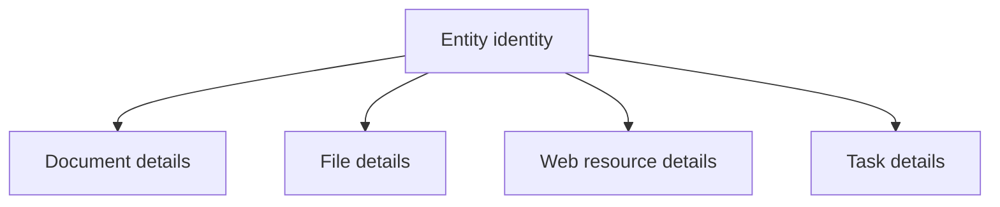

# Entity and relationship model — candidate architecture

**Status:** Recommendation under evaluation; no finalized schema

## Core hypothesis

A thin `Entity` layer could give diverse domain objects stable identities and shared relationship capabilities. Type-specific behavior and storage remain in concrete domain tables. This is **not** a proposal for a universal property bag or an inheritance-heavy TypeScript class hierarchy.

Candidate topology:

Those arrows mean typed specialization, not foreign keys chosen or class inheritance. `Task` is illustrative, not a committed feature or necessarily a Library-eligible resource.

## Proposed relational building blocks

| Candidate table | Role | Status |
| --- | --- | --- |
| `spaces` | Home plus direct-child working contexts; enforce single root | Agreed product structure; schema TBD |
| `libraries` | Exactly one Library per Space | Agreed direction; whether table is independently justified still to verify |
| `entities` | Shared IDs/kind/basic lifecycle data | Candidate |
| `documents`, `files`, `web_resources` | Concrete domain records, possibly sharing Entity IDs | Candidate |
| `library_items` | Explicit many-to-many Library ↔ eligible Entity membership | Recommended |
| `dashboards` | Space-owned dashboard identity, Overview designation | Recommended |
| `views` | Reusable configured data presentation | Candidate; see companion file |
| `dashboard_placements` | Join/dashboard layout references to views | Candidate |
| `pins`, `recent_activity` | User-scoped relations/events referencing eligible entities | Candidate, not required to be one generic table |

## Invariants and relationship semantics

1. **Identity ≠ placement ≠ ownership.** One document ID may have several Library memberships, one explicit owner, and many dashboard references.
2. **Membership removal is not deletion.** Removing a Library item only removes a contextual relationship, unless an intentional domain operation specifies otherwise.
3. **Shared data is canonical.** Two Library entries referencing one document ID show the same edits.
4. **Dashboards and their placements should never cascade-delete resources being displayed.** They may delete their own layout records.
5. **Deleting a Space is an application workflow**, with preflight inventory, transfer decisions, transactional consistency, and clear handling of external file objects. Naive cascading from `spaces` to shared content is unsafe.
6. **Home is the sole root.** The schema must prevent a second global Home and deeper nesting; whether this uses explicit `role`/`kind`, constrained `parent_id`, or another mechanism remains open.
7. **Type integrity matters.** A generic `entity_id` FK does not prove that the row has exactly one correct type-specific detail record. Consider controlled creation operations, constraints/triggers, or alternative schemas.

## Ownership and deletion: unresolved, do not conflate

- Does each document have a `owning_space_id`, or is the authority an account/workspace-level owner while Libraries only associate it with Spaces?
- If a shared document's owning Space is deleted, must the owner be reassigned even if it is still present in another Library?
- When removing the last Library membership, the user suggested content falls back into the parent/Home context. Does that mean **add it to Home Library**, **transfer ownership to Home**, or both? These are separate effects.
- Should deletion generally use `deleted_at` soft deletion first? A foreign-key `ON DELETE CASCADE` fires when the parent row is physically removed, not when `deleted_at` changes.
- Which links restrict hard deletion, and how do restore, trash, file retention, and audit events behave?

## Three implementation strategies worth comparing

| Strategy | Benefit | Cost / risk |
| --- | --- | --- |
| **Thin Entity + typed detail tables** | Stable cross-type IDs; consistent generic relationships | Requires integrity rules and explicit eligibility/capabilities |
| Independent typed tables + typed link targets | Strong per-type constraints; less base abstraction | Repeated relationship logic; cross-type pins/search/views harder |
| Universal attribute/property model | Maximum runtime extensibility | Loses straightforward relational guarantees and complicates validation, querying, migrations |

**Current recommendation:** evaluate the thin-Entity approach first, but prototype an actual mixed-type relationship and the exact deletion/transfer transaction before adoption. Keep `Entity` minimal; do not convert every join row, widget placement, or domain object into one by default.

## Files and provenance

Candidate metadata includes source URL, original filename, MIME type, byte size, checksum, storage object key, upload/download provenance, and acquired timestamp. Binary bytes should be managed separately from metadata. Remote download needs server-side URL safety (including SSRF protection), resource limits, malware/security scanning policy, access controls, and failure/retry rules. A URL bookmark and a downloaded snapshot may be related distinct records rather than forced into one overloaded shape.
