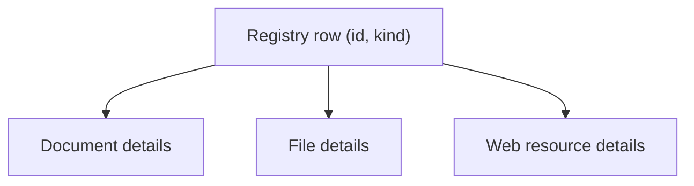

# Persistence and relationship options — candidate architecture

**Status:** Exploratory option study; no finalized schema and no recommended strategy

> **Owner clarification (2026-10-25):** The owner's intended `Entity` abstraction is for shared TypeScript/UI contracts and reusable operations, **not** a common database table. That concept is described in [05 — Shared UI contracts and capabilities](05-shared-ui-contracts-and-capabilities.md). **This file is about persistence only.** It asks how Libraries, pins, dashboards and views could be stored and related. A registry-table design that came up during discussion is kept in section 4 as a clearly labeled alternative. It is not the owner's proposal and not an interpretation of what the owner meant by `Entity`. The file keeps its original name (`entity-relationship-model`) so existing links work.

## 1. Scope

In scope: how persisted records for Spaces, Libraries, resources, dashboards, views and personal relations (pins, recents) could relate, and what must hold when something is shared, unlinked, moved or deleted.

Out of scope: UI contracts, capability interfaces, shells and action menus (see 05); terminology decisions (see 04, "Terminology status"). Sharing a TypeScript contract does not create a database relationship, and a database relationship does not require a shared contract. The two are decided separately.

## 2. Candidate relational building blocks

| Candidate table                       | Role                                                             | Status                                                                                     |
| ------------------------------------- | ---------------------------------------------------------------- | ------------------------------------------------------------------------------------------ |
| `spaces`                              | Home plus direct-child working contexts; enforce single root     | Agreed product structure; schema TBD                                                       |
| `libraries`                           | Exactly one Library per Space                                    | Agreed direction; whether a table is independently justified still to verify               |
| `documents`, `files`, `web_resources` | Concrete domain records, each with its own ID and lifecycle      | Candidate; only documents exist today                                                      |
| Library membership                    | Explicit many-to-many between a Library and an eligible resource | Recommended as a relationship; its table shape depends on the strategy chosen in section 3 |
| `dashboards`                          | Space-owned dashboard identity, Overview designation             | Recommended                                                                                |
| `views`                               | Reusable configured data presentation                            | Candidate; see [03](03-reusable-views-and-widgets.md)                                      |
| `dashboard_placements`                | Join/dashboard layout references to views                        | Candidate                                                                                  |
| Pins and recent activity              | User-scoped relations/events referencing eligible resources      | Candidate; need not be one generic table; shape depends on section 3                       |

## Invariants and relationship semantics

1. **Identity ≠ placement ≠ ownership.** One document ID may have several Library memberships, one explicit owner, and many dashboard references.
2. **Membership removal is not deletion.** Removing a Library item only removes a contextual relationship, unless an intentional domain operation specifies otherwise.
3. **Shared data is canonical.** Two Library entries referencing one document ID show the same edits.
4. **Dashboards and their placements should never cascade-delete resources being displayed.** They may delete their own layout records.
5. **Deleting a Space is an application workflow**, with preflight inventory, transfer decisions, transactional consistency, and clear handling of external file objects. Naive cascading from `spaces` to shared content is unsafe.
6. **Home is the sole root.** The schema must prevent a second global Home and deeper nesting; whether this uses explicit `role`/`kind`, constrained `parent_id`, or another mechanism remains open.
7. **Reference integrity.** Whichever strategy in section 3 is chosen must say how a membership or pin row proves that its target exists and is of the right kind. Per-kind tables get this from foreign keys. A typed (kind, id) pair or a registry table needs extra constraints, triggers, or controlled creation operations.

## Ownership and deletion: unresolved, do not conflate

- Does each document have a `owning_space_id`, or is the authority an account/workspace-level owner while Libraries only associate it with Spaces?
- If a shared document's owning Space is deleted, must the owner be reassigned even if it is still present in another Library?
- When removing the last Library membership, the user suggested content falls back into the parent/Home context. Does that mean **add it to Home Library**, **transfer ownership to Home**, or both? These are separate effects.
- Should deletion generally use `deleted_at` soft deletion first? A foreign-key `ON DELETE CASCADE` fires when the parent row is physically removed, not when `deleted_at` changes.
- Which links restrict hard deletion, and how do restore, trash, file retention, and audit events behave?

## 3. Strategies for relating mixed resource kinds

The question: how do Library membership, pins and recents point at documents, files and web resources, which are separate records of different kinds?

| Strategy                                                                                 | Benefit                                                                     | Cost / risk                                                                                                         |
| ---------------------------------------------------------------------------------------- | --------------------------------------------------------------------------- | ------------------------------------------------------------------------------------------------------------------- |
| **A. Per-kind relationship tables** (for example one membership table per resource kind) | Real foreign keys and strong per-type constraints; no shared-identity layer | Relationship logic repeated per kind and per relationship (membership, pins, recents); cross-type lists need unions |
| **B. Typed reference pair** (a `kind` plus an `id` in generic relationship tables)       | One table per relationship; simple to query across kinds                    | No foreign key to the target; integrity depends on constraints, triggers or cleanup; orphan rows are possible       |
| **C. Registry table** (alternative explored during discussion; see section 4)            | One identity namespace and one foreign-key target for cross-type relations  | Extra integrity rules and a second insert on every create; wider generality can invite over-building                |
| **D. Universal attribute/property model**                                                | Maximum runtime extensibility                                               | Loses straightforward relational guarantees and complicates validation, querying, migrations                        |

**No strategy is recommended yet.** The choice depends on which cross-type relationships actually need relational integrity (see 05, section 9), how many resource kinds exist when it is made, and the answers to the ownership and deletion questions above. Before choosing, prototype one real mixed-type relationship and the exact create, share, unlink, transfer, delete and restore transactions, including failure paths.

Existing accepted persistence for documents and dashboards is outside this packet's authority (see [ADR-0013](../../architecture/decisions/0013-document-and-dashboard-persistence.md)). Any difference between that design and the options here is flagged in 04 and not resolved here.

## 4. Alternative explored during discussion: a registry table

**Not the owner's proposal.** It is retained so the reasoning is not lost.

A thin registry table could give diverse resource records one identity namespace and one foreign-key target. Type-specific behavior and storage would remain in concrete tables. It would not be a universal property bag or an inheritance-heavy class hierarchy.

The arrows mean typed specialization, not class inheritance.

Considerations recorded during discussion:

- It is most useful once a Library holds more than one resource kind. It can likely be added later for existing kinds by creating one registry row per existing record with the same ID. Removing it later, once other tables reference it, would be harder.
- A generic registry foreign key does not prove that the row has exactly one correct type-specific detail record. That needs controlled creation operations, constraints or triggers.
- Today only one candidate kind exists (documents), so the shared columns would be a guess.
- Whether Spaces, dashboards, views and Libraries would be registry rows is the persistence-identity question in 04 (question 10b).

## Files and provenance

Candidate metadata includes source URL, original filename, MIME type, byte size, checksum, storage object key, upload/download provenance, and acquired timestamp. Binary bytes should be managed separately from metadata. Remote download needs server-side URL safety (including SSRF protection), resource limits, malware/security scanning policy, access controls, and failure/retry rules. A URL bookmark and a downloaded snapshot may be related distinct records rather than forced into one overloaded shape.
