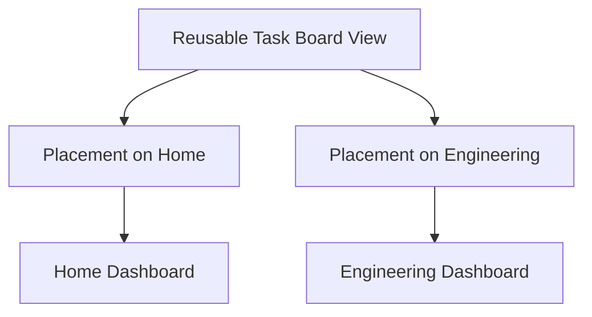

# Reusable views, widgets, and dashboard tabs

**Status:** Agreed product behavior with candidate modeling options

## Agreed behavior

- Dashboards belong to Spaces and appear as tabs in the Space context.
- Every Space has a default Overview dashboard; additional dashboards are user-created.
- Dashboard detail/show routes should remain viable independent entry points.
- Widgets can display information from their current Space, selected Spaces, or a global scope on **any** dashboard, not only Home.
- Users should be able to choose **linked reuse or an independent copy** when adding a widget/view to another dashboard.
- Referenced content remains canonical and is not deleted when a widget or placement is removed.

## Distinguish view, widget, and placement

Recommended vocabulary for discussion:

- **View:** Reusable configuration of a domain query/presentation (e.g. incomplete tasks grouped by status, chosen Spaces, sort order).
- **Widget:** UI component/renderer that presents a view, possibly with supported interactions.
- **Placement:** Instance of a view on one dashboard, holding dashboard-local layout (position, size, collapse state, maybe explicit presentation overrides).



## Linked versus independent behavior

| User choice      | Data/config identity                              | Editing behavior                     | Layout behavior                        |
| ---------------- | ------------------------------------------------- | ------------------------------------ | -------------------------------------- |
| Linked reuse     | Both placements point to one reusable view        | Shared configuration edits propagate | Each placement can have local geometry |
| Independent copy | A fresh view is created from source configuration | Later changes diverge                | Own placement/layout                   |

Changing an underlying task/document is distinct from changing the view's query configuration. Both linked and copied views may show the same canonical resources, even if the views themselves are independent.

## Candidate data scope contract

```ts
type DataScope =
  | { type: 'current-space' }
  | { type: 'selected-spaces'; spaceIds: string[] }
  | { type: 'all-spaces' }
  | { type: 'specific-items'; refs: ResourceRef[] };
```

`ResourceRef` is the typed application reference sketched in [05](05-shared-ui-contracts-and-capabilities.md), section 4. It is a working label, not evidence of a shared database foreign key.

This is an illustrative UI/application contract, **not an approved schema**. Its semantics must be specified: is `current-space` resolved at view creation, view placement, or query execution? A shared view placed in different Spaces could otherwise return unexpectedly different data. `all-spaces` must still enforce user access boundaries; data scopes are filters, not authorization.

## Architectural approaches

1. **Placement embeds all widget configuration.** Simplest for unique widgets; cannot truly link configuration across dashboards without another synchronization layer.
2. **Reusable view with separate dashboard placement (recommended candidate).** Clean linked/copy semantics, location-independent view ID, local geometry; adds versioning and override decisions.
3. **Widget definition directly shared by dashboards.** Fewer concepts; risks mixing global data settings with per-placement layout and interaction state.

## UI and operational edge cases

- Renaming/deleting a shared view: show where it is used, and prompt about placements.
- Copy action: copy configuration, not referenced resource data or automatically the original view's ownership.
- Editing shared configuration: make propagation visible; optionally offer "make independent" from a placement.
- Permission changes: hide/deny resources the viewer cannot access, regardless of view's stored filters.
- Dashboard removal: remove placements and dashboard-owned configuration safely; retain content and shared views used elsewhere.
- Widget type changes and incompatible renderer updates require migration/versioning strategy.
- Global task board, agenda, and schedule are future-facing use cases, not claims that task/calendar domains already exist.
