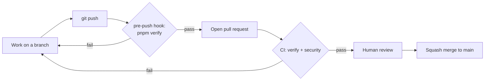

# Quality gates, branches, and pull requests

**Status:** Canonical engineering workflow; the toolchain it describes is defined by ADR-0001

This document states what counts as "done" mechanically, and which parts of that are enforced by a machine versus by convention. It adds no rule without a mechanism behind it. The verification standard itself is `docs/engineering/definition-of-done.md`.

## The gates

| Gate                | Runs                                                                                                             | Blocks                                             |
| ------------------- | ---------------------------------------------------------------------------------------------------------------- | -------------------------------------------------- |
| `pnpm verify`       | `format:check`, `lint`, `check-types`, `deps` (Knip), `brand:check`, `build`, chained in the root `package.json` | Local pushes via the pre-push hook (skippable)     |
| CI `verify` job     | Frozen install, then `pnpm verify` on Node from `.node-version` and pnpm from `packageManager`                   | Nothing automatically (see "What is not enforced") |
| CI `pr-hygiene` job | PR title is `type: short summary`, and no closing keyword sits near an issue reference                           | Nothing automatically                              |
| CI `security` job   | `pnpm audit --audit-level=moderate` and a full-history gitleaks scan                                             | Nothing automatically                              |
| Dependabot          | Weekly update pull requests for npm and GitHub Actions                                                           | Nothing; keeps versions current (`AGENTS.md` §7a)  |

**Audit exceptions.** The `security` job's `pnpm audit` passes only because `pnpm-workspace.yaml` pins patched transitive versions (`overrides`) and records one accepted exception for `braces`, which has no patched release (`auditConfig.ignoreGhsas`; ADR-0001). A new advisory fails the job.

**Secret-scan exceptions.** The `security` job's full-history gitleaks scan passes only because `.gitleaksignore` lists 9 accepted findings: fake passwords that the seeded fixture generator (`packages/dev/fixtures`, `faker.internet.password()`) wrote into the committed seed JSON, which the `generic-api-key` rule flags. Each entry is an exact finding fingerprint, so the rule stays active everywhere else. A fingerprint contains the commit hash, so it matches only the commit it was taken from: a squash merge, rebase or history rewrite that touches the seed creates a new commit and the entries stop matching (this happened when the fixtures package was squash-merged). After such a merge, or when the seed is regenerated, run `gitleaks detect --source . --redact --log-opts=main` on `main` and replace the entries. Scan with `--log-opts=main` to match CI; a plain `gitleaks detect` also scans leftover local branches and reports commits CI never sees. The seed no longer contains a `password` field, so these 9 entries cover history only and should not need to grow; if a field like that returns, fix the data, do not widen the ignore to a path. Adding any other entry needs the repository owner's approval and a recorded reason.

**Vercel deployments.** The free Hobby plan allows 100 deployments per day for the whole team, and each push can deploy every connected project, so the limit is easy to reach ("Deployment rate limited — retry in 24 hours"). A build that Vercel cancels still counts, so an ignored-build command does not help; what helps is not creating the deployment. Each app's `vercel.json` sets `git.deploymentEnabled`: `apps/docs` and `apps/storybook` deploy only `main`, and `apps/web` deploys every branch except `dependabot/**`. A push to a feature branch therefore costs one deployment, a dependency-bot push none, and a merge to `main` three. In branch patterns a single `*` does not match a name containing a slash (`feat/x`), so use `**`. To get a Storybook or docs preview for one PR, change its rule in that app's `vercel.json` in the same PR. These files apply only if the Vercel project's Root Directory is that app's folder.

## Branches and pull requests

- Work happens on a branch named `type/short-description` (for example `chore/phase-01-quality-gates`), never directly on `main`.
- Every change reaches `main` through a pull request, filled in from `.github/pull_request_template.md`: summary, decisions and approvals, exactly what ran and what did not, and what was deferred.
- Merges are **squash-only**. The PR title becomes the commit subject, so it must be a conventional-commit line, checked by the `pr-hygiene` CI job: `type: short summary`, where type is one of `chore`, `feat`, `fix`, `docs`, `refactor`, `test`.
- Merged branches are deleted automatically.
- Keep pull requests small and single-purpose (`docs/engineering/ai-development.md`).
- Never write a GitHub closing keyword (close, closes, closed, closing, fix, fixes, fixed, resolve, resolves, resolved) next to an issue reference in a PR title, description, or commit, even negated: GitHub ignores the negation and closes the issue on merge. Write `Related: owner/repo#N` only. Issues are closed by hand once every acceptance item is met.

## Commits

- Commit messages are a single subject line: `type: short summary`. No body and no trailers.
- Provenance of AI-assisted work is recorded in the pull request description and the approval record, not in commit trailers.

## Tests

`pnpm verify` and CI run Vitest (`pnpm test`, `pnpm test:coverage`), a Playwright smoke test of `apps/web` (`pnpm test:e2e`) and the Storybook story tests (`pnpm test:storybook`). The setup is Proposed in ADR-0005, not yet Accepted, and the testing strategy remains an open candidate decision (`docs/architecture/decisions/README.md`): coverage thresholds, the browser matrix and accessibility gating are undecided. Coverage of the code is thin, so a passing gate does not claim behavior is correct beyond what the tests exercise. Requirements for the test gate:

- Every required test surface is named explicitly by a root script and included in `pnpm verify`.
- The test gate must fail when discovery finds no tests, so required tests cannot silently disappear.
- A test's report names the invariant category it protects (`docs/engineering/definition-of-done.md`, item 3).

A pull request states plainly what the tests covered and what was verified manually or not at all.

## Accessibility

The only automated accessibility check is the axe run inside the Storybook story tests, and it covers only components that have stories. Semantics, keyboard behavior, focus visibility, contrast and reduced motion are otherwise reviewed manually. Reduced-motion and forced-colours handling is implemented once in `@synapcity/frontend-tailwind-config` (ADR-0002). Report accessibility as verified only for the stories axe ran against.

## What is not enforced

GitHub branch protection and required status checks are not available for this private repository on its current plan, so a failing CI run does not stop a merge. The pre-push hook is skippable and may be inactive if its activation failed at install, and CI can be bypassed by an administrator. The workflow above is a convention backed by checks, not a server-side guarantee. Revisit when there is a collaborator or a deployment pipeline.
