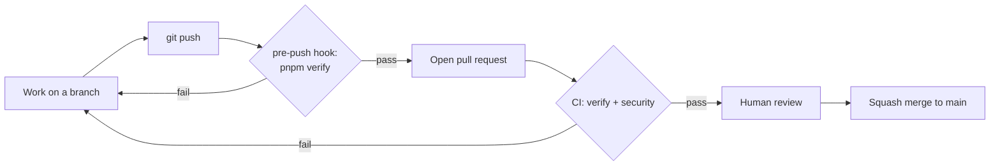

# Quality gates, branches, and pull requests

**Status:** Canonical engineering workflow, defined by ADR-0006

This document states what counts as "done" mechanically, and which parts of that are enforced by a machine versus by convention. It adds no rule without a mechanism behind it. The verification standard itself is `docs/engineering/definition-of-done.md`.

## The gates

| Gate                | Runs                                                                                                                                                                                                       | Blocks                                                            |
| ------------------- | ---------------------------------------------------------------------------------------------------------------------------------------------------------------------------------------------------------- | ----------------------------------------------------------------- |
| `pnpm verify`       | Every check chained in the root `package.json`, including unit/component tests, Storybook browser/accessibility tests, the web application smoke test, documentation consistency, and all workspace builds | Local pushes via the pre-push hook (skippable with `--no-verify`) |
| CI `verify` job     | Frozen install, `pnpm browsers:install --with-deps`, then the canonical `pnpm verify` on pinned Node and pnpm                                                                                              | Nothing automatically (see "What is not enforced")                |
| CI `pr-hygiene` job | PR title is `type: short summary`, and no closing keyword sits near an issue reference (ADR-0008)                                                                                                          | Nothing automatically                                             |
| CI `security` job   | `pnpm audit --audit-level=moderate` and a full-history gitleaks scan                                                                                                                                       | Nothing automatically                                             |
| Dependabot          | Weekly update pull requests for npm and GitHub Actions                                                                                                                                                     | Nothing; keeps versions current (`AGENTS.md` §7a)                 |

## Branches and pull requests

- Work happens on a branch named `type/short-description` (for example `chore/phase-01-quality-gates`), never directly on `main`.
- Every change reaches `main` through a pull request, filled in from `.github/pull_request_template.md`: summary, decisions and approvals, exactly what ran and what did not, and what was deferred.
- Merges are **squash-only**. The PR title becomes the commit subject, so it must be a conventional-commit line, checked by the `pr-hygiene` CI job: `type: short summary`, where type is one of `chore`, `feat`, `fix`, `docs`, `refactor`, `test`.
- Merged branches are deleted automatically.
- Keep pull requests small and single-purpose (`docs/engineering/ai-development.md`).
- Never write a GitHub closing keyword (close, closes, closed, closing, fix, fixes, fixed, resolve, resolves, resolved) next to an issue reference in a PR title, description, or commit, even negated: GitHub ignores the negation and closes the issue on merge. Write `Related: owner/repo#N` only. Issues are closed by hand once every acceptance item is met.

## Commits

- Commit messages are a single subject line: `type: short summary`. No body and no trailers.
- Provenance of AI-assisted work is recorded in the pull request description and the approval record, not in commit trailers.

## Tests

- Unit/component test files are named `*.test.ts` or `*.test.tsx`. Playwright application tests use `*.spec.ts`. Tests for a package live next to the code they protect; cross-cutting repository tests live in `tests/`.
- Every required test surface is named explicitly by a root script and included in `pnpm verify`. Adding a test-owning workspace also requires registering its environment/project or root test command; the workspace glob alone does not make its tests part of the gate.
- The test gate must fail when test discovery finds no tests, so required tests cannot silently disappear. Do not configure the test runner to pass on zero tests.
- A test's report names the invariant category it protects (`docs/engineering/definition-of-done.md`, item 3). Tests that check a rule only against fixtures are labeled self-consistent.
- Minimum expectation for any change: `pnpm verify` passes, and the pull request states what was and was not verified.

## Accessibility

Accessibility now has three complementary layers: axe inside component tests, `@storybook/addon-a11y` in the real-browser Storybook gate, and manual review for semantics, keyboard behavior, focus visibility, and reduced motion that automation cannot establish. Playwright also drives the minimum real application smoke path. ADR-0007's originally proposed JSX accessibility lint layer is deferred because the evaluated current plugin release does not support the repository's ESLint major; the evidence and compatibility constraint are recorded in `docs/engineering/plans/phase-02-dependency-evidence.md`. Do not install it with an invalid peer range or describe the deferred layer as active enforcement.

## What is not enforced

GitHub branch protection and required status checks are not available for this private repository on its current plan, so a failing CI run does not stop a merge. The pre-push hook is skippable and may be inactive if its activation failed at install, and CI can be bypassed by an administrator. The workflow above is a convention backed by checks, not a server-side guarantee. Revisit when there is a collaborator or a deployment pipeline.
