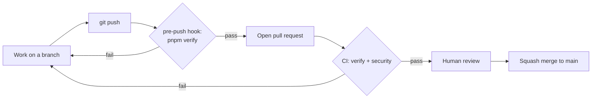

# Quality gates, branches, and pull requests

**Status:** Canonical engineering workflow; the toolchain it describes is defined by ADR-0001

This document states what counts as "done" mechanically, and which parts of that are enforced by a machine versus by convention. It adds no rule without a mechanism behind it. The verification standard itself is `docs/engineering/definition-of-done.md`.

## The gates

| Gate                | Runs                                                                                                                                                                                                                       | Blocks                                             |
| ------------------- | -------------------------------------------------------------------------------------------------------------------------------------------------------------------------------------------------------------------------- | -------------------------------------------------- |
| `pnpm verify`       | `format:check`, `lint`, `check-types`, `deps` (Knip), `boundaries`, `brand:check` (every brand output equals `@synapcity/frontend-brand`; `pnpm brand:sync` regenerates them), `build`, chained in the root `package.json` | Local pushes via the pre-push hook (skippable)     |
| CI `verify` job     | Frozen install, then `pnpm verify` on Node from `.node-version` and pnpm from `packageManager`                                                                                                                             | Nothing automatically (see "What is not enforced") |
| CI `pr-hygiene` job | PR title is `type: short summary`, and no closing keyword sits near an issue reference                                                                                                                                     | Nothing automatically                              |
| CI `security` job   | `pnpm audit --audit-level=moderate` and a full-history gitleaks scan                                                                                                                                                       | Nothing automatically                              |
| Dependabot          | Weekly update pull requests for npm and GitHub Actions                                                                                                                                                                     | Nothing; keeps versions current (`AGENTS.md` §7a)  |

**Audit exceptions.** The `security` job's `pnpm audit` passes only because `pnpm-workspace.yaml` pins patched transitive versions (`overrides`) and records one accepted exception for `braces`, which has no patched release (`auditConfig.ignoreGhsas`; ADR-0001). A new advisory fails the job.

**Secret-scan exceptions.** The `security` job's full-history gitleaks scan passes only because `.gitleaksignore` lists 9 accepted findings: fake passwords that the seeded fixture generator (`packages/dev/fixtures`, `faker.internet.password()`) wrote into the committed seed JSON, which the `generic-api-key` rule flags. Each entry is an exact finding fingerprint, so the rule stays active everywhere else. A fingerprint contains the commit hash, so it matches only the commit it was taken from: a squash merge, rebase or history rewrite that touches the seed creates a new commit and the entries stop matching (this happened when the fixtures package was squash-merged). After such a merge, or when the seed is regenerated, run `gitleaks detect --source . --redact --log-opts=main` on `main` and replace the entries. Scan with `--log-opts=main` to match CI; a plain `gitleaks detect` also scans leftover local branches and reports commits CI never sees. The seed no longer contains a `password` field, so these 9 entries cover history only and should not need to grow; if a field like that returns, fix the data, do not widen the ignore to a path. Adding any other entry needs the repository owner's approval and a recorded reason. `.gitleaksignore` is listed in `.prettierignore` so no formatter, including an editor's format-on-save with a Markdown mode, rewrites its comment block; that entry affects formatting only and gitleaks reads the file as before.

**Vercel deployments.** The free Hobby plan allows 100 deployments per day for the whole team, and each push can deploy every connected project, so the limit is easy to reach ("Deployment rate limited — retry in 24 hours"). A build that Vercel cancels still counts, so an ignored-build command does not help; what helps is not creating the deployment. Each app's `vercel.json` sets `git.deploymentEnabled`: `apps/docs` and `apps/storybook` deploy only `main`, and `apps/web` deploys every branch except `dependabot/**`. A push to a feature branch therefore costs one deployment, a dependency-bot push none, and a merge to `main` three. In branch patterns a single `*` does not match a name containing a slash (`feat/x`), so use `**`. To get a Storybook or docs preview for one PR, change its rule in that app's `vercel.json` in the same PR. These files apply only if the Vercel project's Root Directory is that app's folder.

## Branches and pull requests

- Work happens on a branch named `type/short-description` (for example `chore/phase-01-quality-gates`), never directly on `main`.
- Every change reaches `main` through a pull request, filled in from `.github/pull_request_template.md`: summary, decisions and approvals, exactly what ran and what did not, and what was deferred.
- Merges are **squash-only**. The PR title becomes the commit subject, so it must be a conventional-commit line, checked by the `pr-hygiene` CI job: `type: short summary`, where type is one of `chore`, `feat`, `fix`, `docs`, `refactor`, `test`.
- Merged branches are deleted automatically.
- Keep pull requests small and single-purpose (`docs/engineering/ai-development.md`).
- Never write a GitHub closing keyword (close, closes, closed, closing, fix, fixes, fixed, resolve, resolves, resolved) next to an issue reference in a PR title, description, or commit, even negated: GitHub ignores the negation and closes the issue on merge. Write `Related: owner/repo#N` only. Issues are closed by hand once every acceptance item is met.

## Commits

- Commit messages are a single subject line: `type: short summary`. No body and no trailers.
- Provenance of AI-assisted work is recorded in the pull request description and the approval record, not in commit trailers.

## Tests

`pnpm verify` and CI run Vitest (`pnpm test`, `pnpm test:coverage`), a Playwright smoke test of `apps/web` (`pnpm test:e2e`) and the Storybook story tests (`pnpm test:storybook`). The setup is Proposed in ADR-0005, not yet Accepted, and the testing strategy remains an open candidate decision (`docs/architecture/decisions/README.md`): coverage thresholds, the browser matrix and accessibility gating are undecided. Coverage of the code is thin, so a passing gate does not claim behavior is correct beyond what the tests exercise. Requirements for the test gate:

- Every required test surface is named explicitly by a root script and included in `pnpm verify`.
- The test gate must fail when discovery finds no tests, so required tests cannot silently disappear.
- A test's report names the invariant category it protects (`docs/engineering/definition-of-done.md`, item 3).

A pull request states plainly what the tests covered and what was verified manually or not at all.

`pnpm verify` must be started from the repository root. In `apps/web` the same command is that package's own script (`lint`, `check-types`, `build`) and passes without running any test; a report that says "verify passed" names the directory it ran in. A worktree has no `.env.local`, so the end-to-end server needs the CI placeholder values (`apps/web/README.md`, "A worktree has no `.env.local`"). End-to-end tasks are never cached; `test:coverage` is cached by input hash, so a changed test is a cache miss and runs.

Run `pnpm test:coverage` (and so `pnpm verify`) once at a time in a worktree. Every workspace writes its report to `coverage/report`, and Vitest locks that directory so that two runs cannot delete each other's reports. A second run in the same worktree (a second terminal or an agent session) fails with "The coverage report directory … is already in use by another Vitest process", in whichever package reaches it second. That is the lock working, not a defect in the package: wait for the other run to finish, then run again, or rerun only the failing package with `pnpm --filter <package> test:coverage`. Nothing in CI or the repository reads `coverage/report`, so a per-process report directory would only leave stale copies behind and would not match what Turborepo caches.

End-to-end runs are safe to start from several checkouts at once. Each `playwright test` run chooses a free port for every server it needs (web and docs), starts those servers itself from its own checkout, sets `SITE_URL` to the web origin it serves, prints `[e2e] web: http://localhost:<port>` for each, and stops them when it ends. It never reuses a server it did not start: if anything already listens on the chosen address the run fails before starting a server, locally and in CI ("already has a listener" at config load, or Playwright's "is already used" when the address answers HTTP; a listener that never answers is caught by a bounded TCP check because Playwright's own HTTP check has no timeout, `packages/dev/playwright-config/README.md`), and if its own server cannot bind or exits, the run fails and does not fall back to whatever holds the port. Reports and traces (`playwright-report/`, `test-results/`) and the build (`.next/`) live inside the checkout, so concurrent checkouts do not share them. Pin a port with `E2E_WEB_PORT` or `E2E_DOCS_PORT` to reproduce a run; a pinned port that is taken fails the same way. Limits: two runs in the same checkout still share that checkout's `.next/`, `test-results/` and `playwright-report/` (start the second from another worktree), a run killed with SIGKILL left no server behind in the one check made, but Playwright does not promise that, so look for a leftover with `lsof -nP -iTCP -sTCP:LISTEN` if a port seems busy (ports are per run, so a leftover never blocks the next run), and every checkout shares the one local Supabase stack, which only `pnpm test:e2e:local-session` uses. That run builds and starts its own server from its checkout on the stack's `site_url` (port 3000), proves it serves that build, and holds a machine-wide lock, so a second run fails at once instead of sharing the port; its users and mail are per-run, so data does not interfere (`apps/web/README.md`, "Signed-in checks against the local Supabase stack").

CI skips some end-to-end tests on purpose: whole groups whose precondition CI does not have, and one test that needs a saved account session. `pnpm test:e2e` reports them as skipped, not passed. No total is written here because it changes whenever a test is added to one of these groups; read it from the run summary (`N skipped`), and a group's size with `pnpm --filter web exec playwright test --list <file>`. Each skip is a `test.skip` condition in the spec itself, so `grep -rn "test.skip" apps/web/e2e` finds every site, and this list names each one:

- `global-panel.e2e.ts`, `resource-views.e2e.ts` (the record pages, and the breadcrumb trail across client navigation per ADR-0017) and `dashboard-edit.e2e.ts` (Slice 4: editing a dashboard, with the composition kept in the browser) are skipped as whole groups. They need the development fixture identity, which works only under `next dev` with `SYNAPCITY_DEV_AUTH=fixture` (`apps/web/README.md`); CI serves the production build, where fixture mode is off by design. Run them before merging a change to the signed-in shell: `E2E_WEB_MODE=dev SYNAPCITY_DEV_AUTH=fixture pnpm --filter web exec playwright test global-panel.e2e resource-views.e2e dashboard-edit.e2e`. Playwright matches a file filter against the whole path, so a bare name such as `global-panel` also selects every spec when the checkout's directory name contains it; the `.e2e` suffix names the file. Playwright starts and stops its own `next dev` for that run (no server needs to be running first, and none is reused).
- `local-session.e2e.ts` is skipped as a whole file. It needs the local Supabase stack and an app built against it: `pnpm test:e2e:local-session` in `apps/web` (`apps/web/README.md`). It signs in a temporary local user, checks the public, auth and workspace shells, and exchanges a real code through `/auth/callback`. Run it before merging a change to route groups, layouts or the auth callback.
- One test in `shared-look.e2e.ts` (account fonts over a stale cookie; the file's other tests run in CI) needs `apps/web/e2e/.auth/account.json`, the saved session of a real signed-in account. It is git-ignored and never created in CI; there is no test account or test Supabase project.
- `dashboard-persistence.e2e.ts` (its one test, Slice 4: the dashboard composition through the Server Actions and the database, including a stale second tab and a failed save) needs a saved session of a dedicated test account (`E2E_AUTH_STATE`, default `e2e/.auth/account.json`) and `E2E_DASHBOARD_PATH`, an empty dashboard that account owns. It ran for Slice 4 against a disposable local stack (Postgres, GoTrue and PostgREST on a private Docker network with the repository's migrations), not against the shared local Supabase or a hosted project.

Running these in CI needs either a dev-server job for the fixture group or a dedicated test account and project for the signed-in check. Both are open infrastructure decisions; until one is made, a change to those flows states whether the skipped tests were run.

## Accessibility

The only automated accessibility check is the axe run inside the Storybook story tests, and it covers only components that have stories. Semantics, keyboard behavior, focus visibility, contrast and reduced motion are otherwise reviewed manually. Reduced-motion and forced-colours handling is implemented once in `@synapcity/frontend-tailwind-config` (ADR-0002). Report accessibility as verified only for the stories axe ran against.

## What is not enforced

GitHub branch protection and required status checks are not available for this private repository on its current plan, so a failing CI run does not stop a merge. The pre-push hook is skippable and may be inactive if its activation failed at install, and CI can be bypassed by an administrator. The workflow above is a convention backed by checks, not a server-side guarantee. Revisit when there is a collaborator or a deployment pipeline.
