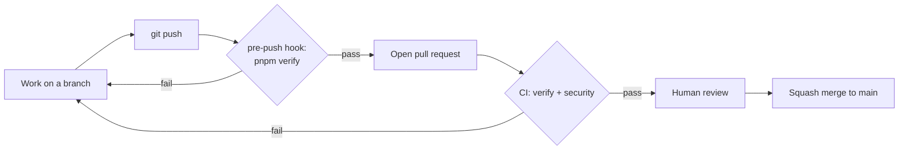

# Quality gates, branches, and pull requests

**Status:** Canonical engineering workflow; the toolchain it describes is defined by ADR-0001

This document states what counts as "done" mechanically, and which parts of that are enforced by a machine versus by convention. It adds no rule without a mechanism behind it. The verification standard itself is `docs/engineering/definition-of-done.md`.

## The gates

| Gate                | Runs                                                                                              | Blocks                                             |
| ------------------- | ------------------------------------------------------------------------------------------------- | -------------------------------------------------- |
| `pnpm verify`       | `format:check`, `lint`, `check-types`, `deps` (Knip), `build`, chained in the root `package.json` | Local pushes via the pre-push hook (skippable)     |
| CI `verify` job     | Frozen install, then `pnpm verify` on Node from `.node-version` and pnpm from `packageManager`    | Nothing automatically (see "What is not enforced") |
| CI `pr-hygiene` job | PR title is `type: short summary`, and no closing keyword sits near an issue reference            | Nothing automatically                              |
| CI `security` job   | `pnpm audit --audit-level=moderate` and a full-history gitleaks scan                              | Nothing automatically                              |
| Dependabot          | Weekly update pull requests for npm and GitHub Actions                                            | Nothing; keeps versions current (`AGENTS.md` §7a)  |

**Audit exceptions.** The `security` job's `pnpm audit` passes only because `pnpm-workspace.yaml` pins patched transitive versions (`overrides`) and records one accepted exception for `braces`, which has no patched release (`auditConfig.ignoreGhsas`; ADR-0001). A new advisory fails the job.

## Branches and pull requests

- Work happens on a branch named `type/short-description` (for example `chore/phase-01-quality-gates`), never directly on `main`.
- Every change reaches `main` through a pull request, filled in from `.github/pull_request_template.md`: summary, decisions and approvals, exactly what ran and what did not, and what was deferred.
- Merges are **squash-only**. The PR title becomes the commit subject, so it must be a conventional-commit line, checked by the `pr-hygiene` CI job: `type: short summary`, where type is one of `chore`, `feat`, `fix`, `docs`, `refactor`, `test`.
- Merged branches are deleted automatically.
- Keep pull requests small and single-purpose (`docs/engineering/ai-development.md`).
- Never write a GitHub closing keyword (close, closes, closed, closing, fix, fixes, fixed, resolve, resolves, resolved) next to an issue reference in a PR title, description, or commit, even negated: GitHub ignores the negation and closes the issue on merge. Write `Related: owner/repo#N` only. Issues are closed by hand once every acceptance item is met.

## Commits

- Commit messages are a single subject line: `type: short summary`. No body and no trailers.
- Provenance of AI-assisted work is recorded in the pull request description and the approval record, not in commit trailers.

## Tests

No test runner is configured, so there is no test gate, and none of the gates above claims behavior is correct. Whether to add one, and which, is an open candidate decision (`docs/architecture/decisions/README.md`). When one exists:

- Every required test surface is named explicitly by a root script and included in `pnpm verify`.
- The test gate must fail when discovery finds no tests, so required tests cannot silently disappear.
- A test's report names the invariant category it protects (`docs/engineering/definition-of-done.md`, item 3).

Until then, a pull request states plainly that behavior was verified manually or not at all, and what that covered.

## Accessibility

There is no automated accessibility check today. Semantics, keyboard behavior, focus visibility, contrast and reduced motion are reviewed manually. Reduced-motion and forced-colours handling is implemented once in `@synapcity/frontend-tailwind-config` (ADR-0002). Report accessibility as not automatically verified.

## What is not enforced

GitHub branch protection and required status checks are not available for this private repository on its current plan, so a failing CI run does not stop a merge. The pre-push hook is skippable and may be inactive if its activation failed at install, and CI can be bypassed by an administrator. The workflow above is a convention backed by checks, not a server-side guarantee. Revisit when there is a collaborator or a deployment pipeline.
