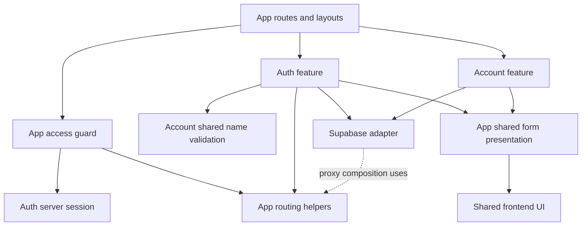

# Auth organization refactor: proposed specification

**Status:** Draft requirements; linked ADRs are Proposed; not approved for implementation.  
**Date:** 2026-10-13.  
**Source snapshot:** Live working tree on `fix/auth-ui`, including concurrent uncommitted changes. Re-inventory before execution.  
**Companion plan:** [Auth refactor plan](../plans/2026-10-13-auth-refactor.md).

## 1. Problem and intended result

Auth functionality is distributed across route-owned actions, `components/auth`, `lib/auth`, and `lib/supabase`. Forms import both operations and form-state types from route files. Application route policy lives under the provider adapter. Profile editing is grouped with authentication, and shared auth buttons embed application destinations.

The required result is cohesive authentication, distinct account-profile responsibility, explicit application policy and provider/platform integration, with clear client/server boundaries. App-local modules, one auth package and a feature/service split are all candidates. Choose physical placement after comparing their contracts, coupling, tests and maintenance cost. A developer should be able to locate a sign-in flow and its operation without searching unrelated route files.

This is an implementation-organization proposal that permits packages and further capability splitting. It adds no product feature/terminology or route URL. A module and a workspace package are different boundary tools; the selection is open until ARF-00 produces a reviewed recommendation.

## 2. Authority and decisions requested

- [ADR-0006](../../architecture/decisions/0006-authentication-with-supabase.md) remains governing: Supabase Auth, cookie sessions, configured redirect origin. Its initial app-local placement is not a restriction on auth packages.
- [Architecture principles](../../architecture/principles.md), section 6, asks for responsibility boundaries before package boundaries.
- [Workspace conventions](../../architecture/workspace-conventions.md) keeps application-runtime concerns in the app and shared presentation independent of app routing/request APIs.
- The earlier [auth-UI spec](2026-10-13-auth-ui-design.md) is a Draft for a different scope. It is historical context for this proposal, not approval or an execution manifest.

The decision records own these proposed architecture choices: [ADR-0007](../../architecture/decisions/0007-app-local-auth-and-account-ownership.md) (responsibility boundaries and package evaluation), [ADR-0008](../../architecture/decisions/0008-auth-actions-and-server-operations.md) (actions/operations), and [ADR-0009](../../architecture/decisions/0009-caller-owned-auth-navigation.md) (caller-owned destinations). This spec derives its architecture from those proposals and owns observable requirements/invariants only. The owner approved correcting the restrictive documents. ARF-00 evaluates topology; selection of a concrete layout and any category/runtime amendments still require explicit approval before source migration.

No architectural or persisted identifier is renamed by this document. `account` and `auth` below are proposed internal technical organization names, not adopted product vocabulary.

## 3. Responsibility boundaries and candidate ownership

The path labels below describe the app-local candidate, not mandatory destinations. A package layout must assign the same responsibilities and define its dependency/runtime contracts; consult ADR-0007 for the full candidate comparison. Common form presentation and account separation can also be modules or packages according to the selected scope.

| Owner                | Responsibility                                                                                                                          | Excludes                                                                       |
| -------------------- | --------------------------------------------------------------------------------------------------------------------------------------- | ------------------------------------------------------------------------------ |
| `features/auth`      | Sign-in/up, OAuth, recovery, password changes, sign-out; verified session access; display-user mapping and browser refresh coordination | Product-resource permissions, account profile writes, application route policy |
| `features/account`   | Existing display-name edit and its validation/metadata update                                                                           | New profile storage, credentials, roles, account deletion                      |
| `lib/supabase`       | Environment validation, browser/server client creation, proxy cookie integration                                                        | Form state, route classification, presentation                                 |
| `lib/routing`        | Existing user destinations, safe-next handling, guest/protected route classification                                                    | Identity verification or new routing architecture                              |
| `lib/access`         | Existing user-area owner guard, composed from verified auth identity and app destinations                                               | New permission framework, roles, teams, sharing                                |
| `components/forms`   | Existing field/message presentation and error-focus behavior usable by auth and account                                                 | Auth actions, provider calls, feature-specific state types                     |
| Shared `frontend-ui` | Existing reusable button, password-input, menu and avatar presentation                                                                  | Supabase, app imports, app-chosen auth destinations                            |
| `app` and `proxy.ts` | Framework entry points, metadata, request/response handling and application composition                                                 | Ownership of reusable form contracts or feature implementation                 |

## 4. App-local candidate structure and responsibility dependencies

```text
apps/web/src/
  app/                         Existing URLs, layouts and callback route
  proxy.ts                     Existing session-refresh entry point
  features/
    auth/
      components/              Auth screens/forms and status presentation
      client/                  UserProvider, auth events and confirmation edit
      server/                  Actions, session access, origin and operations
      shared/                  Display-user types, form contracts, error mapping
    account/
      components/              Existing profile form
      server/                  Profile action and metadata helper
      shared/                  Name validation and profile form contract
  components/forms/            Existing field and message presentation
  lib/
    access/                    User-area owner guard
    routing/                   Route policy and destination helpers
    supabase/                  Existing environment/client/proxy adapter
```



- Auth registration may use account's pure name validator. Account code must not import auth forms, auth actions, or auth form-state types; extracting common field/message presentation avoids that dependency.
- Shared modules contain safe types and pure helpers. They do not import clients, environment readers, framework request APIs, or token-bearing session objects.
- Client code imports safe shared types and explicit Server Action entry points, never server session/operation modules. Browser Supabase access stays in the existing browser adapter.
- Server Actions remain distinct from ordinary server operation functions: importing an action into a client form does not grant client access to arbitrary server code.
- Use explicit file imports or narrow entry points. Do not add a barrel that re-exports server, client and shared code together.
- Server isolation must be checked against the installed framework/tooling before implementation. Any dependency or enforcement tool needed by the selected layout must be evaluated and explicitly included in its approved scope; none is adopted by this documentation correction.

## 5. Action and operation boundary

Retain existing action behavior and place reusable contracts with the capability that owns them. `features/auth/server/actions.ts`, `features/auth/shared/form-state.ts` and account's shared contract are app-local candidate destinations. Selected packages may expose narrow action/shared entry points or receive app-owned framework adapters. Form-state contracts do not belong to a route merely because it first consumed them.

The Server Action owns form extraction, validation at the action boundary, safe field-error presentation, layout revalidation and redirects. Pure validation may use existing helpers. Each authenticated mutation must verify its caller; route/layout checks are not a substitute.

Proposed ADR-0008 separates registration/recovery operation responsibilities regardless of location. `features/auth/server/operations.ts` is the app-local candidate; an auth/service package is also eligible. ARF-00 specifies how request-bound clients/context reach operations, including an adapter-supplied capability where a package cannot construct them. Actions construct trusted callback destinations with current flow discriminators. Operations manage provider options and reduce outcomes, while app policy owns destinations. Further splitting/interfaces are allowed when justified by a concrete boundary; no cross-user client singleton is permitted.

Operation outcomes contain only data needed by the action, such as confirmation-required or a normalized failure. They do not carry form focus state, labels, Next.js redirects/revalidation, raw tokens, passwords or the entire SDK response into client-visible results. Preserve security-relevant error distinctions until the action maps them to safe messages.

Do not force every action through a forwarding wrapper. A direct, simple sign-out call can remain in its action. The callback Route Handler and proxy remain framework entry points; provider/platform helper ownership or adapter contracts may change with the selected layout while preserving behavior.

## 6. Session, authorization and profile invariants

The following current behavior must survive the refactor:

1. Server identity checks use verified claims, or fresh user retrieval where the existing operation needs it. Display metadata and `UserProvider` never authorize a mutation or resource access.
2. The request-scoped session reader continues to share verification across server consumers. No cross-user cache or globally stored server client is introduced.
3. `UserProvider` receives the server's minimal `CurrentUser` view; existing auth-event filtering, subscription cleanup and refresh behavior remain intact. It does not become a second session store.
4. User IDs in URLs remain untrusted. The existing owner check stays at the appropriate page/action boundaries as well as the layout. A stranger's user-area URL retains the current response behavior.
5. Proxy refresh cookies and relevant response headers survive response replacement. Browser/server cookie behavior, PKCE exchange and caching restrictions are preserved.
6. Confirmation/reset/OAuth destinations still use configured `SITE_URL`; existing safe-next and user-path encoding behavior remains intact. Preserve the current `oauth`/`confirm`/`reset` callback flow tags, reason-specific error destinations and unknown-flow fallback.
7. Registration/reset/resend messages retain their current account-discovery protection and existing rate-limit distinctions. Passwords and session secrets never appear in returned form state or logs.
8. Name edits retain existing metadata fields, caller verification, session-refresh behavior and honest partial-success feedback.
9. Current accessible field-error associations, pending/disabled controls, password reveal behavior, confirmation focus movement, confirmation editing and resubmission, reset-link resending and existing cooldown behavior, first-invalid/empty-field and message fallback focus after errors, theme styling, and `next` propagation remain unchanged.

The current display/profile-edit path uses auth metadata. ADR-0006 also records an approved `profiles` table. This organizational refactor neither switches to that table nor selects a new profile system of record. A future storage decision must address the two sources explicitly.

## 7. Shared auth buttons

Proposed ADR-0009 specifies that the `AuthButtons` API adds required `signInHref` and `signUpHref` string props; `variant` and layout styling behavior stay unchanged. `apps/web` supplies the existing destinations. Stories/tests supply example destinations and verify they are rendered.

This is a proposed shared-component API change and must be approved explicitly. It adds no new route, navigation behavior, or provider integration to the UI package.

## 8. Scope limits and package selection criteria

Auth packages, feature/service splitting and separate account ownership are permitted candidates in this refactor. The current documentation correction does not itself create them or select their count/location. ARF-00 must evaluate cohesion, enforceable imports, independent testing, runtime coupling, public contracts and maintenance cost. A single real consumer can justify a package; another app is not required.

Existing workspace conventions constrain current categories and server/framework code placement. The comparison must identify exact canonical amendments a candidate needs and submit them for review; it must neither reject packages merely because the conventions need revision nor silently change those conventions.

Unchanged behavioral scope: no provider/method, password policy, token persistence, state store, route URL, schema, profile-storage, roles/sharing, MFA, deletion or deployment change. Preserve existing confirmation/reset resend and edit behavior. Dependency upgrades are separately scoped; any new package dependencies/exports/configuration require approval as part of a concrete implementation manifest.

A service boundary may be useful with one consumer when it isolates provider effects, enforces a safe operation API or enables meaningful independent tests. Splitting more finely is an option to assess, not a requirement or prohibition.

## 9. Acceptance criteria and verification

- Route files no longer own reusable auth/profile actions or form-state contracts; consuming forms import the feature's explicit action/shared modules.
- No remaining consumers of the superseded source paths; account code has no dependency on auth presentation/state contracts.
- Route classification and destination construction are app-owned; shared `AuthButtons` receives its destinations.
- Existing pure-helper tests move with their behavior. Split profile-mapping/metadata-preservation tests by owner without dropping assertions.
- Meaningful operation tests cover confirmation-required, safe failure mapping, and the recovery redirect options. Mock provider calls where needed, but assert inputs/outcomes rather than only that a mock ran.
- Automated navigation/form tests cover the preserved observable behavior they can actually exercise. Real email and OAuth flows require separate live verification and cannot be inferred from browser mocks.
- Run the actual root verification chain after implementation. Report each stage, pre-existing failures, and unverified behavior; a green gate does not establish complete auth coverage.

Declared versions inspected: Next.js 16.3.8, React 19.2.8, `@supabase/ssr` 0.12.7, `@supabase/supabase-js` 2.117.3, Vitest 4.1.11. No version change is proposed. Re-read installed docs and current first-party guidance before implementation introduces version-sensitive APIs.

First-party evidence checked on 2026-10-13: [Next.js data security](https://nextjs.org/docs/app/guides/data-security) describes server-only data access, minimal returned data and action-level authorization; [Supabase SSR client setup](https://supabase.com/docs/guides/auth/server-side/creating-a-client?queryGroups=framework&framework=nextjs) distinguishes browser/server clients and proxy cookie refresh. These sources inform the proposal and do not override accepted Synapcity decisions.

## 10. Approval and execution readiness

All implementation criteria above are proposed and unverified. The parent plan owns the candidate migration inventory and task order; the three child plans own tasks ARF-00 through ARF-11 and their checkboxes, while parent task ARF-12 owns final verification. ARF-00 is the new first task. All execution checkboxes remain unchecked; existing overlapping source work must be assessed against the live baseline rather than inferred from a task label. These plans are the only proposed execution task surface; no external tracker is created. Before source execution: select topology, approve the corresponding ownership/API choices and canonical amendments, capture the latest WIP baseline, and approve a fresh exact mutation manifest with numeric budgets and a recovery path. Draft authoring does not approve any source-code move, deletion or package creation.
