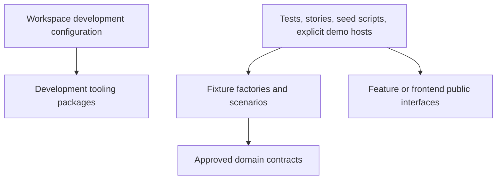
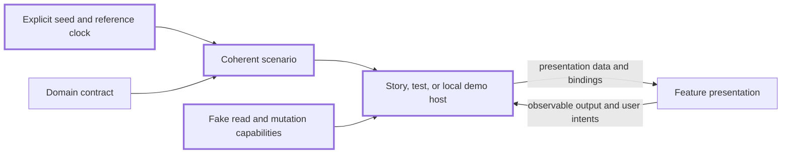

# Dev Packages

The accepted decision is [ADR-0014](../../docs/architecture/decisions/0014-multi-app-package-boundaries.md). Its runtime dependency matrix is normative; the [ownership map](../../docs/architecture/reorganization-ownership-map.md) assigns existing source to target owners. These READMEs explain category boundaries without creating leaf packages.

## Purpose

Owns: shared development/build tooling, test infrastructure, synthetic fixtures, sample content, and deterministic scenarios for tests, Storybook, seeds, and explicit local demos.

**Status:** Current direction, selected by the repository owner on 2026-10-23.
**Scope:** Target development boundaries, including extension of the existing fixtures package. No package, seed, generator, configuration, or fixture implementation is changed by this README.

## Decision context

The owner selected the five package categories and the direction to extend `dev/fixtures` during the architecture-reorganization discussion on 2026-10-23. These sibling READMEs record that shared source of direction.

Development packages provide tools and evidence. Fake data, a passing test, or a convincing story do not create product semantics, authorize a mutation, or establish production behavior.

## Existing packages

| Package                                          | Current responsibility                          |
| ------------------------------------------------ | ----------------------------------------------- |
| [eslint-config](eslint-config/README.md)         | Shared lint configuration                       |
| [typescript-config](typescript-config/README.md) | Shared TypeScript configuration                 |
| [vitest-config](vitest-config/README.md)         | Shared unit/component test configuration        |
| [playwright-config](playwright-config/README.md) | Shared end-to-end browser configuration         |
| [fixtures](fixtures/README.md)                   | Seeded fake data and checked-in seed generation |

A development package is consumed through tooling configuration, development dependencies, or dedicated test/story/seed entry points. Those build-time uses are legitimate. Production application logic and shipped feature entry points do not import fixture generators or test infrastructure.

## Fixture responsibilities

Extend the existing fixture package around three related responsibilities:

1. **Factories:** produce one valid record with explicit overrides, using the owning product contract.
2. **Scenarios:** assemble coherent records and relationships for cases such as a new account, a populated workspace, many pinned items, or long content.
3. **Sample content:** example titles, descriptions, document bodies, and other realistic content used by factories/scenarios.

Keep isolated seeded generators, explicit reference clocks, and reproducible output. Generate identities per factory invocation and keep relationships internally consistent. Edge-case factories may intentionally produce invalid input, but label that intent rather than weakening a production schema.

These are target requirements. The fixture implementation has not yet been brought into conformance by this documentation change.

## Data and copy ownership

| Material                                                                   | Intended owner                                            |
| -------------------------------------------------------------------------- | --------------------------------------------------------- |
| Synthetic users, Spaces, Documents, and Dashboards                         | Development fixtures, typed against the product contracts |
| Sample titles, descriptions, document bodies, and scenario narratives      | Development fixtures                                      |
| Invalid-input examples, failure simulations, and fake capability outcomes  | Test/story fixtures and adapters                          |
| Shipped product labels, validation messages, empty states, and action text | Owning feature's production copy module                   |
| Generic component labels                                                   | Owning frontend component                                 |
| Actual user records and effects                                            | Production server/data capability                         |
| Canonical schemas and semantic types                                       | Domain owner                                              |

Fixture schemas must not become a second product model. Keep platform-neutral record factories separate from rendering examples that require React, DOM, or icon components. A scenario name does not create a product taxonomy, lifecycle state, or persisted identifier.

## Dependency boundaries

Arrows mean source or configuration dependencies, not production runtime traffic.

Use a deliberate dependency graph. A fixture package that depends on a domain package must not become a reverse dependency of that domain package's own tests; use local cases or independent test utilities there. Shared configuration packages should not import application or product-feature implementations.

An explicit demo host can supply generated data and fake commands to a feature. The production feature must remain independent of `dev/fixtures`. Merely putting a runtime import in `devDependencies` does not prevent it from being bundled.

## Example scenario interaction

Heavy borders identify development-only components. The production feature receives ordinary inputs and an explicit capability contract.

A fake capability can simulate success, rejection, latency, or failure without a real provider. User-visible demo behavior must be identifiable as demo behavior. Production hosts bind real capabilities; a fixture success is never evidence that a record was saved.

## Current implementation and migration inputs

The [fixtures README](fixtures/README.md) now records that [the implementation](fixtures/src/index.ts) includes generic primitives and workspace/document/dashboard sample shapes. It also has rendering-specific values and shared default record identity that need review before expansion. This README records the intended boundary, not a claim that those issues are fixed.

Several [web features](../../apps/web/src/features) still contain local fixtures. Move those only in scoped migrations that align them with their contract owner, preserve useful scenario coverage, and keep production composition separate.

Shared fixtures are useful where scenarios repeat or relationships need consistency. A one-off test may keep a small explicit input beside the test, especially when sharing would create a dependency cycle or obscure the invariant being tested.

## Verification and documentation reconciliation

Check reproducibility, fresh per-record identity, cross-record references, approved contract conformance, malformed-input cases, and isolation from real providers. Test expected behavior against an independent invariant; reusing a fixture factory as both implementation and expected result does not establish correctness.

The [package checklist](../../docs/architecture/package-creation-checklist.md), fixtures README, and [ADR-0014](../../docs/architecture/decisions/0014-multi-app-package-boundaries.md) now distinguish tooling, tests, seeds, explicit demo hosts, and production dependencies. No test result, seed generation, production-bundle audit, or package migration is claimed by this document.

Related umbrellas: [domain](../domain/README.md), [frontend](../frontend/README.md), [server](../server/README.md), [features](../features/README.md).
