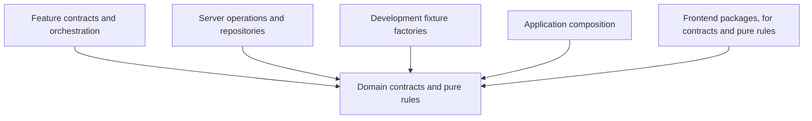
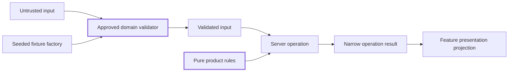

# Domain Packages

The accepted decision is [ADR-0014](../../docs/architecture/decisions/0014-multi-app-package-boundaries.md). Its runtime dependency matrix is normative; the [ownership map](../../docs/architecture/reorganization-ownership-map.md) assigns existing source to target owners. These READMEs explain category boundaries without creating leaf packages.

Owns: portable product contracts, validation, transformations, and semantic rules shared by application, frontend, and server implementations.

**Status:** Current direction, selected by the repository owner on 2026-10-23.
**Scope:** Target responsibility boundaries for the reorganization. No domain package or public export is created by this README.

## Decision context

The owner selected the five umbrellas and requested these boundary READMEs during the architecture-reorganization discussion on 2026-10-23. The sibling READMEs share that decision origin; their agreement is not independent corroboration. Planned desktop and mobile consumers, independent testing, and clearer ownership justify establishing boundaries early.

These boundaries organize existing and approved capabilities. They do not choose new product vocabulary, schemas, persistence behavior, relationship semantics, or the first product slice. Check the [product foundation](../../PRODUCT.md), [glossary](../../docs/glossary.md), and [architecture principles](../../docs/architecture/principles.md) for those constraints.

## Responsibilities

- Canonical TypeScript contracts and runtime validation for approved product concepts.
- Pure transformations and product rules, including preference reconciliation where it needs no platform access.
- Input and result contracts that genuinely belong to a product capability.
- Interfaces for external capabilities when the domain needs them, with concrete implementations supplied elsewhere.
- Explicit distinctions among canonical records, presentation projections, and create/update inputs.

A schema has one owner. Frontend components, server adapters, feature composition, and fixtures consume that contract rather than maintaining divergent definitions. A feature-specific screen model can remain in its feature; a UI-only props type can remain with its component.

## Outside this umbrella

React components and hooks, Next.js APIs, DOM effects, browser storage, cookies, SDK clients, network calls, database row mapping, secrets, and concrete repositories belong to other owners. Database constraints and RLS still enforce their own durable security invariants; sharing a validator does not replace them.

A capability's meaning is independent of where it renders. Route containment does not establish ownership. Record kinds extend one base contract for their shared attributes (owner decision, 2026-10-23) and keep their own semantics. Do not create an identical package for every product noun merely to complete a diagram.

## Dependency boundaries

Arrows below mean source dependencies from consumer to dependency, not runtime network requests.

Domain production modules may depend on other portable domain modules through explicit, acyclic public interfaces and on approved platform-independent libraries. They do not import applications, frontend, server, features, or development fixtures.

Type-only imports must respect ownership too; erasing an import at runtime does not make an inverted dependency desirable. If fixture factories depend on a domain package, that domain package's own tests should use local cases or independent test utilities rather than introduce a reverse dependency on those factories.

## Example interaction

This styled diagram shows one contract used by several consumers. Heavy borders identify the owning module; styling inherits the renderer's theme.

Validation establishes the shape and applicable semantic rules. The server independently verifies identity and authorization before effects. A fixture passing validation proves that it matches the contract, not that it is persisted or authorized.

## Examples and current implementation

Candidate responsibilities include the existing Space saved-record contract, document/dashboard contracts, and portable preference rules. Names here describe the current code and do not finalize provisional product terminology.

The base record contract lives in [`domain-records`](records/README.md) (M5.1). The Space contract, created there in M5.1, lives in [`domain-spaces`](spaces/README.md) since 2026-10-24 (owner decision). The [document/dashboard query helper](../../apps/web/src/lib/owned-records/owned-records.ts) still combines persistence implementation with its schema, which is now the base contract; the queries move to server data in M8. Extracting a contract must preserve its existing shape unless a separately approved change alters it.

### Example Packages

- `records` ----> Base record contract that every record kind extends. Exists since M5.1 ([README](records/README.md))
- `spaces` ----> Space create, update and saved contracts. Moved out of `records` on 2026-10-24 ([README](spaces/README.md))
- `preferences` ----> Preference data, rules, scope and consent policy. Exists since M6.1 ([README](preferences/README.md))
- `identity` ----> Credential, profile and verified-identity contracts. Exists since M4 with the verified-identity result ([README](identity/README.md))

The full list is the [package inventory](../../docs/architecture/workspace-conventions.md#package-inventory).

## Package design and verification

Group cohesive contracts and rules by capability. A new helper, type, or schema does not automatically need a package. ADR-0014 settles the responsibility families; exact leaf packages, names, and exports are Milestone 3 work, and migration scope is set per extraction.

For each extraction, check pure behavior, schema compatibility, and consumers in features, server code, and fixtures. Runtime validation and TypeScript checks cover different failures. Boundary enforcement is intended work, not implemented by this document.

## Documentation reconciliation

Placement guidance is reconciled by [ADR-0014](../../docs/architecture/decisions/0014-multi-app-package-boundaries.md), the amended earlier ADRs, workspace conventions, and the package checklist. Existing behavior/security decisions remain in force. The ownership map records the selected destinations; exact leaf-package manifests, export signatures, and enforcement implementation follow in Milestone 3. Source extraction, native presentation, and automated transitive enforcement are not complete.

Related umbrellas: [frontend](../frontend/README.md), [server](../server/README.md), [features](../features/README.md), [dev](../dev/README.md).
