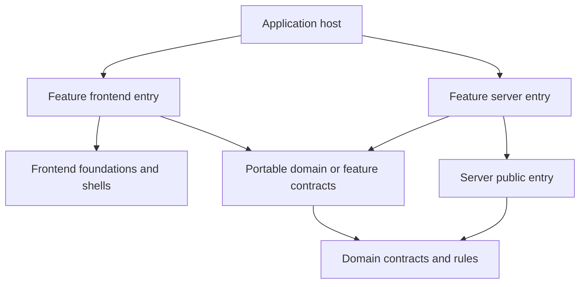
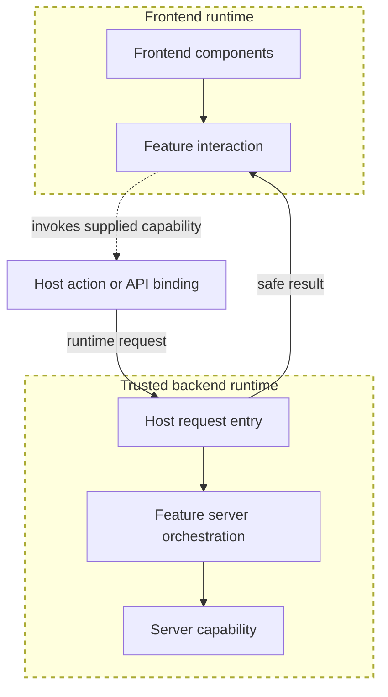

# Features Packages

The accepted decision is [ADR-0014](../../docs/architecture/decisions/0014-multi-app-package-boundaries.md). Its runtime dependency matrix is normative; the [ownership map](../../docs/architecture/reorganization-ownership-map.md) assigns existing source to target owners. These READMEs explain category boundaries without creating leaf packages.

Owns: product capabilities that compose domain rules, frontend presentation, data access, and behavior into reusable workflows and experiences.

**Status:** Current direction, selected by the repository owner on 2026-10-23.
**Scope:** Target feature-composition responsibilities and runtime boundaries. No feature package, public export, route, or implementation move is created by this README.

## Decision context

The owner selected features as the product-composition category during the architecture-reorganization discussion on 2026-10-23 and requested these boundary READMEs. All sibling documents record that shared decision.

A planned consumer, independence from an app, and clearer ownership can justify a package before a second app implements the capability. Web, docs, and Storybook are present application hosts; desktop and mobile are planned hosts. Each host consumes the capabilities relevant to its role. Each feature must state which of its contracts, behavior, React bindings, and presentation are actually portable.

## Responsibilities

- Product-specific screens, components, controllers, hooks, and interaction state.
- Workflow composition, feature-local drafts, feedback, and supported action orchestration.
- Product copy, labels, empty/error messages, and feature-specific configuration.
- Mapping canonical records to presentation projections.
- Server-side loading/orchestration needed to assemble an experience, calling server capabilities through their public interfaces.
- Explicit capability contracts for host-provided navigation, persistence calls, and platform interactions.

The feature can combine data and functionality without owning a second copy of canonical information. A local draft or optimistic projection needs explicit synchronization and failure behavior; it is not the durable record authority.

## Two levels of composition

| Level                   | Owns                                                                                                                    |
| ----------------------- | ----------------------------------------------------------------------------------------------------------------------- |
| Feature composition     | A reusable product experience such as browsing Spaces, editing preferences, or managing an account                      |
| Application composition | Selecting routes and shells, assembling features, and binding request, navigation, transport, and platform capabilities |

[Frontend](../frontend/README.md) provides general presentation and interaction foundations. [Domain](../domain/README.md) provides semantic contracts/rules. [Server](../server/README.md) performs trusted operations and persistence. A feature composes these responsibilities through runtime-appropriate entry points.

## Dependency boundaries

Arrows mean source dependencies. This is a target graph, not the current package inventory.

There is no source-import arrow from the feature frontend entry to the feature server entry. Their runtime interaction goes through a host-provided action/API binding. Neither entry point imports app source.

Feature contracts may depend on domain contracts; domain must not depend on feature contracts. Frontend foundations and server libraries do not import the feature that composes them. Cross-feature reuse uses deliberate, acyclic public interfaces; aggregate experiences can compose several features without reaching into their private files.

## Runtime separation

A package may expose separate portable-contract, React/presentation, and server entry points where those responsibilities exist. The export names and exact package structure are still to be specified. Avoid a root barrel that makes server implementation reachable through the browser entry point.

Browser code receives display data and supported commands. A command is a host binding, not an arbitrary function that can be serialized across every platform; the host follows its framework's actual constraints. Server composition receives request-bound capabilities without reading an app's environment or source files.

The following example separates imports from the runtime round trip. Dashed borders identify the runtime boundaries; the dotted connection is a supplied capability, not a source import.

The host may bind a current web action or another approved transport. This diagram does not adopt a new API, deployment, state library, or persistence mechanism.

## Examples

- A Settings feature combines preference rules, settings controls, drafts/feedback, and load/save capabilities. The browser applies preferences through an explicit platform adapter; account preference persistence remains a backend responsibility.
- A Spaces feature maps approved records to collection presentation and invokes supported operations. Its UI does not invent product ownership from the URL or component tree.
- An Auth feature combines forms and flow feedback with backend operations and host-owned destinations. A visual auth shell remains a frontend component.
- Home is an aggregate experience that consumes existing capabilities. It should not become their canonical contract or repository owner.

Names here describe existing capabilities. They do not resolve provisional terminology or require one package for every example. A feature may contain several related components and modules.

### Example packages

- auth/
- account/
- settings/
- spaces/
- documents/
- dashboards/
- home/

## Data, copy, and fixtures

Product-interface copy lives with its owning feature unless it is genuinely generic component text. Sample document bodies, fake titles, and synthetic records belong in [dev fixtures](../dev/README.md). Actual records arrive through production data/capability interfaces.

Stories, tests, and explicit development hosts supply fixtures and fake capabilities through the same presentation interfaces. A production feature does not import Faker, build fake records by default, or report a demo mutation as a persisted success. Production and demo providers are selected by the host.

## Current implementation and migration inputs

Existing [web features](../../apps/web/src/features) are migration inputs, not packages in this category. Their interfaces, dependencies, and runtime assumptions must be reviewed before moving them.

[Collection](../frontend/collection/README.md) (moved to `frontend-collection` in M5.3) and [Home composition](../../apps/web/src/features/home/components/home-page/home-page-view.tsx) currently contain overlapping or fixture-specific behavior. Their consolidation must preserve approved behavior and separate demo operations explicitly.

[`features-spaces`](spaces/README.md) is the first feature package (M5.4): Space browsing and detail, with `./contracts`, `./frontend` and `./server`, the host supplying the source, the actions and navigation.

[`features-settings`](settings/README.md) (M6.4) owns Settings presentation, drafts, workflow composition and its server loader. Web keeps the Profile/Auth Account tab as a lazy host slot, along with request, action and logging policy.

## Package design and verification

Choose packages by cohesive capability, dependency/runtime isolation, and expected reuse. Flatten unnecessary private wrapper/barrel layers; a component does not automatically need a package. The ownership map assigns existing families. Features own product controllers and orchestration; sibling features use explicit public contracts with an acyclic dependency graph. Exact leaf packages, interface signatures, and platform-specific implementations remain implementation design work.

Verify pure rules, meaningful component/workflow behavior, host integration, and boundary isolation. Storybook is a consumer of feature presentation with fixtures and fake capabilities; it does not need production credentials. Runtime-specific and transitive import checks are future enforcement work, not proven by these diagrams.

## Documentation reconciliation

Placement guidance is reconciled by [ADR-0014](../../docs/architecture/decisions/0014-multi-app-package-boundaries.md), the amended earlier ADRs, workspace conventions, and the package checklist. Existing behavior/security decisions remain in force. The ownership map records the selected destinations; exact leaf-package manifests, export signatures, and enforcement implementation follow in Milestone 3. Source extraction, native presentation, and automated transitive enforcement are not complete.

Related umbrellas: [domain](../domain/README.md), [frontend](../frontend/README.md), [server](../server/README.md), [dev](../dev/README.md).
