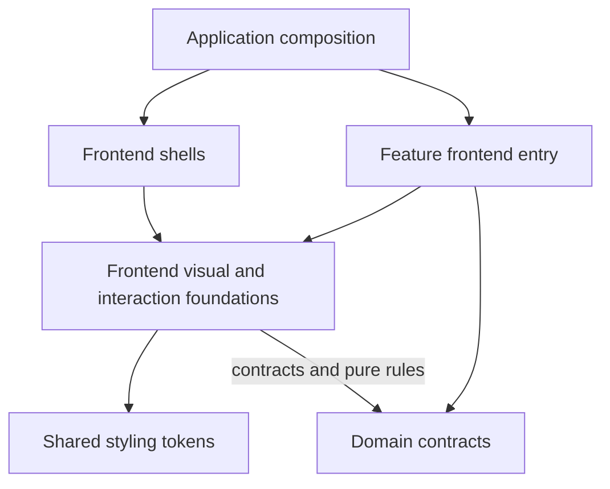
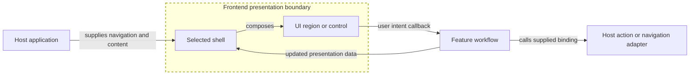

# Frontend Packages

The accepted decision is [ADR-0014](../../docs/architecture/decisions/0014-multi-app-package-boundaries.md). Its runtime dependency matrix is normative; the [ownership map](../../docs/architecture/reorganization-ownership-map.md) assigns existing source to target owners. These READMEs explain category boundaries without creating leaf packages.

Owns: reusable presentation foundations, visual components, shells, styling foundations, and general frontend interaction behavior.

**Status:** Current direction, selected by the repository owner on 2026-10-23.
**Scope:** Target frontend boundaries. Existing packages remain in place; no additional package or implementation move is made by this README.

## Decision context

The owner requested category boundary documentation after selecting `domain`, `frontend`, `server`, `features`, and `dev` in the architecture-reorganization discussion on 2026-10-23. These sibling documents record one shared decision.

Web, docs, and Storybook are present consumers. Desktop and mobile are planned consumers that should inform design now. Each implementation must state its actual portability: pure logic, React behavior, DOM presentation, or framework integration. Package placement alone does not make a DOM component compatible with a native renderer.

## Responsibilities

- Visual primitives and reusable components: buttons, menus, fields, dialogs, and layout regions.
- General interaction behavior such as focus management, responsive regions, and resizable presentation.
- Theme tokens, typography, styling foundations, and their presentation interfaces.
- Reusable shell composition and shell-local interaction.
- Frontend platform adapters where the capability requires them, isolated from portable entry points.

Product workflows, product-specific copy, data loading, and persisted product ownership belong to [features](../features/README.md), [server](../server/README.md), or [domain](../domain/README.md), according to the responsibility. Components accept presentation data, slots, and supported callbacks rather than importing their consuming application.

## Shells

The selected destination is one future `packages/frontend/shells` package containing multiple cohesive shell implementations. Application, authentication, documentation, and other shells can share foundations and expose separate entry points.

| Owner          | Responsibility                                                                                      |
| -------------- | --------------------------------------------------------------------------------------------------- |
| UI foundations | Sidebar primitives, menus, resizable regions, and other general visual components                   |
| Shells         | Surrounding layout, responsive regions, header/sidebar coordination, and utility-panel presentation |
| Features       | The product content and workflows placed into shell regions                                         |
| Apps           | Shell selection, route destinations, request/authentication wiring, and application assembly        |

A shell may own its own ephemeral interaction state. Saved panel preferences and other durable choices must follow the approved preference owner and persistence policy. A visual auth shell does not implement sign-in or grant access.

Multiple shells do not require multiple packages or one component with a growing set of unrelated boolean flags. The exact internal folders and exports remain design work.

## Dependency boundaries

Arrows mean source dependencies.

Frontend production modules do not import application source, feature implementations, server packages, development fixtures, or secrets. Frontend may import domain contracts and pure rules through domain's public interface, but canonical schemas and product orchestration remain with their owners. Styles have one token owner.

Framework-specific integration must have an explicit entry point or host adapter so it cannot leak into a purportedly portable component. Existing Next.js imports are migration evidence, not proof that every future consumer uses Next.js.

## Example runtime interaction

Arrows here mean runtime calls or supplied content. The dashed boundary encloses reusable presentation.

The host supplies where a link leads and how an action is invoked. A callback expresses intent; verified persistence and authorization stay in the server path. Product-specific success messages must follow the operation result.

### Example Packages

- `ui` ----> Reusable DOM primitives and visual components
- `shells` ----> Composable app shells and page frames; content arrives through slots
- `collection` ----> Browse behavior and DOM collection views
- `settings` ----> Reusable settings presentation (rows, sections, editor controls); the editing workflow is `features/settings`
- `auth` ----> Reusable authentication presentation (form pieces, status and confirmation views); auth workflows are `features/auth`
- `supabase` ----> Browser Supabase client adapter
- `editor` ----> Future document editor runtime (Lexical), once the editor is approved
- `preferences` ----> Browser preference runtime: device store, applying theme/mode/fonts, consent state
- `error-reports` ----> Consent-gated browser error reporting
- `site` ----> Existing site metadata/brand concerns
- `tailwind-config` ----> Existing styling foundation

## Current implementation and migration inputs

Existing packages are [UI](ui/README.md), [collection](collection/README.md), [Tailwind configuration and tokens](tailwind-config/README.md), and [site metadata/brand support](site/README.md). Their documented current exports remain usable until a scoped migration changes them.

[RootShell](ui/src/blocks/root-shell/root-shell.tsx), [RootSidebar](ui/src/blocks/sidebar-shell/root-sidebar/root-sidebar.tsx), and the [web authentication page shell](../../apps/web/src/components/shells/auth-page-shell/auth-page-shell.tsx) are inputs to the shells ownership review. Product schemas currently in UI should move to their domain owner.

Collection's generic controls, display mechanics, and interaction belong to a cohesive frontend collection family. Resource-specific projections, actions, and copy belong to resource features. The ownership map records that split; migration will assign individual files according to responsibility rather than current folder names. M5.3 moved the generic part into [`frontend-collection`](collection/README.md); resource-specific projections and copy stay with Spaces, Documents and Dashboards.

## Presentation, testing, and copy

Keep accessibility, keyboard behavior, focus, responsive layout, and reduced-motion behavior with the component or interaction they belong to. Storybook should exercise frontend foundations and feature presentation through their public interfaces.

Fixtures and fake capabilities may be supplied by stories/tests, with no production dependency on `dev/fixtures`. Generic component text may live with its component; product labels, errors, and workflow copy belong to the owning feature. Data examples belong to fixtures.

## Documentation reconciliation

Placement guidance is reconciled by [ADR-0014](../../docs/architecture/decisions/0014-multi-app-package-boundaries.md), the amended earlier ADRs, workspace conventions, and the package checklist. Existing behavior/security decisions remain in force. The ownership map records the selected destinations; exact leaf-package manifests, export signatures, and enforcement implementation follow in Milestone 3. Source extraction, native presentation, and automated transitive enforcement are not complete.

Related umbrellas: [domain](../domain/README.md), [server](../server/README.md), [features](../features/README.md), [dev](../dev/README.md).
