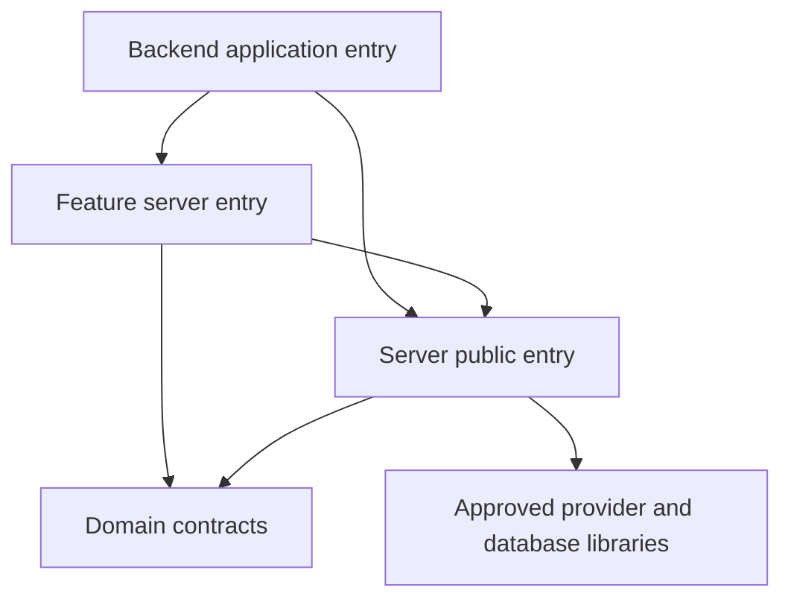
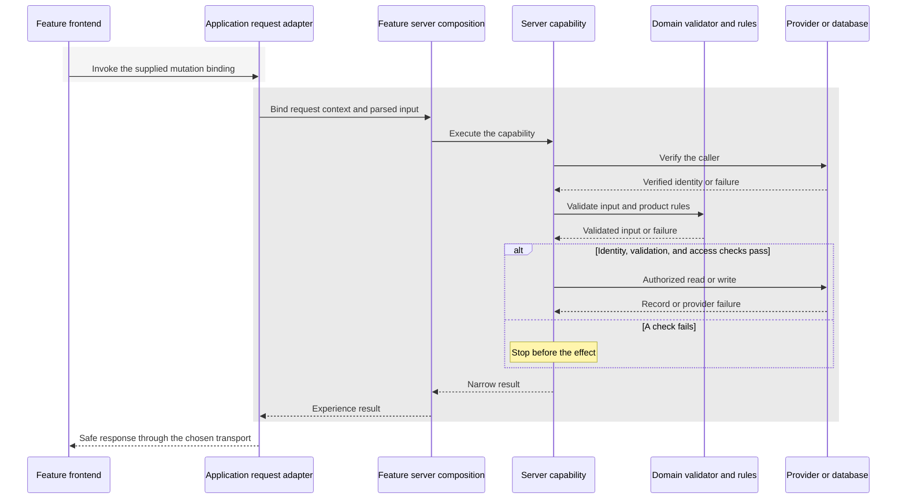

# Server Packages

The accepted decision is [ADR-0014](../../docs/architecture/decisions/0014-multi-app-package-boundaries.md). Its runtime dependency matrix is normative; the [ownership map](../../docs/architecture/reorganization-ownership-map.md) assigns existing source to target owners. These READMEs explain category boundaries without creating leaf packages.

Owns: reusable backend operations, verified identity and authorization support, repositories, persistence adapters, and server-side infrastructure.

**Status:** Current direction, selected by the repository owner on 2026-10-23.
**Scope:** Target server-package responsibilities and trust boundaries. No server package, endpoint, dependency, database migration, or deployment is created here.

## Decision context

The owner selected a server category during the architecture-reorganization discussion on 2026-10-23 and requested these umbrella READMEs. The sibling documents share this origin.

A server package is a library executed by a trusted backend host. It can run inside the existing web deployment. Its creation does not select a separate service, API framework, transport, or hosting model. Desktop and mobile frontend clients call the backend through an appropriate host API rather than importing server implementations.

## Responsibilities

- Backend capability operations and reduced, typed outcomes.
- Verified caller/identity helpers and capability-specific authorization enforcement.
- Resource repositories, database queries, row mapping, and provider adapters.
- Integration with approved backend SDKs and concrete storage.
- Server-side failure reporting that preserves the existing privacy/security constraints.

[Domain](../domain/README.md) owns portable contracts and semantic rules. [Features](../features/README.md) own product-experience orchestration. Apps own request/framework entry points and bind the concrete request context to those capabilities.

## Host versus library

| Responsibility                                                                      | Intended owner                                                       |
| ----------------------------------------------------------------------------------- | -------------------------------------------------------------------- |
| Routes, request parsing, response formatting, redirects, and framework revalidation | Application host                                                     |
| Cookie/header access and request-bound client provisioning                          | Application adapter, passed through an explicit server interface     |
| Trusted identity verification and operation-level access decisions                  | Server capability, using host-bound request/provider context         |
| Queries, writes, row mapping, provider effects, and narrow results                  | Server operation or repository                                       |
| Product invariants and portable validation                                          | Domain module                                                        |
| Mapping data/results into an experience                                             | Feature composition, with transport/navigation responses in the host |

The exact provisioning interface is refined when extracting the code. Passing a user ID from the browser is not a substitute for verification. Preserve operation-level checks even when a page/layout was already guarded; preserve database RLS and grants as independent protections.

## Dependency boundaries

Arrows mean source dependencies, not remote calls.

Server production modules do not import application source, frontend components, feature implementations, or development fixtures. Dependencies among server modules use explicit public interfaces and remain acyclic.

Only trusted runtime entry points may reach server implementations. Type-only imports from a server implementation are not the public contract for browser code; place cross-runtime contracts with the appropriate domain or feature owner. Future export design and transitive boundary checks must enforce this intent.

## Example request flow

This sequence is a logical interaction example, not a selection of HTTP versus Server Actions. Shaded regions distinguish the client and trusted backend.

The example does not prescribe one verification order for every capability. Existing enumeration protection, provider-specific verification, failure semantics, and database enforcement must survive extraction.

## Initial grouping

[ADR-0014](../../docs/architecture/decisions/0014-multi-app-package-boundaries.md#4-grouping-and-public-interface-principles) settles the initial grouping: auth operations/identity support, account/profile/preference operations, and data repositories. Package paths, manifests, and export names are Milestone 3 work; none is created here.

A persistence package may contain separate modules for Spaces, Documents, and Dashboards. A new query does not automatically require a new package. Keep a concrete owner and narrow API rather than growing an unrestricted backend utility bucket.

Current inputs include [auth operations](../../apps/web/src/features/auth/server/operations/operations.ts), [account caller helpers](../../apps/web/src/features/account/server/caller.ts), the [Space source](../features/spaces/README.md) (the port and its Supabase implementation, over [`server-data`](data/README.md), moved to `features-spaces/server` in M5.4). Document and Dashboard queries and pin writes moved from `apps/web/src/lib/owned-records` to `server-data` in M8. Account preference row persistence moved to [`server-account`](account/README.md) in M6.4; caller identity, fixture selection, request clients, and failure logging remain host-owned.

### Example packages

- `auth` ----> Verified identity, auth operations, verified caller helpers, identity/provider translation, session-related backend behavior. Exists since M4 with the identity boundary ([README](auth/README.md))
- `account` ----> Account/profile/preference operations, metadata updates and persistence
- `data` ----> Resource repositories, database row mapping, participation queries, shared persistence infrastructure for Spaces/Documents/Dashboards, using the client from `supabase`
- `supabase` ----> Supabase adapter: request-bound server client, session refresh, provider-error translation; the only server package importing the SDK. Exists since M4 with the request client and identity adapter ([README](supabase/README.md))

## Verification and undecided details

Check authorization, malformed input, cross-owner access, operation failures, reduced outcomes, request/client lifetimes, and repository mapping in proportion to each extraction. A mocked SDK test does not establish live provider, email, OAuth, deployed RLS, or production behavior.

No schema, permission, provider setting, transport, secret policy, runtime upgrade, or deployment change follows from adding this category. Those retain their own approval and verification requirements.

## Documentation reconciliation

Placement guidance is reconciled by [ADR-0014](../../docs/architecture/decisions/0014-multi-app-package-boundaries.md), the amended earlier ADRs, workspace conventions, and the package checklist. Existing behavior/security decisions remain in force. The ownership map records the selected destinations; exact leaf-package manifests, export signatures, and enforcement implementation follow in Milestone 3. Source extraction, native presentation, and automated transitive enforcement are not complete.

Related umbrellas: [domain](../domain/README.md), [frontend](../frontend/README.md), [features](../features/README.md), [dev](../dev/README.md).
